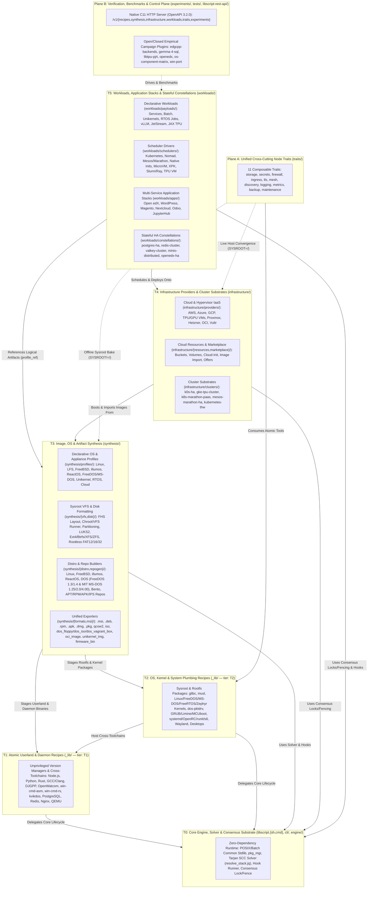

# Architecture: Decentralized, Native & Six-Tier (`T0`–`T5`)

LibScript is a unified software delivery substrate and operating system synthesis framework built on
zero-dependency POSIX `/bin/sh` and Windows Batch (`.cmd`) scripts. It scales from an unprivileged
developer toolchain version manager (`T1`, natively replacing `nvm`, `pyenv`, `rustup`, and `rvm`)
to an operating system, unikernel, RTOS, and native installer synthesizer (`T3`), multicloud &
cluster substrate provisioner (`T4`), and declarative workload & stateful HA constellation engine
(`T5`).

The architecture enforces two core invariants:

1. **Strict Downward-Only Compositional Tiers (`T5 -> T4 -> T3 -> T2 -> T1 -> T0`)**: Every vertical
   tier depends exclusively on lower tiers—eliminating fractional `.5` tiers, circular dependencies,
   and physical-vs-logical directory leaks (statically enforced by
   `devtools/audit/audit_tiers.{sh,cmd}`).
2. **Explicit Orthogonal Cross-Cutting Planes (`Plane A: traits/`, `Plane B: experiments/` &
   `libscript-rest-api/`)**: Capabilities that intentionally bind across multiple tiers—such as node
   traits operating in both `T3` offline sysroot staging and `T4`/`T5` live host convergence, or
   empirical verification harnesses driving all tiers—live in explicit orthogonal planes rather than
   polluting the vertical compositional stack.

---

## 🏛️ Compositional Stack (`T0`–`T5`) & Orthogonal Planes (`Plane A`, `Plane B`)

---

## Layer Directory & Schema Reference

| Layer                                        | Canonical Root(s)                                                                                                                                                                                                       | Governing JSON Schema(s)                                                                                                                                        | CLI Entrypoint(s)                                                                              |
| :------------------------------------------- | :---------------------------------------------------------------------------------------------------------------------------------------------------------------------------------------------------------------------- | :-------------------------------------------------------------------------------------------------------------------------------------------------------------- | :--------------------------------------------------------------------------------------------- |
| **`T0` Core Engine & Solver**                | `libscript.{sh,cmd}`, `cli/`, `engine/` (`common/`, `solver/`, `hooks/`, `target/`, `consensus/`)                                                                                                                       | `engine/schemas/{manifest,base_vars,consensus-common,consensus-state,tfrc-policy,gcs-ml-storage}.schema.json`                                                   | `./libscript.{sh,cmd}`                                                                         |
| **`T1` Atomic Userland & Daemons**           | `_lib/{languages,toolchains,package-managers,utilities,runtimes,containers,virtualization,schedulers,iac,databases,caches,search,security,message-brokers,web-servers,app-servers,logging,git-servers,storage-layers}/` | `engine/schemas/manifest.schema.json` (`"tier": "T1"`)                                                                                                          | `./libscript.{sh,cmd} <install\|use\|env\|ls\|...> <pkg>`                                      |
| **`T2` OS & System Plumbing**                | `_lib/{base-system,kernel,bootloaders,init-systems,unikernels,networking,graphics,audio,display-servers,display-managers,desktops}/`                                                                                    | `engine/schemas/manifest.schema.json` (`"tier": "T2"`)                                                                                                          | `./libscript.{sh,cmd} install <pkg>` (`LIBSCRIPT_TARGET_SYSROOT`)                              |
| **`T3` Image, OS & Artifact Synthesis**      | `synthesis/{profiles,schemas,vfs,disk,distro,repogen,formats,msi}/`                                                                                                                                                     | `synthesis/schemas/{os-config,execution-plan*}.schema.json`, `synthesis/msi/{packaging,installer}.schema.json`                                                  | `./libscript.{sh,cmd} <synthesize\|package-as\|build-image\|build-installer\|distro\|repogen>` |
| **`T4` Infrastructure & Cluster Substrates** | `infrastructure/{providers,resources,clusters,marketplace,cli_actions}/`                                                                                                                                                | `infrastructure/clusters/cluster-substrate.schema.json`, `infrastructure/marketplace/marketplace-offer.schema.json`                                             | `./libscript.{sh,cmd} <provision\|deprovision\|cluster\|import-image\|publish-marketplace>`    |
| **`T5` Workloads, Stacks & Constellations**  | `workloads/{apps,ai,constellations,payloads,schedulers,services,schemas}/`                                                                                                                                              | `libscript.schema.json`, `workloads/schemas/{payload,workload-common,ml-workload,tpu-matrix}.schema.json`, `workloads/constellations/constellation.schema.json` | `./libscript.{sh,cmd} <workload\|constellation\|stack\|app\|up\|down\|deploy\|train\|infer>`   |
| **`Plane A` Unified Node Traits**            | `traits/{storage,secrets,firewall,ingress,tls,mesh,discovery,logging,metrics,backup,maintenance}/`                                                                                                                      | `traits/trait.schema.json`                                                                                                                                      | `./libscript.{sh,cmd} trait <list\|enable\|disable\|apply\|verify\|teardown>`                  |
| **`Plane B` Verification & Control Plane**   | `experiments/`, `tests/`, `libscript-rest-api/`, `devtools/audit/`                                                                                                                                                      | `experiments/schemas/{experiment-suite,installer-experiment,os-matrix-results}.schema.json`, `libscript-rest-api/openapi.yaml`                                  | `./libscript.{sh,cmd} experiment <list\|scaffold\|validate\|run\|render-latex>`                |

---

## Core Architectural Contracts

### 1. Atomic Recipe Rule & Capability Facets (`T1` vs. `T2` in `_lib/`)

Every directory in `_lib/<category>/<component>/` manages **exactly one** atomic software unit and
declares an explicit `"tier"` (`"T1"` or `"T2"`) plus fine-grained `"capabilities"` in
`manifest.json`:

- **`T1` Capabilities**: `"userland-package"`, `"cross-toolchain"`, `"service-daemon"`,
  `"sysroot-library"`. Supports unprivileged side-by-side installation and `O(1)` `use` switching in
  `${LIBSCRIPT_HOME}/bin` as well as sysroot staging.
- **`T2` Capabilities**: `"sysroot-package"`, `"sysroot-library"`, `"kernel-image"`, `"bootloader"`,
  `"service-daemon"`. Scoped to `LIBSCRIPT_TARGET_SYSROOT` or privileged host OS plumbing;
  `libscript use <t2-pkg>` is rejected with exit code `2`.
- Multi-service web platforms (`workloads/apps/*`), cloud IaaS operators
  (`infrastructure/providers/*`), and synthesis scripts (`synthesis/*`) never reside in `_lib/`.

### 2. The `LIBSCRIPT_TARGET_SYSROOT` & Dual-Mode Trait Context Contract

- **Offline Synthesis Mode (`LIBSCRIPT_TARGET_SYSROOT != /`)**: `T1`/`T2` recipes and `Plane A`
  traits stage binaries, `/etc/fstab` entries, firewall rulesets, and init units purely inside the
  target sysroot directory without mutating the build host.
- **Live Convergence Mode (`LIBSCRIPT_TARGET_SYSROOT == /`)**: `Plane A` traits and `T4`/`T5`
  engines format unformatted volumes via `T0` `engine/common/format_fs.{sh,cmd}`, bring up WireGuard
  meshes, issue TLS certificates, acquire consensus leases (`engine/consensus/lock.{sh,cmd}`), fence
  unreachable leaders (`engine/consensus/fence.{sh,cmd}`), and reload reverse proxies with zero
  downtime.

### 3. Cluster Substrates (`T4`) vs. Stateful Workload Constellations (`T5`)

Separating **cluster-forming substrates**
(`infrastructure/clusters/{k0s-ha,gke-tpu-cluster,k8s-marathon-paas,mesos-marathon-ha,kubernetes-thw}`
in `T4`) from **stateful database & application constellations**
(`workloads/constellations/{postgres-ha,redis-cluster,valkey-cluster,minio-distributed,openedx-ha,openedx-unikernel-pod}`
in `T5`)—while sharing the `T0` quorum lease and fencing state machine (`engine/consensus/`)—ensures
`T5` schedulers and workloads always sit strictly above `T4` cluster substrates without vertical
inversion.
