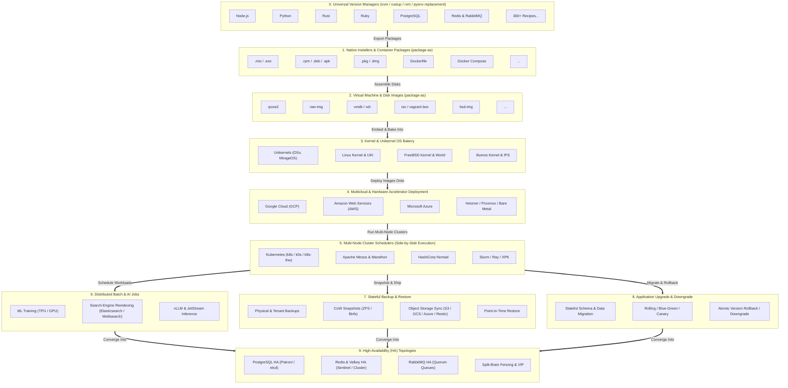
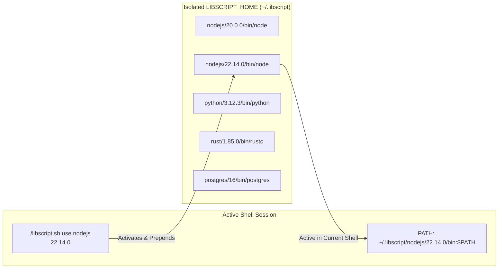
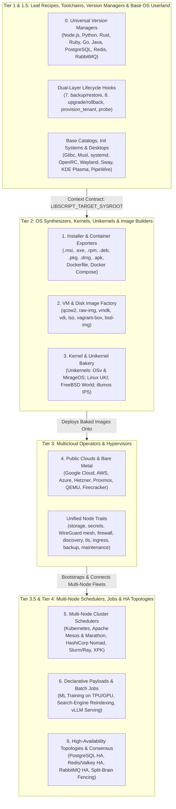
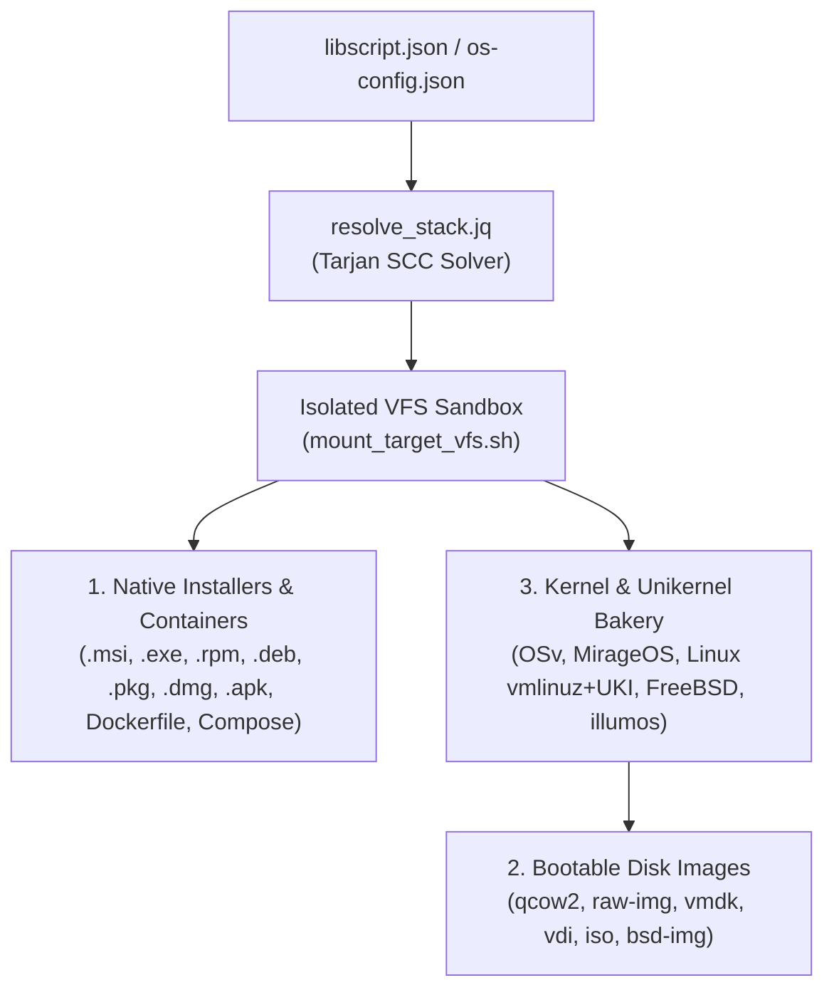

# 🚀 LibScript: The Universal Substrate & Multi-Tier OS Engine

**From Native Version Manager to Operating System Synthesizer and Multicloud AI Orchestrator.**  
_Native Power. Zero Dependencies. Zero YAML Bloat. Provision Anything, Anywhere._

[](https://opensource.org/licenses/Apache-2.0)
[](https://github.com/SamuelMarks/libscript/actions/workflows/ci.yml)
[](DOCS_ROADMAP.md)

LibScript is a unified software delivery substrate written in pure, zero-dependency POSIX shell
(`/bin/sh`) and native Windows Batch (`.cmd`) / PowerShell (`.ps1`). It bridges the gap between
everyday developer toolchain management and full-system operating system engineering.

Whether you need a lightweight, universal replacement for `nvm`, `pyenv`, `rustup`, and `rvm` (for
everything from Node.js to PostgreSQL), an automated pipeline to export native installers (`.msi`,
`.exe`, `.rpm`, `.deb`, `.pkg`, `.dmg`, `.apk`, `Dockerfile`, `docker-compose.yml`) and disk images
(`qcow2`, `raw-img`) or bake customized Unikernels (`OSv`, `MirageOS`), Linux, FreeBSD, and illumos
kernels, or a multicloud operator to deploy across Google Cloud, AWS, and Azure, run multi-node
clusters (Kubernetes, Apache Mesos, HashiCorp Nomad), execute batch jobs (ML training, search-engine
reindexing), manage stateful lifecycles (backup/restore, zero-downtime upgrade/downgrade), and
orchestrate high-availability topologies (PostgreSQL HA, Redis HA, RabbitMQ HA), LibScript handles
the entire lifecycle through a single, idempotent interface.



---

## 🌟 The Core Experience: Native Version Management (Stage 0)

Before building operating systems or provisioning cloud fleets, developers need clean, isolated,
multi-version runtime environments without installing dozens of separate, conflicting version
managers.

LibScript natively replaces **`nvm`**, **`pyenv`**, **`rustup`**, **`rvm`**, **`sdkman`**,
**`fnm`**, and **`go` version managers** with a single unified, cross-platform CLI covering
everything from **Node.js**, **Python**, **Rust**, and **Ruby** to **PostgreSQL**, **Redis**,
**RabbitMQ**, **Elasticsearch**, and **Kubernetes**.

### ⚡ Why Drop Third-Party Version Managers?

| Capability               | Traditional Managers (`nvm`, `pyenv`, `rustup`)              | LibScript                                                         |
| :----------------------- | :----------------------------------------------------------- | :---------------------------------------------------------------- |
| **Runtime Dependencies** | Requires Node, Python, Ruby, or Curl/Bash hacks              | **Zero external dependencies** (POSIX `/bin/sh` or Windows Batch) |
| **Windows Support**      | Often requires WSL, MSYS2, or separate tools (`nvm-windows`) | **100% Native Windows Batch (`.cmd`) and PowerShell (`.ps1`)**    |
| **Syntax Consistency**   | Every tool uses different flags, paths, and commands         | **Universal workflow across all 304+ tools & 324+ subsystems**    |
| **Isolation**            | Pollutes `~/.nvm`, `~/.pyenv`, `~/.cargo` separately         | **Standardized sandbox (`${LIBSCRIPT_HOME}/<tool>/<version>`)**   |
| **State & Cleanliness**  | Mutates global profiles (`~/.bashrc`, `~/.zshrc`)            | **Per-shell dynamic path injection via `use` or `env`**           |

### 🛠️ Universal Workflow (`ls-remote`, `install`, `ls`, `use`, `uninstall`)

Manage any language, runtime, database, or cluster orchestrator with the exact same five commands:



```sh
# 1. Query available versions directly from upstream
./libscript.sh ls-remote nodejs
./libscript.sh ls-remote python
./libscript.sh ls-remote rust
./libscript.sh ls-remote ruby
./libscript.sh ls-remote postgres

# 2. Install specific versions side-by-side without global pollution
./libscript.sh install nodejs 22.14.0
./libscript.sh install python 3.12.3
./libscript.sh install rust 1.85.0
./libscript.sh install postgres 16

# 3. Inspect locally installed versions
./libscript.sh ls nodejs
./libscript.sh ls postgres

# 4. Activate a specific version in the current shell session
./libscript.sh use nodejs 22.14.0
./libscript.sh use python 3.12.3

# 5. Clean teardown when done
./libscript.sh uninstall nodejs 20.0.0
```

### 📦 Autonomous Local CLIs

Every component in LibScript is a self-contained package manager. You can execute commands through
the global orchestrator or directly within each component's directory:

```sh
# Autonomous component CLI workflow
./_lib/languages/nodejs/cli.sh ls-remote
./_lib/languages/python/cli.sh install 3.12
./_lib/languages/python/cli.sh use 3.12
./_lib/databases/postgres/cli.sh install 16
./_lib/databases/postgres/cli.sh start
```

### 🔧 Generic 3-Mode Build Substrate & Multi-Compiler C/C++ Matrix

Every component supports three universal installation modes—isolated native binary/sandbox staging,
on-demand ecosystem package manager delegation (`--pkg-mgr=<pm>`), and source compilation
(`--from-source`) across selectable C/C++ toolchains (`gcc`, `clang`, `tcc`, `edgcpp` v7.0.1, or
`--custom-cc=/path/to/cc`):

```sh
# 1. Delegate to any OS or ecosystem package manager (auto-bootstrapping if missing)
./libscript.sh install sqlite latest --pkg-mgr=brew
./libscript.sh install sqlite latest --pkg-mgr=apt-get

# 2. Compile from source with a selectable C/C++ compiler toolchain
./libscript.sh install sqlite 3.46.1 --from-source --toolchain=edgcpp
./libscript.sh install sqlite 3.46.1 --from-source --toolchain=tcc
./libscript.sh install sqlite 3.46.1 --custom-cc=/path/to/my-c-compiler
```

---

## 🏛️ The Five-Tier Architecture

LibScript organizes systems into five strictly decoupled, composable architectural tiers (plus
cross-cutting traits) to prevent cross-layer pollution while enabling seamless escalation from a
single CLI tool to a multi-node high-availability cloud cluster.



---

### Tier 1 & 1.5: Leaf Recipes, Cross-Toolchains & Base Userland

Tier 1 components are modular, autonomous recipes located in `_lib/`. They adhere to a strict
**Context Contract**:

- **Target Sysroot Isolation (`LIBSCRIPT_TARGET_SYSROOT`)**: All builds and staging occur under an
  isolated root prefix without polluting the host.
- **Stage 0 & Stage 1 Toolchain Bootstrapping**:
  - `_lib/toolchains/bootstrap/stage0.sh`: Cross-compiles Binutils Pass 1, standalone GCC Pass 1,
    kernel API headers, and Target LibC into an isolated `/tools` tree.
  - `_lib/toolchains/bootstrap/stage1.sh`: Bootstraps foundational POSIX userland utilities (`dash`,
    `coreutils`, `make`, `patch`, `tar`, `sed`, `grep`, `xz`).
- **Standardized Multi-Arch Triplets**: Supports `x86_64`, `aarch64`, `riscv64`, and `i686` with
  `glibc`, `musl`, or `bsd-libc`.
- **Comprehensive Ecosystem Catalogs**:
  - **Base Systems**: Glibc locales, Musl C library, BusyBox, Toybox, `e2fsprogs`, `btrfs-progs`,
    `xfsprogs`, `eudev`, PAM, and Shadow.
  - **Graphics & Display Protocols**: Direct Rendering (`libdrm`, `mesa` Gallium/Vulkan,
    `vulkan-loader`), Wayland core (`wayland`, `wayland-protocols`, `wlroots`, `seatd`, `xwayland`),
    and X11 stacks.
  - **Desktops & Compositors**: Sway, Hyprland, KDE Plasma 6, XFCE4, LXQt, Weston, and display
    greeters (`greetd`, `sddm`, `gdm`, `lightdm`).
  - **Audio & Multimedia**: PipeWire multimedia graph router, `wireplumber`, compatibility shims
    (`pipewire-pulse`, `pipewire-alsa`), and ALSA base stacks.
  - **Networking & Security Services**: NetworkManager, `systemd-networkd`, `iwd`, `wpa_supplicant`,
    `dhcpcd`, `nftables`, `iptables`, and hardened OpenSSH.

---

### Tier 2: Package Exporters, Disk Images & Kernel/Unikernel Baking (Stages 1, 2 & 3)

Tier 2 elevates LibScript from software provisioning to universal artifact packaging and full
operating system synthesis. Instead of relying on pre-baked generic cloud images, Tier 2 exports
native packages, virtual disk images, and custom kernels or unikernels from the ground up.



#### 1. Export to Native Installers & Container Formats (Stage 1)

Package any software stack or runtime into native OS installers and container definitions via
`package-as`:

```sh
# Windows Installers (.msi and .exe via WiX / msi-rs / NSIS / Inno Setup)
./libscript.sh package-as msi        # Windows Installer (.msi)
./libscript.sh package-as nsis       # Windows NSIS executable (.exe)
./libscript.sh package-as innosetup  # Windows Inno Setup executable (.exe)

# Linux & BSD System Packages (.rpm, .deb, .apk, .txz)
./libscript.sh package-as rpm        # Red Hat / Fedora / Enterprise Linux (.rpm)
./libscript.sh package-as deb        # Debian / Ubuntu (.deb)
./libscript.sh package-as apk        # Alpine Linux (.apk)
./libscript.sh package-as txz        # FreeBSD / illumos archive package (.txz)

# macOS Native Bundles (.pkg, .dmg)
./libscript.sh package-as pkg        # macOS flat installer (.pkg)
./libscript.sh package-as dmg        # macOS disk image (.dmg)

# Container & Multi-Container Orchestration
./libscript.sh package-as docker         # Hermetic multi-stage Dockerfile
./libscript.sh package-as docker-compose # Multi-service docker-compose.yml
./libscript.sh package-as rootfs-tar     # Clean rootfs tarball archive
./libscript.sh package-as tui            # Interactive Terminal UI installer
```

Supports both lightweight **Online (`--online`)** and self-contained **Air-Gapped Offline
(`--offline`)** installer bundles, plus automated cross-platform GUI screenshot capture and running
system verification via `SamuelMarks/msi-rs` (`./devtools/capture_msi_vagrant_matrix.sh` and
`./devtools/verify_screenshots.sh`).

#### 2. Export to Virtual Machine & Raw Disk Images (Stage 2)

```sh
# Generate compressed & raw virtual machine disks
./libscript.sh package-as qcow2            # QEMU / KVM / Proxmox (qcow2)
./libscript.sh package-as raw-img          # Partitioned bare-metal / cloud disk image (raw-img)
./libscript.sh package-as vmdk             # VMware ESXi / Workstation (vmdk)
./libscript.sh package-as vdi              # Oracle VirtualBox (vdi)
./libscript.sh package-as hyperv-vhd       # Microsoft Hyper-V (VHD / VHDX)
./libscript.sh package-as proxmox-template # Proxmox VE template image
./libscript.sh package-as vagrant-box      # Vagrant Box (QEMU / Libvirt / VirtualBox)
./libscript.sh package-as iso              # Live bootable hybrid ISO (UEFI + BIOS, SquashFS + OverlayFS)

# Direct cloud & modular OS distribution image synthesis
./libscript.sh package-as aws-ami          # Amazon AWS AMI image
./libscript.sh package-as azure-vhd        # Microsoft Azure VHD image
./libscript.sh package-as gcp-image        # Google Cloud Platform image
./libscript.sh package-as freebsd-distro   # Modular FreeBSD distribution image
./libscript.sh package-as illumos-distro   # Modular illumos / SunOS ZFS distribution image
```

Automates virtual disk provisioning (`_lib/storage/`) with UEFI (GPT + ESP) or Hybrid BIOS/UEFI
partitioning, **LUKS2** full-disk encryption (`argon2id`), and **Ext4**, **Btrfs** (`@`, `@home`,
`@snapshots`), **XFS**, or **ZFS** filesystems.

#### 3. Embed Into Unikernels, Linux, FreeBSD & illumos Kernels (Stage 3)

LibScript embeds staged applications directly into specialized unikernels and custom-compiled
operating system kernels:

- **Unikernels (`OSv`, `MirageOS`, `Unikraft`, `Solo5`)**:
  - Compiles single-address-space unikernel images (`./libscript.sh package-as unikernel`) and Solo5
    tenders (`_lib/orchestration/solo5/`) for sub-15ms boot on Firecracker, Cloud-Hypervisor, and
    KVM.
  - Ships curated profiles including `profiles/osv-cloud-runtime.json`,
    `profiles/unikraft-nginx-redis.json`, and `profiles/firecracker-microvm-appliance.json`.
- **Linux Kernel Engine (`_lib/kernel/linux/` & `_lib/kernel/initramfs/`)**:
  - Cryptographically verifies kernel sources, merges modular `.cfg` fragments (`virtio.cfg`,
    `wayland_drm.cfg`, `sound.cfg`, `zfs.cfg`), compiles `bzImage` + `dtbs` across selectable
    compilers (`profiles/linux-kernel-{gcc,clang,tcc,edgcpp,custom-cc}-*.json`), packs a `zstd -19`
    initramfs, and signs single-file `.efi` Unified Kernel Images (UKI) with GRUB2, `systemd-boot`,
    or Limine.
- **FreeBSD Kernel & World Engine (`_lib/freebsd/`)**:
  - Automates FreeBSD source checkout, isolated `buildworld` and `buildkernel`, and ZFS/UFS image
    generation (`./libscript.sh package-as bsd-img`).
- **illumos Kernel & Distro Engine (`_lib/illumos/distro/`)**:
  - Synthesizes bootable OpenIndiana and OmniOS kernel/userland images with IPS repositories, ZFS
    boot environments, and SMF services (`./libscript.sh package-as illumos-distro`).

```sh
# Configure OS profiles interactively or declaratively
./libscript.sh config os --profile=osv-cloud-runtime --export=unikernel-os.json
./libscript.sh config os --profile=linux-minimal-headless-musl --export=linux-os.json
./libscript.sh config os --profile=freebsd-server-standard --export=freebsd-os.json
```

---

### Tier 3: Multicloud Deployment: Google Cloud, AWS & Azure (Stage 4)

Tier 3 deploys synthesized OS images, unikernels, containers, and application stacks directly onto
**Google Cloud (GCP)**, **Amazon Web Services (AWS)**, **Microsoft Azure**, as well as **Hetzner
Cloud**, **Proxmox VE**, and local hypervisors.

```sh
# Deploy onto Google Cloud (GCP)
./libscript.sh provision gcp prod-cluster vpc-main us-central1-a ./ ~/app
./libscript.sh cloud gcp firewall create allow-ingress --network vpc-main --allow tcp:80,tcp:443

# Deploy onto Amazon Web Services (AWS)
./libscript.sh provision aws prod-cluster vpc-main us-east-1 ./ ~/app
./libscript.sh cloud aws network create vpc-main

# Deploy onto Microsoft Azure
./libscript.sh provision azure prod-cluster rg-east eastus ./ ~/app
./libscript.sh cloud azure node deploy worker-node-01 rg-east ./src ~/app

# Git-driven deployment & multi-app remote host deployment
./libscript.sh deploy ./
./libscript.sh deploy-remote deploy@prod.example.com ./

# Clean multicloud teardown
./libscript.sh deprovision aws prod-cluster vpc-main us-east-1
```

---

### Tier 3.5 & Tier 4: Multi-Node Schedulers, Jobs, Lifecycle & High Availability (Stages 5–9)

Once images are running on cloud or bare-metal nodes, LibScript coordinates multi-node clusters,
batch jobs, stateful lifecycle operations, and high-availability consensus topologies.

```mermaid
flowchart LR
    subgraph Schedulers["5. Multi-Node Cluster Schedulers"]
        K8s["Kubernetes<br/>(k8s / k0s / k8s-thw / k8s-marathon)"]
        Mesos["Apache Mesos<br/>(& Marathon v2 PaaS)"]
        Nomad["HashiCorp Nomad<br/>(docker & raw_exec)"]
    end

    subgraph Workloads["6, 7 & 8. Jobs & Lifecycle Operations"]
        Jobs["6. Batch & AI Jobs<br/>(ML Training, Search Reindexing)"]
        Backup["7. Backup & Restore<br/>(CoW Snapshots, S3/GCS/Restic)"]
        Upgrade["8. Upgrade & Downgrade<br/>(Rolling Migration & Rollback)"]
    end

    subgraph HA["9. High-Availability Topologies"]
        PG_HA["PostgreSQL HA<br/>(Patroni + etcd Raft)"]
        Redis_HA["Redis & Valkey HA<br/>(Sentinel & 16384-Slot Cluster)"]
        RMQ_HA["RabbitMQ HA<br/>(Quorum Queues & Clustering)"]
    end

    Schedulers ==>|Orchestrates| Workloads
    Schedulers ==>|Maintains Quorum| HA
    Workloads ==>|Protects & Updates| HA
```



#### 5. Multi-Node Cluster Orchestration: Kubernetes, Mesos & Nomad (Stage 5)

Run multiple synthesized images side-by-side across multi-node clusters using first-class Tier 1/3
cluster managers and the Tier 4 declarative payload compiler (`payloads/engine.sh`):

- **Kubernetes (`kubernetes`, `kubernetes-k0s`, `kubernetes-thw`, `k8s-marathon`)**: Full upstream
  Kubernetes, zero-friction `k0s`, Kubernetes The Hard Way (`k8s-thw`), and the Marathon-equivalent
  PaaS controller (`k8s-marathon`) translating `payload.json` into `Deployment`, `StatefulSet`,
  `Job`, `Service`, and `Ingress` manifests.
- **Apache Mesos & Marathon (`mesos`, `marathon`)**: Two-level distributed systems kernel with
  ZooKeeper quorum leader election (`topologies/mesos-marathon-ha/topology.json`), supporting both
  `DOCKER` and `MESOS` Universal Containerizer / native LibScript sandboxes.
- **HashiCorp Nomad (`nomad`)**: Unified multi-node orchestrator scheduling containerized (`docker`)
  and isolated native (`raw_exec`) service and batch allocations across Linux, macOS, FreeBSD, and
  Windows.

```sh
# Provision multi-node schedulers side-by-side via native version managers or HA topologies
./libscript.sh install kubernetes latest
./libscript.sh install mesos 1.11.0
./libscript.sh install nomad 1.9.0

# Bring up multi-node Mesos+Marathon or Kubernetes HA clusters
./libscript.sh topology up topologies/mesos-marathon-ha/topology.json
./libscript.sh topology up topologies/k8s-marathon-paas/topology.json
./libscript.sh topology up topologies/k0s-ha/topology.json

# Compile and submit the exact same workload payload to Kubernetes, Mesos, or Nomad
./libscript.sh payload submit payloads/web/openedx/payload.json --scheduler kubernetes
./libscript.sh payload submit payloads/web/openedx/payload.json --scheduler mesos
./libscript.sh payload submit payloads/web/openedx/payload.json --scheduler nomad
```

#### 6. Deploying Distributed Jobs: ML Training & Search-Engine Reindexing (Stage 6)

Schedule one-shot or recurring batch, AI training, and indexing jobs (`"type": "batch"` or
`"type": "ai-training"`) across Kubernetes Jobs, Nomad Batch allocations, Mesos tasks, Slurm/Ray, or
Google Cloud TPU Pods (`xpk`):

- **Distributed ML Training & Inference**:
  - Orchestrates multi-slice TPU Pod training (`v4-128`, `v5p-2048`) via GKE + `xpk` and multi-node
    GPU training with gang scheduling (`payloads/ai/gke-xpk-training/payload.json`,
    `_lib/ml-training/`).
  - Pre-wires [GCS FUSE](https://cloud.google.com/storage/docs/gcs-fuse) dataset streaming,
    [TensorBoard](https://www.tensorflow.org/tensorboard) telemetry, and high-throughput serving via
    [`vLLM`](https://github.com/vllm-project/vllm),
    [`JetStream`](https://github.com/google/JetStream), and [`Ollama`](https://ollama.com/).
- **Search-Engine Reindexing & Full-Stack Web Payloads**:
  - Provisions and manages **Elasticsearch** (`_lib/search/elasticsearch`) and **Meilisearch**
    (`_lib/search/meilisearch`), executing zero-downtime index rebuilds, alias swaps, and multi-tier
    application workloads (`payloads/web/openedx/payload.json`, `payloads/ai/vllm/payload.json`)
    across Kubernetes, Nomad, or Mesos.

```sh
# Submit a distributed ML training job to GKE TPU slices (XPK), Slurm/Ray, or Nomad
./libscript.sh payload submit payloads/ai/gke-xpk-training/payload.json --scheduler xpk
./libscript.sh payload submit payloads/ai/gke-xpk-training/payload.json --scheduler slurm_ray

# Submit AI inference & web application payloads to Nomad, Kubernetes, or Mesos
./libscript.sh payload submit payloads/ai/vllm/payload.json --scheduler nomad
./libscript.sh payload submit payloads/ai/vllm/payload.json --scheduler kubernetes
./libscript.sh payload submit payloads/web/openedx/payload.json --scheduler mesos

# Run declarative ML training, evaluation, and inference directly via the unified ML CLI
./libscript.sh train libscript.json --target gke-xpk
./libscript.sh eval-ml libscript.json --target gcp-tpu-vm
./libscript.sh infer libscript.json --backend vllm
./libscript.sh serve-ml libscript.json --backend ollama
```

#### 7. Stateful Backup & Restore (Stage 7)

LibScript unifies physical instance snapshots, logical multi-tenant backups, Copy-on-Write (CoW)
filesystem snapshots, and encrypted off-site object storage replication (`traits/backup/` &
`_lib/_common/hooks.sh`):

- **Physical & Multi-Tenant Hooks**: Every stateful component (`postgres`, `redis`, `valkey`,
  `mariadb`, `mysql`, `mongodb`, `sqlite`, `etcd`, `openbao`) implements `hooks/backup`,
  `hooks/restore`, `hooks/backup_tenant`, and `hooks/restore_tenant` with SHA-256 manifest
  verification.
- **Filesystem CoW Snapshots**: Atomic ZFS and Btrfs snapshots via `traits/backup/cow_snapshot.sh`.
- **Multi-Backend Cloud Shipping**: Automated encryption and upload to `s3://`, `gs://`, `azure://`,
  `rclone://`, `restic://`, and `borg://` via `traits/backup/ship.sh`, scheduled continuously via
  `traits/maintenance/`.

```sh
# Execute a physical or tenant-scoped backup with SHA-256 manifest verification
./_lib/_common/hooks.sh --exec postgres backup /var/backups/postgres
./_lib/_common/hooks.sh --exec postgres backup_tenant --tenant-id acme_corp

# Take an atomic ZFS/Btrfs CoW snapshot and ship encrypted backups to S3 / GCS / Azure
./libscript.sh trait apply backup
./traits/backup/orchestrate.sh postgres /var/backups/postgres s3://my-enterprise-backups/pg

# Verify manifest checksums and restore state
./_lib/_common/hooks.sh --exec postgres restore /var/backups/postgres
```

#### 8. Application Upgrade & Downgrade / Rollback (Stage 8)

Transition applications and stateful clusters between versions safely with zero-downtime rollout
strategies and deterministic rollback hooks:

- **Stateful Upgrade & Downgrade (`hooks/upgrade` & `hooks/rollback`)**: Executes automated data
  directory and schema migrations when moving forward (`upgrade`), and atomic state reversion when
  downgrading or recovering from a failed deployment (`rollback`).
- **Cluster-Wide Rolling Upgrades (`topologies/engine.sh upgrade`)**: Orchestrates epoch-tracked
  rolling upgrades across multi-node topologies with `RollingUpdate`, `BlueGreen`, or `Recreate`
  strategies and health-probe gating (`hooks/probe readiness`).
- **Instant Side-by-Side Version Switching**: Switch active runtime versions instantly via
  `./libscript.sh use <component> <version>`.

```sh
# Upgrade a stateful component across versions (with automatic data/schema migration)
./_lib/_common/hooks.sh --exec postgres upgrade 15 16

# Atomically downgrade / roll back to the previous version if a deployment check fails
./_lib/_common/hooks.sh --exec postgres rollback 15 16

# Perform a zero-downtime rolling upgrade across an entire multi-node HA cluster topology
./libscript.sh topology upgrade topologies/postgres-ha/topology.json 16.4
```

#### 9. High-Availability (HA) Topologies: PostgreSQL HA, Redis HA & RabbitMQ HA (Stage 9)

Tier 3.5 (`topologies/`) orchestrates multi-node consensus clusters with distributed lease locking
(`topologies/lock.sh`), encrypted **WireGuard** mesh overlays (`traits/mesh/`), automated
split-brain fencing (`cloud-api-poweroff`, `cloud-api-detach-nic`, `firewall-isolate`,
`watchdog-reset` in `topologies/fence.sh`), and VIP/DNS ingress routing (`netctl`):

- **PostgreSQL HA (`topologies/postgres-ha/`)**: Multi-node primary/replica streaming replication
  orchestrated with **Patroni**, **etcd** Raft quorum, **PgBouncer** connection pooling, and
  automated leader failover.
- **Redis HA & Valkey HA (`topologies/redis-cluster/`, `topologies/valkey-cluster/`)**: Distributed
  in-memory caching with **Redis Sentinel** quorum failover and 16384-hash-slot cluster sharding
  over encrypted WireGuard peering.
- **RabbitMQ HA (`_lib/message-brokers/rabbitmq/` + HA Topologies)**: Multi-node Erlang cookie
  clustering, Raft-backed **Quorum Queues**, mirrored exchanges, and `netctl` AMQP load balancing.
- **Distributed Storage, Enterprise Web & Compute Topologies**: Turnkey blueprints for `openedx-ha`
  (multi-node Open edX LMS/CMS + Celery + MariaDB/MongoDB/Redis/Meilisearch HA), `minio-distributed`
  (erasure-coded object storage), `mesos-marathon-ha`, `k8s-marathon-paas`, `k0s-ha`, and
  `gke-tpu-cluster`.

```sh
# Provision High-Availability PostgreSQL, Redis, Valkey, and Open edX clusters
./libscript.sh topology up topologies/postgres-ha/topology.json
./libscript.sh topology up topologies/redis-cluster/topology.json
./libscript.sh topology up topologies/valkey-cluster/topology.json
./libscript.sh topology up topologies/openedx-ha/topology.json

# Provision and cluster RabbitMQ HA nodes
./libscript.sh install rabbitmq latest
./libscript.sh start rabbitmq

# Inspect quorum health, scale worker pools, or trigger fenced leader failover
./libscript.sh topology status topologies/postgres-ha/topology.json
./libscript.sh topology scale topologies/postgres-ha/topology.json pg-replicas=4
./libscript.sh topology failover topologies/postgres-ha/topology.json pg-replicas-1
```

#### 🌐 Built-in PaaS, Universal Routing (`netctl`) & REST API (`libscript-rest-api`)

Turn raw virtual machines or bare-metal servers into self-healing application platforms:

- **Universal Reverse Proxy**: Define routes, static directories, and proxy passes once; emit
  configurations for Nginx, Caddy, Apache, Traefik, or Windows IIS.
- **Automatic TLS**: Automated certificate acquisition and renewal via Let's Encrypt / Certbot.
- **Native OS Daemon Supervision**: Automatically generates and registers system services
  (`systemd`, `openrc`, `runit`, `s6`, `dinit`, `sysvinit` on Linux/BSD, `launchd` on macOS, `smf`
  on illumos, and Windows Service Manager on Windows).
- **HTTP REST API Daemon (`libscript-rest-api/`)**: Native C HTTP server (`c-rest-framework`) for
  programmatic component provisioning, background job tracking, and OpenAPI-governed orchestration.

```sh
# Define ingress routes and emit an Nginx configuration instantly
./libscript.sh netctl --listen 80 --listen 443 --proxy /api http://localhost:8080 --static / /var/www --emit nginx
```

---

## ☸️ Declarative Stacks: `libscript.json`

Combine software versions, database provisioning, application service daemons, lifecycle hooks, and
feature variants in a single declarative manifest governed by
[`libscript.schema.json`](libscript.schema.json):

```json
{
  "name": "enterprise-microservice",
  "version": "1.0.0",
  "domain": "api.example.com",
  "deps": {
    "nodejs": ">=22.0.0",
    "postgres": "16",
    "valkey": "latest"
  },
  "databases": [
    {
      "engine": "postgres",
      "name": "app_prod",
      "user": "app_user",
      "password_env": "DB_PASSWORD",
      "migration_dir": "./migrations"
    }
  ],
  "services": [
    {
      "name": "api-server",
      "command": "node server.js",
      "port": 8080,
      "health_check": {
        "url": "http://127.0.0.1:8080/health",
        "expect_status": 200
      }
    }
  ],
  "variants": {
    "wayland": true,
    "lto": true
  }
}
```

The underlying constraint solver (`resolve_stack.jq`) resolves dependencies across tiers (`deps` /
`dependencies`) and uses Tarjan's Strongly Connected Components (SCC) algorithm to identify and
break circular build cycles automatically.

---

## 🔒 Rigorous Engineering Standards & Safety Invariants

LibScript is built for mission-critical, enterprise, and air-gapped environments:

1. **Dual-Platform Parity**: Every `.sh` script has an exact `.cmd` companion.
2. **Canonical Preamble & Recursion Guards**: All scripts enforce canonical `THIS_FILE=` path
   resolution and re-entrant `STACK` guards to prevent recursion loops.
3. **100% Documentation Coverage**: Every script includes structured `## Overview` and `## Usage`
   headers in its first 30 lines.
4. **Universal Idempotency**: All operations check state stamps (`.built`, `.installed`,
   `.configured`) and pass 2x consecutive execution without mutating state.
5. **Air-Gapped Modality**: Full offline capability via ahead-of-time cache hydration
   (`hydrate_offline_cache.*`) and checksum verification (`offline_bundle.json`).
6. **Git Safety Invariant**: Automated test suites and CI pipelines are strictly prohibited from
   invoking `git push`.

Verify all standards locally using the built-in audit harnesses:

```sh
# Run static engineering standards, POSIX compliance, version manager contract, and 100% doc coverage audits
./devtools/audit/audit_standards.sh --all
./devtools/audit/doc_coverage.sh --strict
./devtools/audit/audit_version_manager.sh
./devtools/audit/audit_posix.sh --all
```

---

## ⚡ Quick Start: 3 Minutes to Power

```sh
# 1. Clone the repository
git clone https://github.com/SamuelMarks/libscript.git
cd libscript

# 2. Use as a native version manager (instant Node & Python switching)
./libscript.sh install nodejs 22.14.0
./libscript.sh use nodejs 22.14.0

# 3. Provision databases or servers natively
./libscript.sh install postgres 16
./libscript.sh start postgres

# 4. Bake a custom minimal bootable OS disk image or unikernel
./libscript.sh config os --profile=linux-minimal-headless-musl --export=custom.json
./libscript.sh package-as qcow2

# 5. Deploy workloads across Kubernetes, Mesos, or Nomad and bring up HA topologies
./libscript.sh payload submit payloads/web/openedx/payload.json --scheduler nomad
./libscript.sh topology up topologies/postgres-ha/topology.json

# 6. Run automated QEMU headless verification
./tests/os_boot_test.sh build/disk.qcow2 60
```

---

## 📖 Documentation & Architecture Guides

- [ARCHITECTURE.md](ARCHITECTURE.md): Comprehensive 5-tier architectural breakdown and design
  principles.
- [WHAT_A_VERSION_MANAGER_SHOULD_LOOK_LIKE.md](WHAT_A_VERSION_MANAGER_SHOULD_LOOK_LIKE.md):
  Specification for native toolchain version isolation.
- [USAGE.md](USAGE.md): Full CLI command reference, flags, and execution modes.
- [topologies/README.md](topologies/README.md): Tier 3.5 multi-node HA consensus topologies, lease
  locking, and split-brain fencing.
- [payloads/README.md](payloads/README.md): Tier 4 declarative workload payloads and scheduler
  drivers (Kubernetes, Mesos/Marathon, Nomad, Slurm/Ray, XPK, MicroVM).
- [traits/README.md](traits/README.md): Cross-cutting node traits (`storage`, `secrets`, `mesh`,
  `firewall`, `discovery`, `tls`, `ingress`, `logging`, `metrics`, `backup`, `maintenance`).
- [libscript-rest-api/README.md](libscript-rest-api/README.md): Native C HTTP REST API server daemon
  for programmatic LibScript orchestration.
- [PACKAGING_BRANDING_GUIDE.md](PACKAGING_BRANDING_GUIDE.md): Cross-platform installer branding,
  online/offline variants, and automated GUI screenshot verification.
- [LIVE_INSTALLER_GUIDE.md](LIVE_INSTALLER_GUIDE.md): Native GUI Live Installer and multiboot ISO
  architecture.
- [WINDOWS.md](WINDOWS.md) & [WINDOWS_MSI.md](WINDOWS_MSI.md): Native Windows Batch/PowerShell
  architecture and modular Windows Installer (`.msi`) generation.
- [PAAS.md](PAAS.md): Universal PaaS orchestration, reverse proxy (`netctl`), and daemon
  supervision.
- [DEPENDENCIES.md](DEPENDENCIES.md): Dependency management and Tarjan SCC solver mechanics.
- [TEST.md](TEST.md) & [VAGRANT.md](VAGRANT.md): Multi-OS testing architecture, QEMU boot harnesses,
  and Vagrant verification matrix.
- [ROADMAP.md](ROADMAP.md) & [DOCS_ROADMAP.md](DOCS_ROADMAP.md): Master development and
  documentation roadmaps across all tiers.
- [packaging/README.md](packaging/README.md),
  [packaging/ARCHITECTURE_LOGICAL_PROVISIONING.md](packaging/ARCHITECTURE_LOGICAL_PROVISIONING.md) &
  [packaging/ARCHITECTURE_MODULAR_MSI.md](packaging/ARCHITECTURE_MODULAR_MSI.md): Multi-format
  installer compilation, logical multi-tenant provisioning, and modular MSI chaining.
- [WHY.md](WHY.md), [DEVELOPING.md](DEVELOPING.md) & [AGENTS.md](AGENTS.md): Project philosophy,
  contributor guidelines, and agent engineering standards.

---

## 📜 License

Licensed under either of:

- Apache License, Version 2.0 ([LICENSE-APACHE](LICENSE-APACHE) or
  <https://apache.org/licenses/LICENSE-2.0>)
- MIT license ([LICENSE-MIT](LICENSE-MIT) or <https://opensource.org/licenses/MIT>)
- CC0 1.0 Universal ([LICENSE-CC0](LICENSE-CC0) or
  <https://creativecommons.org/publicdomain/zero/1.0/>)

at your option.

## Supported Components

Components are organized into LibScript's 5 architectural tiers (see
[`ARCHITECTURE.md`](ARCHITECTURE.md)).

### Tier 1: Leaf Recipes, Toolchains & Native Version Managers

| Component                             | Category           | Linux (apk) | Linux (deb) | Linux (rpm) | Windows | SunOS | FreeBSD | macOS |
| ------------------------------------- | ------------------ | ----------- | ----------- | ----------- | ------- | ----- | ------- | ----- |
| `7zip`                                | `utilities`        | ✅          | ✅          | ✅          | ✅      | ✅    | ✅      | ✅    |
| `android-sdk`                         | `toolchains`       | ❓          | ❓          | ❓          | ❓      | -     | -       | ❓    |
| `ansible-galaxy`                      | `package-managers` | ✅          | ✅          | ✅          | ✅      | ✅    | ✅      | ✅    |
| `apk`                                 | `package-managers` | ✅          | ✅          | ✅          | -       | -     | -       | -     |
| `apt`                                 | `package-managers` | -           | ✅          | -           | -       | -     | -       | -     |
| `aqua`                                | `package-managers` | ✅          | ✅          | ✅          | ✅      | -     | -       | ✅    |
| `aria2`                               | `utilities`        | ✅          | ✅          | ✅          | ✅      | -     | ✅      | ✅    |
| `asdf`                                | `package-managers` | ✅          | ✅          | ✅          | -       | -     | -       | ✅    |
| `awscli`                              | `package-managers` | ✅          | ✅          | ✅          | ✅      | ✅    | ✅      | ✅    |
| `azure-cli`                           | `package-managers` | ✅          | ✅          | ✅          | ✅      | -     | ✅      | ✅    |
| `bazel`                               | `toolchains`       | -           | ✅          | ✅          | ✅      | -     | ✅      | ✅    |
| `bootstrap`                           | `toolchains`       | ✅          | ✅          | ✅          | -       | -     | -       | -     |
| `brew`                                | `package-managers` | -           | -           | -           | -       | -     | -       | ✅    |
| `bun`                                 | `languages`        | ✅          | ✅          | ✅          | ✅      | -     | -       | ✅    |
| `bun-pm`                              | `package-managers` | ✅          | ✅          | ✅          | ✅      | -     | -       | ✅    |
| `bundler`                             | `package-managers` | ✅          | ✅          | ✅          | ✅      | -     | ✅      | ✅    |
| `busybox`                             | `utilities`        | ✅          | ✅          | ✅          | ✅      | -     | ✅      | ✅    |
| `c`                                   | `languages`        | ✅          | ✅          | ✅          | ✅      | ✅    | ✅      | ✅    |
| `cabal`                               | `package-managers` | ✅          | ✅          | ✅          | ✅      | -     | ✅      | ✅    |
| `caddy`                               | `web-servers`      | ✅          | ✅          | ✅          | ✅      | -     | ✅      | ✅    |
| `cargo`                               | `package-managers` | ✅          | ✅          | ✅          | ✅      | ✅    | ✅      | ✅    |
| `cargo-binstall`                      | `package-managers` | ✅          | ✅          | ✅          | ✅      | -     | -       | ✅    |
| `cc`                                  | `languages`        | ✅          | ✅          | ✅          | ✅      | ✅    | ✅      | ✅    |
| `celery`                              | `web-apps`         | ✅          | ✅          | ✅          | ✅      | ✅    | ✅      | ✅    |
| `choco`                               | `package-managers` | -           | -           | -           | ✅      | -     | -       | -     |
| `clang`                               | `languages`        | ❌          | ✅          | ✅          | ✅      | ✅    | ✅      | ✅    |
| `cmake`                               | `toolchains`       | ✅          | ✅          | ✅          | ✅      | ✅    | ✅      | ✅    |
| `composer`                            | `package-managers` | ✅          | ✅          | ✅          | ✅      | -     | ✅      | ✅    |
| `conan`                               | `package-managers` | ✅          | ✅          | ✅          | ✅      | ✅    | ✅      | ✅    |
| `conda`                               | `package-managers` | -           | ✅          | ✅          | -       | -     | -       | ✅    |
| `coursier`                            | `toolchains`       | -           | ✅          | ✅          | -       | -     | -       | ✅    |
| `cpanm`                               | `package-managers` | ✅          | ✅          | ✅          | ✅      | ✅    | -       | ✅    |
| `cpp`                                 | `languages`        | ✅          | ✅          | ✅          | ✅      | ✅    | ✅      | ✅    |
| `csharp`                              | `languages`        | ✅          | ✅          | ✅          | ✅      | -     | ✅      | ✅    |
| `curl`                                | `utilities`        | ✅          | ✅          | ✅          | ✅      | ✅    | ✅      | ✅    |
| `custom-cc`                           | `languages`        | ✅          | ✅          | ✅          | ✅      | ✅    | ✅      | ✅    |
| `cygwin`                              | `package-managers` | -           | -           | -           | ✅      | -     | -       | -     |
| `dash`                                | `utilities`        | ✅          | ✅          | ✅          | ✅      | -     | ✅      | ✅    |
| `deno`                                | `languages`        | ✅          | ✅          | ✅          | ✅      | -     | ✅      | ✅    |
| `deno-pm`                             | `package-managers` | ✅          | ✅          | ✅          | ✅      | -     | ✅      | ✅    |
| `dnf`                                 | `package-managers` | -           | -           | ✅          | -       | -     | -       | -     |
| `drupal`                              | `web-apps`         | ✅          | ✅          | ✅          | ✅      | -     | ✅      | ✅    |
| `duckdb`                              | `databases`        | ✅          | ✅          | ✅          | ✅      | -     | ✅      | ✅    |
| `edgcpp`                              | `languages`        | ✅          | ✅          | ✅          | ✅      | ✅    | ✅      | ✅    |
| `elasticsearch`                       | `search`           | ✅          | ✅          | ✅          | ✅      | -     | ✅      | ✅    |
| `elixir`                              | `languages`        | ✅          | ✅          | ✅          | ✅      | -     | ✅      | ✅    |
| `emerge`                              | `package-managers` | -           | -           | -           | -       | -     | -       | -     |
| `eopkg`                               | `package-managers` | -           | -           | -           | -       | -     | -       | -     |
| `etcd`                                | `databases`        | ✅          | ✅          | ✅          | ✅      | -     | ✅      | ✅    |
| `exim`                                | `utilities`        | ✅          | ✅          | ✅          | ✅      | -     | ✅      | ✅    |
| `firecrawl`                           | `web-apps`         | ✅          | ✅          | ✅          | -       | -     | ✅      | ✅    |
| `flatpak`                             | `package-managers` | ✅          | ✅          | ✅          | -       | -     | -       | -     |
| `fluentbit`                           | `logging`          | ✅          | ✅          | ✅          | ✅      | -     | ✅      | ✅    |
| `fnm`                                 | `package-managers` | ✅          | ✅          | ✅          | ✅      | -     | ✅      | ✅    |
| `gcc`                                 | `languages`        | ❌          | ✅          | ✅          | ✅      | ✅    | ✅      | ✅    |
| `gcsfuse`                             | `storage-layers`   | ✅          | ✅          | ✅          | -       | -     | -       | ✅    |
| `gem`                                 | `package-managers` | ✅          | ✅          | ✅          | ✅      | -     | ✅      | ✅    |
| `ghcup`                               | `package-managers` | ✅          | ✅          | ✅          | ✅      | -     | ✅      | ✅    |
| `gitea`                               | `git-servers`      | ✅          | ✅          | ✅          | ✅      | -     | ✅      | ✅    |
| `gitlab`                              | `git-servers`      | ✅          | ✅          | ✅          | ✅      | -     | ✅      | -     |
| `go`                                  | `languages`        | ✅          | ✅          | ✅          | ✅      | -     | ✅      | ✅    |
| `go-pm`                               | `package-managers` | ✅          | ✅          | ✅          | ✅      | ✅    | ✅      | ✅    |
| `google-cloud-sdk`                    | `package-managers` | ✅          | ✅          | ✅          | ✅      | -     | ✅      | ✅    |
| `gradle`                              | `toolchains`       | ✅          | ✅          | ✅          | ✅      | -     | ✅      | ✅    |
| `guix`                                | `package-managers` | -           | ✅          | ✅          | -       | -     | -       | -     |
| `gunicorn`                            | `app-servers`      | ✅          | ✅          | ✅          | ✅      | ✅    | ✅      | ✅    |
| `hatch`                               | `package-managers` | ✅          | ✅          | ✅          | ✅      | ✅    | ✅      | ✅    |
| `helm`                                | `package-managers` | ✅          | ✅          | ✅          | ✅      | -     | ✅      | ✅    |
| `hmailserver`                         | `utilities`        | -           | -           | -           | ✅      | -     | -       | -     |
| `httpd`                               | `web-servers`      | ✅          | ✅          | ✅          | ✅      | -     | ✅      | ✅    |
| `huggingface-cli`                     | `toolchains`       | ✅          | ✅          | ✅          | ✅      | ✅    | -       | ✅    |
| `iis`                                 | `web-servers`      | -           | -           | -           | ✅      | -     | -       | -     |
| `java`                                | `languages`        | ✅          | ✅          | ✅          | ✅      | -     | ✅      | ✅    |
| `jetstream`                           | `app-servers`      | ✅          | ✅          | ✅          | -       | -     | -       | ✅    |
| `joomla`                              | `web-apps`         | ✅          | ✅          | ✅          | ✅      | -     | ✅      | ✅    |
| `jq`                                  | `utilities`        | ✅          | ✅          | ✅          | ✅      | ✅    | ✅      | ✅    |
| `julia`                               | `package-managers` | -           | ✅          | ✅          | ✅      | -     | -       | ✅    |
| `jupyterhub`                          | `web-apps`         | ✅          | ✅          | ✅          | ✅      | -     | ✅      | ✅    |
| `just`                                | `toolchains`       | ✅          | ✅          | ✅          | ✅      | -     | -       | ✅    |
| `kafka`                               | `message-brokers`  | ✅          | ✅          | ✅          | -       | -     | -       | ✅    |
| `kotlin`                              | `languages`        | ✅          | ✅          | ✅          | ✅      | -     | ✅      | ✅    |
| `krew`                                | `package-managers` | ✅          | ✅          | ✅          | ✅      | -     | -       | ✅    |
| `lfs-toolchain`                       | `toolchains`       | ✅          | ✅          | ✅          | -       | -     | -       | -     |
| `lighttpd`                            | `web-servers`      | ✅          | ✅          | ✅          | ✅      | -     | ✅      | ✅    |
| `luarocks`                            | `package-managers` | ✅          | ✅          | ✅          | ✅      | -     | ✅      | ✅    |
| `macports`                            | `package-managers` | -           | -           | -           | -       | -     | -       | ✅    |
| `magento`                             | `web-apps`         | ✅          | ✅          | ✅          | ✅      | -     | ✅      | ✅    |
| `mamba`                               | `package-managers` | -           | ✅          | ✅          | ✅      | -     | -       | ✅    |
| `mariadb`                             | `databases`        | ✅          | ✅          | ✅          | ✅      | ✅    | ✅      | ✅    |
| `mas`                                 | `package-managers` | -           | -           | -           | -       | -     | -       | ✅    |
| `maven`                               | `toolchains`       | ✅          | ✅          | ✅          | ✅      | -     | ✅      | ✅    |
| `meilisearch`                         | `search`           | ✅          | ✅          | ✅          | ✅      | -     | ✅      | ✅    |
| `memcached`                           | `caches`           | ✅          | ✅          | ✅          | ✅      | -     | ✅      | ✅    |
| `minio`                               | `storage-layers`   | ✅          | ✅          | ✅          | -       | -     | -       | ✅    |
| `mise`                                | `package-managers` | ✅          | ✅          | ✅          | -       | -     | -       | ✅    |
| `mix`                                 | `package-managers` | ✅          | ✅          | ✅          | ✅      | -     | ✅      | ✅    |
| `mongodb`                             | `databases`        | -           | ✅          | ✅          | -       | -     | -       | ✅    |
| `mosquitto`                           | `message-brokers`  | ✅          | ✅          | ✅          | ✅      | -     | ✅      | ✅    |
| `msi-rs`                              | `package-managers` | ✅          | ✅          | ✅          | ✅      | ✅    | ✅      | ✅    |
| `msvc`                                | `toolchains`       | -           | -           | -           | ✅      | -     | -       | -     |
| `msys2`                               | `package-managers` | -           | -           | -           | ✅      | -     | -       | -     |
| `mysql`                               | `databases`        | ✅          | ✅          | ✅          | ✅      | -     | ✅      | ✅    |
| `nats`                                | `message-brokers`  | ✅          | ✅          | ✅          | ✅      | -     | ✅      | ✅    |
| `nextcloud`                           | `web-apps`         | ✅          | ✅          | ✅          | ✅      | -     | ✅      | ✅    |
| `nginx`                               | `web-servers`      | ✅          | ✅          | ✅          | ✅      | -     | ✅      | ✅    |
| `nimble`                              | `package-managers` | ✅          | ✅          | ✅          | ✅      | -     | -       | ✅    |
| `nix`                                 | `package-managers` | -           | ✅          | ✅          | -       | -     | -       | -     |
| `nodeenv`                             | `package-managers` | ✅          | ✅          | ✅          | ✅      | ✅    | ✅      | ✅    |
| `nodejs`                              | `languages`        | ✅          | ✅          | ✅          | ✅      | -     | ✅      | ✅    |
| `nodejs-server`                       | `app-servers`      | ✅          | ✅          | ✅          | ✅      | -     | ✅      | ✅    |
| `npm`                                 | `package-managers` | ✅          | ✅          | ✅          | ✅      | -     | ✅      | ✅    |
| `nuget`                               | `package-managers` | -           | ✅          | ✅          | ✅      | -     | -       | ✅    |
| `nvm`                                 | `package-managers` | ✅          | ✅          | ✅          | ✅      | ✅    | ✅      | ✅    |
| `odoo`                                | `web-apps`         | ✅          | ✅          | ✅          | ✅      | -     | ✅      | ✅    |
| `ollama`                              | `app-servers`      | ✅          | ✅          | ✅          | ✅      | -     | -       | ✅    |
| `opam`                                | `package-managers` | ✅          | ✅          | ✅          | -       | -     | -       | ✅    |
| `openbao`                             | `security`         | ✅          | ✅          | ✅          | ✅      | -     | ✅      | ✅    |
| `openedx`                             | `web-apps`         | ✅          | ✅          | ✅          | ✅      | ✅    | ✅      | ✅    |
| `pacman`                              | `package-managers` | -           | -           | -           | -       | -     | -       | -     |
| `paru`                                | `package-managers` | -           | -           | -           | -       | -     | -       | -     |
| `pdm`                                 | `package-managers` | ✅          | ✅          | ✅          | ✅      | ✅    | ✅      | ✅    |
| `php`                                 | `languages`        | ✅          | ✅          | ✅          | ✅      | -     | ✅      | ✅    |
| `phpbb`                               | `web-apps`         | ✅          | ✅          | ✅          | ✅      | -     | ✅      | ✅    |
| `pip`                                 | `package-managers` | ✅          | ✅          | ✅          | ✅      | ✅    | ✅      | ✅    |
| `pipx`                                | `package-managers` | ✅          | ✅          | ✅          | ✅      | -     | -       | ✅    |
| `pkg`                                 | `package-managers` | -           | -           | -           | -       | -     | ✅      | -     |
| `pkgx`                                | `package-managers` | ✅          | ✅          | ✅          | -       | -     | -       | ✅    |
| `pnpm`                                | `package-managers` | ✅          | ✅          | ✅          | ✅      | -     | -       | ✅    |
| `poetry`                              | `package-managers` | ✅          | ✅          | ✅          | ✅      | ✅    | -       | ✅    |
| `porg`                                | `package-managers` | ✅          | ✅          | ✅          | -       | -     | ✅      | -     |
| `postgres`                            | `databases`        | ✅          | ✅          | ✅          | ✅      | ✅    | ✅      | ✅    |
| `powershell`                          | `utilities`        | ✅          | ✅          | ✅          | ✅      | -     | ✅      | ✅    |
| `prestashop`                          | `web-apps`         | ✅          | ✅          | ✅          | ✅      | -     | ✅      | ✅    |
| `psmux`                               | `utilities`        | -           | -           | -           | ✅      | -     | -       | -     |
| `pub`                                 | `package-managers` | -           | ✅          | ✅          | ✅      | -     | -       | ✅    |
| `pyenv`                               | `package-managers` | ✅          | ✅          | ✅          | ✅      | ✅    | ✅      | ✅    |
| `python`                              | `languages`        | ✅          | ✅          | ✅          | ✅      | ✅    | ✅      | ✅    |
| `python-server`                       | `app-servers`      | ✅          | ✅          | ✅          | ✅      | ✅    | ✅      | ✅    |
| `r`                                   | `package-managers` | ✅          | ✅          | ✅          | ✅      | -     | -       | ✅    |
| `rabbitmq`                            | `message-brokers`  | ✅          | ✅          | ✅          | ✅      | -     | ✅      | ✅    |
| `rbenv`                               | `package-managers` | ✅          | ✅          | ✅          | ✅      | ✅    | ✅      | ✅    |
| `rebar3`                              | `package-managers` | ✅          | ✅          | ✅          | ✅      | -     | ✅      | ✅    |
| `redis`                               | `caches`           | ✅          | ✅          | ✅          | ✅      | -     | ✅      | ✅    |
| `ruby`                                | `languages`        | ✅          | ✅          | ✅          | ✅      | -     | ✅      | ✅    |
| `runtimes/provision_isolated_runtime` | `runtimes`         | ✅          | ✅          | ✅          | ✅      | ✅    | ✅      | ✅    |
| `rust`                                | `languages`        | ✅          | ✅          | ✅          | ✅      | ✅    | ✅      | ✅    |
| `rust-server`                         | `app-servers`      | ✅          | ✅          | ✅          | ✅      | ✅    | ✅      | ✅    |
| `rustup`                              | `package-managers` | ✅          | ✅          | ✅          | ✅      | ✅    | ✅      | ✅    |
| `rvm`                                 | `package-managers` | ✅          | ✅          | ✅          | ✅      | -     | -       | ✅    |
| `rye`                                 | `package-managers` | ✅          | ✅          | ✅          | ✅      | -     | -       | ✅    |
| `sbt`                                 | `package-managers` | ✅          | ✅          | ✅          | ✅      | -     | ✅      | ✅    |
| `scoop`                               | `package-managers` | -           | -           | -           | ✅      | -     | -       | -     |
| `sdkman`                              | `package-managers` | ✅          | ✅          | ✅          | -       | -     | ✅      | ✅    |
| `serve-actix-diesel-auth-scaffold`    | `web-apps`         | ✅          | ✅          | ✅          | ✅      | -     | ✅      | ✅    |
| `sh`                                  | `languages`        | ✅          | ✅          | ✅          | ✅      | ✅    | ✅      | ✅    |
| `snap`                                | `package-managers` | -           | ✅          | ✅          | -       | -     | -       | -     |
| `spack`                               | `package-managers` | ✅          | ✅          | ✅          | ✅      | ✅    | ✅      | ✅    |
| `sqlite`                              | `databases`        | ✅          | ✅          | ✅          | ✅      | ✅    | ✅      | ✅    |
| `stack`                               | `package-managers` | ✅          | ✅          | ✅          | ✅      | -     | ✅      | ✅    |
| `swift`                               | `languages`        | -           | ✅          | ✅          | ✅      | -     | ✅      | ✅    |
| `swupd`                               | `package-managers` | -           | -           | -           | -       | -     | -       | -     |
| `tcc`                                 | `languages`        | ❌          | ✅          | ✅          | ✅      | ✅    | ✅      | ✅    |
| `tensorboard`                         | `logging`          | ✅          | ✅          | ✅          | -       | -     | -       | ✅    |
| `tmux`                                | `utilities`        | ✅          | ✅          | ✅          | ✅      | ✅    | ✅      | ✅    |
| `utils`                               | `git-servers`      | ✅          | ✅          | ✅          | ✅      | ✅    | ✅      | ✅    |
| `uv`                                  | `package-managers` | ✅          | ✅          | ✅          | ✅      | -     | -       | ✅    |
| `uvicorn`                             | `app-servers`      | ✅          | ✅          | ✅          | ✅      | ✅    | ✅      | ✅    |
| `uwsgi`                               | `app-servers`      | ✅          | ✅          | ✅          | ✅      | ✅    | ✅      | ✅    |
| `valkey`                              | `caches`           | ✅          | ✅          | ✅          | -       | -     | ✅      | ✅    |
| `vcpkg`                               | `package-managers` | ✅          | ✅          | ✅          | ✅      | -     | -       | ✅    |
| `vcredist`                            | `utilities`        | -           | -           | -           | ✅      | -     | -       | -     |
| `vfox`                                | `package-managers` | ✅          | ✅          | ✅          | ✅      | -     | -       | ✅    |
| `vllm`                                | `app-servers`      | -           | ✅          | -           | -       | -     | -       | -     |
| `wait4x`                              | `utilities`        | ✅          | ✅          | ✅          | ✅      | -     | -       | ✅    |
| `waitress`                            | `app-servers`      | ✅          | ✅          | ✅          | ✅      | ✅    | ✅      | ✅    |
| `wget`                                | `utilities`        | ✅          | ✅          | ✅          | ✅      | ✅    | ✅      | ✅    |
| `winget`                              | `package-managers` | -           | -           | -           | ✅      | -     | -       | -     |
| `wix`                                 | `toolchains`       | -           | -           | -           | ✅      | -     | -       | -     |
| `woocommerce`                         | `web-apps`         | ✅          | ✅          | ✅          | ✅      | -     | ✅      | ✅    |
| `wordpress`                           | `web-apps`         | ✅          | ✅          | ✅          | ✅      | -     | ✅      | ✅    |
| `xbps`                                | `package-managers` | -           | -           | -           | -       | -     | -       | -     |
| `xpk`                                 | `toolchains`       | ✅          | ✅          | ✅          | -       | -     | -       | ✅    |
| `yarn`                                | `package-managers` | ✅          | ✅          | ✅          | ✅      | -     | ✅      | ✅    |
| `yay`                                 | `package-managers` | -           | -           | -           | -       | -     | -       | -     |
| `zig`                                 | `languages`        | ✅          | ✅          | ✅          | ✅      | -     | ✅      | ✅    |
| `zookeeper`                           | `databases`        | ✅          | ✅          | ✅          | ✅      | ✅    | ✅      | ✅    |
| `zypper`                              | `package-managers` | -           | -           | -           | -       | -     | -       | -     |

### Tier 1.5: Base OS Userland, Init Systems, Networking, Audio, Graphics & Desktops

| Component            | Category           | Linux (apk) | Linux (deb) | Linux (rpm) | Windows | SunOS | FreeBSD | macOS |
| -------------------- | ------------------ | ----------- | ----------- | ----------- | ------- | ----- | ------- | ----- |
| `alsa-lib`           | `audio`            | ✅          | ✅          | ✅          | -       | -     | ✅      | -     |
| `alsa-ucm-conf`      | `audio`            | ✅          | ✅          | ✅          | -       | -     | -       | -     |
| `alsa-utils`         | `audio`            | ✅          | ✅          | ✅          | -       | -     | ✅      | -     |
| `btrfs-progs`        | `base-system`      | ✅          | ✅          | ✅          | -       | -     | -       | -     |
| `chrony`             | `networking`       | ✅          | ✅          | ✅          | -       | -     | ✅      | ✅    |
| `coreutils`          | `base-system`      | ✅          | ✅          | ✅          | -       | -     | ✅      | ✅    |
| `dhcpcd`             | `networking`       | ✅          | ✅          | ✅          | -       | -     | ✅      | -     |
| `dinit`              | `init-systems`     | ✅          | ✅          | ✅          | -       | -     | ✅      | -     |
| `doas`               | `base-system`      | ✅          | ✅          | ✅          | -       | -     | ✅      | -     |
| `dosfstools`         | `base-system`      | ✅          | ✅          | ✅          | -       | -     | ✅      | -     |
| `e2fsprogs`          | `base-system`      | ✅          | ✅          | ✅          | -       | -     | ✅      | -     |
| `eudev`              | `base-system`      | ✅          | ✅          | ✅          | -       | -     | -       | -     |
| `gdm`                | `display-managers` | ✅          | ✅          | ✅          | -       | -     | ✅      | -     |
| `glibc`              | `base-system`      | ✅          | ✅          | ✅          | -       | -     | -       | -     |
| `gnome`              | `desktops`         | ✅          | ✅          | ✅          | -       | -     | ✅      | -     |
| `greetd`             | `display-managers` | ✅          | ✅          | -           | -       | -     | -       | -     |
| `hyprland`           | `desktops`         | ✅          | ✅          | -           | -       | -     | -       | -     |
| `intel-media-driver` | `graphics`         | ✅          | ✅          | ✅          | -       | -     | -       | -     |
| `iptables`           | `networking`       | ✅          | ✅          | ✅          | -       | -     | -       | -     |
| `iwd`                | `networking`       | ✅          | ✅          | -           | -       | -     | -       | -     |
| `kde-plasma-6`       | `desktops`         | ✅          | ✅          | ✅          | -       | -     | -       | -     |
| `kmod`               | `base-system`      | ✅          | ✅          | ✅          | -       | -     | -       | -     |
| `labwc`              | `desktops`         | ✅          | ✅          | -           | -       | -     | ✅      | -     |
| `lfs-base`           | `base-system`      | ✅          | ✅          | ✅          | -       | -     | -       | -     |
| `lfs-temp-tools`     | `base-system`      | ✅          | ✅          | ✅          | -       | -     | -       | -     |
| `libdrm`             | `graphics`         | ✅          | ✅          | ✅          | -       | -     | ✅      | -     |
| `libseat`            | `display-servers`  | ✅          | ✅          | ✅          | -       | -     | ✅      | -     |
| `libva`              | `graphics`         | ✅          | ✅          | ✅          | -       | -     | ✅      | -     |
| `libvdpau`           | `graphics`         | ✅          | ✅          | ✅          | -       | -     | ✅      | -     |
| `libxkbcommon`       | `display-servers`  | ✅          | ✅          | ✅          | -       | -     | ✅      | -     |
| `lightdm`            | `display-managers` | ✅          | ✅          | ✅          | -       | -     | ✅      | -     |
| `lxqt`               | `desktops`         | ✅          | ✅          | -           | -       | -     | ✅      | -     |
| `mesa`               | `graphics`         | ✅          | ✅          | ✅          | -       | -     | ✅      | -     |
| `musl`               | `base-system`      | ✅          | ✅          | ✅          | -       | -     | -       | -     |
| `netctl`             | `networking`       | ✅          | ✅          | ✅          | ✅      | ✅    | ✅      | ✅    |
| `networkmanager`     | `networking`       | ✅          | ✅          | ✅          | -       | -     | -       | -     |
| `nftables`           | `networking`       | ✅          | ✅          | ✅          | -       | -     | -       | -     |
| `nvidia`             | `graphics`         | -           | ✅          | ✅          | -       | -     | -       | -     |
| `openbox`            | `desktops`         | ✅          | ✅          | ✅          | -       | -     | ✅      | -     |
| `openrc`             | `init-systems`     | ✅          | ✅          | ✅          | -       | -     | -       | -     |
| `openssh`            | `networking`       | ✅          | ✅          | ✅          | ✅      | ✅    | ✅      | ✅    |
| `openvpn`            | `networking`       | ✅          | ✅          | ✅          | ✅      | -     | ✅      | -     |
| `pam`                | `base-system`      | ✅          | ✅          | ✅          | -       | -     | -       | -     |
| `pf`                 | `networking`       | -           | -           | -           | -       | -     | ✅      | ✅    |
| `pipewire`           | `audio`            | ✅          | ✅          | ✅          | -       | -     | -       | -     |
| `pulseaudio`         | `audio`            | ✅          | ✅          | ✅          | ✅      | -     | ✅      | ✅    |
| `runit`              | `init-systems`     | ✅          | ✅          | ✅          | -       | -     | ✅      | ✅    |
| `s6`                 | `init-systems`     | ✅          | ✅          | ✅          | -       | -     | ✅      | -     |
| `sddm`               | `display-managers` | ✅          | ✅          | ✅          | -       | -     | ✅      | -     |
| `seatd`              | `display-servers`  | ✅          | ✅          | ✅          | -       | -     | ✅      | -     |
| `shadow`             | `base-system`      | ✅          | ✅          | ✅          | -       | -     | -       | -     |
| `sudo`               | `base-system`      | ✅          | ✅          | ✅          | -       | ✅    | ✅      | ✅    |
| `sway`               | `desktops`         | ✅          | ✅          | -           | -       | -     | -       | -     |
| `systemd`            | `init-systems`     | -           | ✅          | ✅          | -       | -     | -       | -     |
| `systemd-networkd`   | `networking`       | -           | ✅          | ✅          | -       | -     | -       | -     |
| `sysvinit`           | `init-systems`     | ✅          | ✅          | ✅          | -       | -     | -       | -     |
| `util-linux`         | `base-system`      | ✅          | ✅          | ✅          | -       | -     | -       | -     |
| `vulkan-loader`      | `graphics`         | ✅          | ✅          | ✅          | ✅      | -     | ✅      | -     |
| `wayland`            | `display-servers`  | ✅          | ✅          | ✅          | -       | -     | -       | -     |
| `wayland-protocols`  | `display-servers`  | ✅          | ✅          | ✅          | -       | -     | ✅      | -     |
| `weston`             | `desktops`         | ✅          | ✅          | ✅          | -       | -     | -       | -     |
| `wireplumber`        | `audio`            | ✅          | ✅          | ✅          | -       | -     | ✅      | -     |
| `wlroots`            | `display-servers`  | ✅          | ✅          | -           | -       | -     | ✅      | -     |
| `wpa_supplicant`     | `networking`       | ✅          | ✅          | ✅          | -       | -     | ✅      | -     |
| `xfce4`              | `desktops`         | ✅          | ✅          | ✅          | -       | -     | ✅      | -     |
| `xfsprogs`           | `base-system`      | ✅          | ✅          | ✅          | -       | -     | -       | -     |
| `xorg-server`        | `display-servers`  | ✅          | ✅          | ✅          | -       | -     | ✅      | -     |
| `xwayland`           | `display-servers`  | ✅          | ✅          | ✅          | -       | -     | ✅      | -     |

### Tier 2: OS Synthesizers, Kernels, Bootloaders, Storage & Image Builders

| Component                  | Category         | Linux (apk) | Linux (deb) | Linux (rpm) | Windows | SunOS | FreeBSD | macOS |
| -------------------------- | ---------------- | ----------- | ----------- | ----------- | ------- | ----- | ------- | ----- |
| `bento-builder`            | `virtualization` | ✅          | ✅          | ✅          | ✅      | -     | ✅      | ✅    |
| `bootloaders/grub`         | `bootloaders`    | ✅          | ✅          | ✅          | -       | -     | ✅      | -     |
| `bootloaders/limine`       | `bootloaders`    | ✅          | ✅          | ✅          | -       | -     | ✅      | -     |
| `bootloaders/refind`       | `bootloaders`    | ✅          | ✅          | ✅          | -       | -     | ✅      | -     |
| `bootloaders/systemd-boot` | `bootloaders`    | ✅          | ✅          | ✅          | -       | -     | ✅      | -     |
| `distro`                   | `orchestration`  | ✅          | ✅          | ✅          | -       | -     | -       | -     |
| `freebsd/distro`           | `freebsd`        | ✅          | ✅          | ✅          | -       | -     | -       | -     |
| `illumos/distro`           | `illumos`        | ✅          | ✅          | ✅          | -       | -     | -       | -     |
| `initramfs`                | `kernel`         | ✅          | ✅          | ✅          | -       | -     | -       | -     |
| `linux`                    | `kernel`         | ✅          | ✅          | ✅          | -       | -     | -       | -     |
| `packagers`                | `orchestration`  | ✅          | ✅          | ✅          | -       | -     | -       | -     |
| `repogen`                  | `orchestration`  | ✅          | ✅          | ✅          | -       | -     | -       | -     |
| `runner`                   | `orchestration`  | ✅          | ✅          | ✅          | -       | -     | -       | -     |
| `solo5`                    | `orchestration`  | ✅          | ✅          | ✅          | -       | -     | -       | -     |
| `storage/provision_disk`   | `storage`        | ✅          | ✅          | ✅          | ✅      | ✅    | ✅      | ✅    |
| `vfs`                      | `orchestration`  | ✅          | ✅          | ✅          | -       | -     | -       | -     |

### Tier 3: Cloud Operators, Hypervisors & IaaS Provisioners

| Component             | Category          | Linux (apk) | Linux (deb) | Linux (rpm) | Windows | SunOS | FreeBSD | macOS |
| --------------------- | ----------------- | ----------- | ----------- | ----------- | ------- | ----- | ------- | ----- |
| `aws`                 | `cloud-providers` | ✅          | ✅          | ✅          | ✅      | ✅    | ✅      | ✅    |
| `azure`               | `cloud-providers` | ✅          | ✅          | ✅          | ✅      | ✅    | ✅      | ✅    |
| `cdn`                 | `cloud`           | ✅          | ✅          | ✅          | ✅      | ✅    | ✅      | ✅    |
| `cert`                | `cloud`           | ✅          | ✅          | ✅          | ✅      | ✅    | ✅      | ✅    |
| `cloud`               | `orchestration`   | ✅          | ✅          | ✅          | -       | -     | -       | ✅    |
| `cloud-hypervisor`    | `orchestration`   | ✅          | ✅          | ✅          | -       | -     | -       | -     |
| `cloudinit`           | `cloud`           | ✅          | ✅          | ✅          | ✅      | ✅    | ✅      | ✅    |
| `core`                | `cloud`           | ✅          | ✅          | ✅          | ✅      | ✅    | ✅      | ✅    |
| `digitalocean`        | `cloud-providers` | ❓          | ❓          | ❓          | ❓      | ❓    | ❓      | ❓    |
| `docker`              | `orchestration`   | ✅          | ✅          | ✅          | -       | -     | -       | ✅    |
| `firecracker`         | `orchestration`   | ✅          | ✅          | ✅          | -       | -     | -       | -     |
| `gcp`                 | `cloud-providers` | ✅          | ✅          | ✅          | ✅      | ✅    | ✅      | ✅    |
| `gcp-cli`             | `cloud-providers` | ✅          | ✅          | ✅          | ✅      | ✅    | ✅      | ✅    |
| `gcp-filestore`       | `cloud-providers` | ✅          | ✅          | ✅          | ✅      | ✅    | ✅      | ✅    |
| `gcp-gke-tpu-cluster` | `cloud-providers` | ✅          | ✅          | ✅          | ✅      | ✅    | ✅      | ✅    |
| `gcp-gpu-vm`          | `cloud-providers` | ✅          | ✅          | ✅          | ✅      | ✅    | ✅      | ✅    |
| `gcp-tpu-vm`          | `cloud-providers` | ✅          | ✅          | ✅          | ✅      | ✅    | ✅      | ✅    |
| `hetzner`             | `cloud-providers` | ✅          | ✅          | ✅          | ✅      | ✅    | ✅      | ✅    |
| `k8s-marathon`        | `orchestration`   | ✅          | ✅          | ✅          | ✅      | ✅    | ✅      | ✅    |
| `kubectl`             | `orchestration`   | ✅          | ✅          | ✅          | ✅      | -     | ✅      | ✅    |
| `kubernetes`          | `orchestration`   | ✅          | ✅          | ✅          | ✅      | -     | ✅      | ✅    |
| `kubernetes-k0s`      | `orchestration`   | ✅          | ✅          | ✅          | -       | -     | -       | -     |
| `kubernetes-thw`      | `orchestration`   | ✅          | ✅          | ✅          | -       | -     | -       | ✅    |
| `linode`              | `cloud-providers` | ❓          | ❓          | ❓          | ❓      | ❓    | ❓      | ❓    |
| `marathon`            | `orchestration`   | ✅          | ✅          | ✅          | ✅      | ✅    | ✅      | ✅    |
| `mesos`               | `orchestration`   | ✅          | ✅          | ✅          | ✅      | ✅    | ✅      | ✅    |
| `nomad`               | `orchestration`   | ✅          | ✅          | ✅          | ✅      | ✅    | ✅      | ✅    |
| `packer`              | `orchestration`   | ✅          | ✅          | ✅          | ✅      | -     | ✅      | ✅    |
| `proxmox`             | `cloud-providers` | ✅          | ✅          | ✅          | -       | -     | -       | -     |
| `qemu`                | `orchestration`   | ✅          | ✅          | ✅          | ✅      | ✅    | ✅      | ✅    |
| `slurm`               | `orchestration`   | ✅          | ✅          | ✅          | ✅      | ✅    | ✅      | ✅    |
| `storage`             | `cloud`           | ✅          | ✅          | ✅          | ✅      | ✅    | ✅      | ✅    |
| `vagrant`             | `orchestration`   | -           | ✅          | ✅          | ✅      | -     | ✅      | ✅    |
| `virtualbox`          | `orchestration`   | -           | -           | -           | ✅      | -     | -       | -     |
| `volume`              | `cloud`           | ✅          | ✅          | ✅          | ✅      | ✅    | ✅      | ✅    |
| `vultr`               | `cloud-providers` | ❓          | ❓          | ❓          | ❓      | ❓    | ❓      | ❓    |

### Tier 3.5, Tier 4 & Cross-Cutting Traits: Topologies, Payloads, Schedulers & Traits

| Component                        | Category        | Linux (apk) | Linux (deb) | Linux (rpm) | Windows | SunOS | FreeBSD | macOS |
| -------------------------------- | --------------- | ----------- | ----------- | ----------- | ------- | ----- | ------- | ----- |
| `gke-xpk-inference`              | `ai-serving`    | ✅          | ✅          | ✅          | -       | -     | -       | -     |
| `gke-xpk-training`               | `orchestration` | ✅          | ✅          | ✅          | -       | -     | -       | -     |
| `ml-training`                    | `ml-training`   | ✅          | ✅          | ✅          | ✅      | ✅    | ✅      | ✅    |
| `payloads/schedulers/kubernetes` | `payloads`      | ✅          | ✅          | ✅          | ✅      | ✅    | ✅      | ✅    |
| `payloads/schedulers/mesos`      | `payloads`      | ✅          | ✅          | ✅          | ✅      | ✅    | ✅      | ✅    |
| `payloads/schedulers/microvm`    | `payloads`      | ✅          | ✅          | ✅          | ✅      | ✅    | ✅      | ✅    |
| `payloads/schedulers/native`     | `payloads`      | ✅          | ✅          | ✅          | ✅      | ✅    | ✅      | ✅    |
| `payloads/schedulers/nomad`      | `payloads`      | ✅          | ✅          | ✅          | ✅      | ✅    | ✅      | ✅    |
| `payloads/schedulers/slurm_ray`  | `payloads`      | ✅          | ✅          | ✅          | ✅      | ✅    | ✅      | ✅    |
| `payloads/schedulers/xpk`        | `payloads`      | ✅          | ✅          | ✅          | -       | -     | -       | ✅    |
| `topologies/gke-tpu-cluster`     | `topologies`    | ✅          | ✅          | ✅          | ✅      | ✅    | ✅      | ✅    |
| `topologies/k0s-ha`              | `topologies`    | ✅          | ✅          | ✅          | ✅      | ✅    | ✅      | ✅    |
| `topologies/k8s-marathon-paas`   | `topologies`    | ✅          | ✅          | ✅          | ✅      | ✅    | ✅      | ✅    |
| `topologies/mesos-marathon-ha`   | `topologies`    | ✅          | ✅          | ✅          | ✅      | ✅    | ✅      | ✅    |
| `topologies/minio-distributed`   | `topologies`    | ✅          | ✅          | ✅          | ✅      | ✅    | ✅      | ✅    |
| `topologies/openedx-ha`          | `topologies`    | ✅          | ✅          | ✅          | ✅      | ✅    | ✅      | ✅    |
| `topologies/postgres-ha`         | `topologies`    | ✅          | ✅          | ✅          | ✅      | ✅    | ✅      | ✅    |
| `topologies/redis-cluster`       | `topologies`    | ✅          | ✅          | ✅          | ✅      | ✅    | ✅      | ✅    |
| `topologies/valkey-cluster`      | `topologies`    | ✅          | ✅          | ✅          | ✅      | ✅    | ✅      | ✅    |
| `traits/backup`                  | `traits`        | ✅          | ✅          | ✅          | ✅      | ✅    | ✅      | ✅    |
| `traits/discovery`               | `traits`        | ✅          | ✅          | ✅          | ✅      | ✅    | ✅      | ✅    |
| `traits/firewall`                | `traits`        | ✅          | ✅          | ✅          | ✅      | ✅    | ✅      | ✅    |
| `traits/ingress`                 | `traits`        | ✅          | ✅          | ✅          | ✅      | ✅    | ✅      | ✅    |
| `traits/logging`                 | `traits`        | ✅          | ✅          | ✅          | ✅      | ✅    | ✅      | ✅    |
| `traits/maintenance`             | `traits`        | ✅          | ✅          | ✅          | ✅      | ✅    | ✅      | ✅    |
| `traits/mesh`                    | `traits`        | ✅          | ✅          | ✅          | ✅      | ✅    | ✅      | ✅    |
| `traits/metrics`                 | `traits`        | ✅          | ✅          | ✅          | ✅      | ✅    | ✅      | ✅    |
| `traits/secrets`                 | `traits`        | ✅          | ✅          | ✅          | ✅      | ✅    | ✅      | ✅    |
| `traits/storage`                 | `traits`        | ✅          | ✅          | ✅          | ✅      | ✅    | ✅      | ✅    |
| `traits/tls`                     | `traits`        | ✅          | ✅          | ✅          | ✅      | ✅    | ✅      | ✅    |
