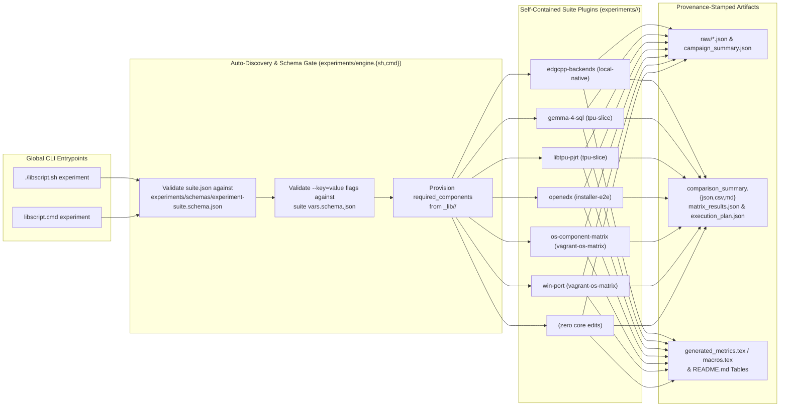

<!-- cspell:words PLDI -->

# LibScript Open/Closed Research Experiments (`experiments/`)

Self-contained empirical research campaigns (`experiments/<suite-id>/`) auto-discovered by
`experiments/engine.{sh,cmd}` and `./libscript.sh experiment <verb> <suite-id>` (or
`.\libscript.cmd experiment <verb> <suite-id>` on Windows) without modifying core CLI routers or
atomic `T1`/`T2` `_lib/` software recipes.

Every experiment plugin pairs declarative manifest validation
(`experiments/schemas/experiment-suite.schema.json` and per-suite `vars.schema.json`), hermetic
`T1`/`T2` dependency provisioning, idempotent benchmark or VM execution, provenance-stamped JSON/CSV
telemetry, and deterministic LaTeX macro or Markdown table synthesis with zero hand-typed manuscript
numbers.

---

## Architecture & Open/Closed Plugin Contract



### Core Architectural Invariants

1. **Zero Core Router Edits (Open/Closed Principle)**: Adding a new directory
   `experiments/<suite-id>/suite.json` immediately registers `<suite-id>` across `list`, `validate`,
   `provision`, `sync`, `run`, `collect`, `render-latex`, `test`, and `teardown`.
2. **Strict Dual-Platform Parity**: Every suite ships behavior-matched POSIX `/bin/sh` (`run.sh`,
   `test.sh`) and native Windows Batch (`run.cmd`, `test.cmd`) entrypoints with canonical `STACK`
   re-entrancy guards and 100% docstring coverage.
3. **Strict Flag Schema Validation**: `experiments/engine.{sh,cmd}` maps `--kebab-case=value` CLI
   flags to `UPPER_SNAKE_CASE` environment variables and validates them against the suite's
   `vars.schema.json` before execution, rejecting unknown or mistyped flags immediately.
4. **2x-Rerun Idempotency & Resume Safety**: Running any suite twice against the same
   `--results-dir` produces identical summary outputs without corrupting workspace state, snapshots,
   or caches.
5. **Zero-Hallucination Synthesis**: Manuscript macros (`generated_metrics.tex`) and compatibility
   matrices (`README.md`, `comparison_summary.md`) are mechanically emitted from SHA-pinned JSON
   logs rather than edited by hand.

---

## Built-In Experiment Suites Catalog

| Suite ID                                                 | Substrate           | Protocol                | Sub-Suites                | Primary Research & Verification Target                                                                                                                                                                                                                                                                      | Documentation                                                      |
| :------------------------------------------------------- | :------------------ | :---------------------- | :------------------------ | :---------------------------------------------------------------------------------------------------------------------------------------------------------------------------------------------------------------------------------------------------------------------------------------------------------- | :----------------------------------------------------------------- |
| [`edgcpp-backends`](./edgcpp-backends/README.md)         | `local-native`      | `PLDI-2027-v1`          | `E0`–`E7`                 | EDG C/C++ v7.0.1 LLVM, GCC/`libgccjit`, and legacy C/C++ backends vs. native Clang/GCC across compile latency, SQLite ablations, EH, C++20 coroutines, psABI/Csmith/YARPGen fuzzing, 10-project/Linux kernel builds, and 60 LaTeX macros.                                                                   | [`edgcpp-backends/README.md`](./edgcpp-backends/README.md)         |
| [`gemma-4-sql`](./gemma-4-sql/README.md)                 | `tpu-slice`         | `1.0.0`                 | `E0`–`E4`                 | `gemma-4-sql: TPU performance comparisons betwixt JAX, Keras, and PyTorch on Google's Gemma 4` across Hugging Face Transformers, native PyTorch, Keras (JAX/TF/PyTorch), MaxText, and native JAX covering prefill/decode, SQLite/DuckDB Text-to-SQL, SFT/LoRA/DPO, `/dev/shm` eviction, and Stage B guards. | [`gemma-4-sql/README.md`](./gemma-4-sql/README.md)                 |
| [`libtpu-pjrt`](./libtpu-pjrt/README.md)                 | `tpu-slice`         | `PLDI-2027-v1`          | `E0`–`E8`                 | Clean-room Rust PJRT TPU runtime & compiler (`libtpu-rs`) vs. `libtpu.so`: binary forensics, cold/warm C11 startup, stock `jax` single-chip/SPMD drop-in, 5-stage AOT compilation, 2D VMEM packing, VLIW modulo scheduling, 29-dtype SparseCore numerics, and 18-artifact LaTeX synthesis.                  | [`libtpu-pjrt/README.md`](./libtpu-pjrt/README.md)                 |
| [`openedx`](./openedx/README.md)                         | `installer-e2e`     | `1.0.0`                 | `E0`–`E3` (Steps `0`–`5`) | Multi-OS Bento Vagrant verification of native Open edX installers (`.msi`, `.exe`, `.deb`, `.rpm`, `.pkg`, `.dmg`) across isolated `headless`, `quick`, and `custom` clean-snapshot runs plus guest desktop icon, LMS (`:8000`), and Studio CMS (`:8001`) CDP login screenshots.                            | [`openedx/README.md`](./openedx/README.md)                         |
| [`os-component-matrix`](./os-component-matrix/README.md) | `vagrant-os-matrix` | `1.0.0`                 | `M0`                      | Aggregates 7-OS (`apk`, `deb`, `rpm`, `windows`, `sunos`, `freebsd`, `macos`) component smoke & 2x-rerun idempotency markers into provenance-stamped `matrix_results.json` and regenerates the 5-tier Supported Components tables in root `README.md`.                                                      | [`os-component-matrix/README.md`](./os-component-matrix/README.md) |
| [`win-port`](./win-port/README.md)                       | `vagrant-os-matrix` | `PLDI-2027-win-port-v1` | `E0`–`E7`                 | 14-repository Windows/DOS portability campaign (`cdd-c`, `auto-win-msvc`, `msi-rs`, `win-cmd-rs`, `bento`, 9 `*-windows` ports, and `freebsd-src`) across Win64 servers/CLIs, 5 MS-DOS/FreeDOS Vagrant COM1 boxes, WiX/WINE MSI rollback, `cmd.exe` Packrat oracle, and 285 LaTeX macros.                   | [`win-port/README.md`](./win-port/README.md)                       |

---

## Directory Layout & Plugin Anatomy

Every `experiments/<suite-id>/` plugin adheres to a standardized 7-file layout:

```text
experiments/
├── README.md                     # Architecture & operator guide (this document)
├── engine.sh                     # POSIX Open/Closed auto-discovery & lifecycle engine
├── engine.cmd                    # Native Windows Batch Open/Closed lifecycle engine
└── <suite-id>/
    ├── README.md                 # Suite-specific documentation, CLI flags & expected outputs
    ├── suite.json                # Declarative manifest validated against experiments/schemas/experiment-suite.schema.json
    ├── vars.schema.json          # JSON Schema governing suite-specific CLI/env variables
    ├── run.sh                    # POSIX benchmark/verification entrypoint
    ├── run.cmd                   # Windows Batch benchmark/verification entrypoint
    ├── test.sh                   # POSIX hermetic smoke & schema validation test
    └── test.cmd                  # Windows Batch hermetic smoke & schema validation test
```

### Supported Execution Substrates (`suite.json` -> `.substrate`)

| Substrate           | Description                                                                                                                                                                                                                |
| :------------------ | :------------------------------------------------------------------------------------------------------------------------------------------------------------------------------------------------------------------------- |
| `local-native`      | Executes directly on bare-metal or pinned host hardware (enforcing native ISA checks, optional cache-drop, and optional cross-ISA `qemu-user` baselines).                                                                  |
| `tpu-slice`         | Orchestrates single-host or multi-host Cloud TPU VMs / Queued Resources under TFRC zero-cost policy gates (`tfrc_guard.sh`), or runs locally with `--local-exec` / `--synthetic-fixtures`.                                 |
| `installer-e2e`     | Delegates to `experiments/_common/pkg_ui_runner.{sh,cmd}` to boot Bento Vagrant guests, snapshot clean state, install native packages across `headless`/`quick`/`custom` modes, and capture guest UI/CDP browser evidence. |
| `vagrant-os-matrix` | Coordinates multi-OS Bento Vagrant boxes (Linux, BSD, illumos, macOS, Windows, MS-DOS/FreeDOS) and host runners for cross-OS portability and idempotency campaigns.                                                        |
| `cloud-vm`          | Provisions ephemeral bare-metal or dedicated cloud VMs (`mac2.metal`, `Standard_D160ads_v7`, `c7g.metal`, `Standard_D32s_v5`) via `experiments/cli/experiment_cloud.{sh,cmd}`.                                             |
| `gke-xpk`           | Targets Google Kubernetes Engine / XPK multi-slice accelerator clusters.                                                                                                                                                   |

---

## Lifecycle Verbs & Flag Contract

All verbs can be invoked via `./libscript.sh experiment <verb> ...` (POSIX),
`.\libscript.cmd experiment <verb> ...` (Windows), or directly via `./experiments/engine.{sh,cmd}`:

| Verb            | Arguments                | Behavior                                                                                                                                                                                          |
| :-------------- | :----------------------- | :------------------------------------------------------------------------------------------------------------------------------------------------------------------------------------------------ |
| `list`          | _(none)_                 | Scans `experiments/*/suite.json` (or `$LIBSCRIPT_EXPERIMENTS_DIR/*/suite.json`) and prints `<id>\t<substrate>\t<title>`.                                                                          |
| `scaffold`      | `<suite-id> [options]`   | Generates a complete, docstring-compliant `experiments/<suite-id>/` plugin (`--title=...`, `--substrate=...`, `--template=default\|installer-e2e`, `--packaging-manifest=...`, `--out-root=...`). |
| `validate`      | `<suite-id> [--k=v ...]` | Validates `suite.json` required fields, substrate enum, `packaging_manifest` existence, `run.{sh,cmd}` parity, and `--key=value` flags against `vars.schema.json`.                                |
| `provision`     | `<suite-id> [--k=v ...]` | Installs missing `.required_components` via LibScript `T1`/`T2` `_lib/` recipes and prepares Vagrant workspaces (`--phase=provision`) for `installer-e2e` suites.                                 |
| `sync`          | `<suite-id> [--k=v ...]` | Resolves or builds target installer artifacts / synchronizes workspace inputs (`--phase=sync`).                                                                                                   |
| `run`           | `<suite-id> [--k=v ...]` | Validates the manifest and flags, exports mapped environment variables, and executes `experiments/<suite-id>/run.{sh,cmd}`.                                                                       |
| `collect`       | `<suite-id> [--k=v ...]` | Aggregates raw per-mode or per-worker results into unified summary JSON (`--phase=collect`).                                                                                                      |
| `render-latex`  | `<suite-id> [--k=v ...]` | Sets `EXPERIMENT_PHASE=render-latex` and invokes `run.{sh,cmd} --render-latex` to emit LaTeX macro files (`generated_metrics.tex` or `macros.tex`).                                               |
| `update-readme` | `[update_results args]`  | Delegates to `tests/update_results.{sh,cmd}` to refresh tiered 7-OS Supported Components tables.                                                                                                  |
| `test`          | `<suite-id>`             | Executes the suite's hermetic smoke test (`experiments/<suite-id>/test.{sh,cmd}`).                                                                                                                |
| `teardown`      | `<suite-id> [--k=v ...]` | Halts or destroys (`DESTROY_VM=1`) provisioned Vagrant/cloud experiment workspaces (`--phase=teardown`).                                                                                          |

### CLI Flag-to-Environment Resolution Rules

When passing `--key=value` to `./libscript.sh experiment <verb> <suite-id>`:

- **Core Pass-Through Flags**: `--results-dir`, `--paper-dir`, `--repo-dir`, `--subsuites`,
  `--tfrc-config`, `--backends`, `--model`, `--output`, `--json`, `--suite-dir`, and `--phase` are
  forwarded directly to the underlying suite runner.
- **`installer-e2e` Built-In Flags**: `--target-os`, `--bento-prefix`, `--bento-dir`, `--provider`,
  `--pkg-format`, `--pkg-source`, `--release-repo`, `--release-tag`, `--install-modes`,
  `--force-rebuild`, and `--dry-run` are automatically exported as `UPPER_SNAKE_CASE` environment
  variables and forwarded.
- **Boolean Valueless Flags**: Flags without `=` (such as `--synthetic-fixtures`, `--dry-run`,
  `--local-exec`, `--no-require-tpu-hbm`, `--build-pdf`, `--force`) are forwarded directly to
  `run.{sh,cmd}`.
- **Schema-Checked `--key=value` Flags**: Any other `--key=value` flag is converted to
  `UPPER_SNAKE_CASE` (for example, `--edgcpp-backends-suite-trials=5` ->
  `EDGCPP_BACKENDS_SUITE_TRIALS=5`) and checked against `experiments/<suite-id>/vars.schema.json`.
  Passing an undeclared `--key=value` flag aborts immediately with exit code `1`.

---

## How to Run

### 1. Discover and Validate All Experiment Suites

**POSIX (`Linux` / `macOS` / `FreeBSD` / `illumos`):**

```sh
# List all auto-discovered experiment suites
./libscript.sh experiment list

# Validate every built-in suite manifest and flag schema
for suite in edgcpp-backends gemma-4-sql libtpu-pjrt openedx os-component-matrix win-port; do
  ./libscript.sh experiment validate "$suite"
done
```

**Windows (`cmd.exe`):**

```cmd
:: List all auto-discovered experiment suites
call .\libscript.cmd experiment list

:: Validate every built-in suite manifest and flag schema
for %%S in (edgcpp-backends gemma-4-sql libtpu-pjrt openedx os-component-matrix win-port) do (
    call .\libscript.cmd experiment validate %%S
)
```

### 2. Run Suite Smoke Tests & Plugin Architecture Integration Tests

**POSIX:**

```sh
# Run an individual suite's smoke test
./libscript.sh experiment test edgcpp-backends
./libscript.sh experiment test openedx

# Run the full Open/Closed experiment plugin integration test suite
./tests/test_experiment_plugins.sh
```

**Windows:**

```cmd
call .\libscript.cmd experiment test edgcpp-backends
call .\libscript.cmd experiment test openedx
call .\tests\test_experiment_plugins.cmd
```

### 3. Execute Offline Deterministic Runs (Dry-Run & Synthetic Fixtures)

Every built-in suite supports fast, hermetic offline verification without requiring cloud TPU quota,
licensed compiler checkouts, or heavy hypervisor downloads:

```sh
# Compiler & runtime suites in deterministic synthetic-fixtures mode
./libscript.sh experiment run edgcpp-backends --synthetic-fixtures --results-dir=./build/smoke/edgcpp
./libscript.sh experiment run libtpu-pjrt --synthetic-fixtures --results-dir=./build/smoke/libtpu
./libscript.sh experiment run win-port --synthetic-fixtures --results-dir=./build/smoke/win_port

# Cloud TPU suite dry-run plan verification
./libscript.sh experiment run gemma-4-sql --dry-run --results-dir=./build/smoke/gemma-4-sql

# Open edX installer-e2e dry-run plan emission
./libscript.sh experiment run openedx \
  --dry-run=1 \
  --target-os=windows-11 \
  --pkg-format=msi \
  --pkg-source=github-release \
  --results-dir=./build/smoke/openedx

# 7-OS component matrix aggregation into isolated staging paths
cp README.md ./build/smoke/README.staging.md
./libscript.sh experiment run os-component-matrix \
  --results-dir=./build/smoke/os-matrix \
  --readme-out=./build/smoke/README.staging.md
```

### 4. Scaffold & Onboard a New Experiment Suite (Zero Core Edits)

```sh
# Scaffold a standard local-native empirical suite
./libscript.sh experiment scaffold my-compiler-study \
  --title="My Compiler Optimization Study (E0-E3)" \
  --substrate=local-native

# Validate, provision dependencies, test, and run immediately
./libscript.sh experiment validate my-compiler-study --trials=5
./libscript.sh experiment test my-compiler-study
./libscript.sh experiment run my-compiler-study --trials=5

# Or scaffold a declarative installer-e2e GUI/browser verification suite for any packaged web app
./libscript.sh experiment scaffold wordpress-e2e \
  --template=installer-e2e \
  --packaging-manifest=../../workloads/apps/wordpress/packaging.json
```

> **Tip:** Set `LIBSCRIPT_EXPERIMENTS_DIR=/path/to/custom/experiments` (or `--out-root=...` during
> `scaffold`) to maintain private or out-of-tree experiment suites while still driving them through
> `./libscript.sh experiment`.

---

## Expected Output

### 1. Discovery (`./libscript.sh experiment list`)

`list` emits a tab-separated 3-column table (`<suite-id>\t<substrate>\t<title>`) to `stdout` (with
`STACK` trace diagnostics on `stderr`):

```text
[CONTINUE] processing "./experiments/cli/cli.sh"
[CONTINUE] processing "./experiments/engine.sh"
edgcpp-backends	local-native	EDG C/C++ v7.0.1 Multi-Backend Empirical Evaluation & Zero-Hallucination Benchmarking Protocol (E0-E7)
gemma-4-sql	tpu-slice	gemma-4-sql: TPU performance comparisons betwixt JAX, Keras, and PyTorch on Google's Gemma 4
libtpu-pjrt	tpu-slice	libtpu-rs Empirical Evaluation Protocol (SIGPLAN E0-E8)
openedx	installer-e2e	Open edX Multi-OS Vagrant, Native Installer & Guest-UI Verification Suite
os-component-matrix	vagrant-os-matrix	7-OS Component Compatibility & 2x-Idempotency Matrix
win-port	vagrant-os-matrix	win_port 14-Repository Empirical Evaluation & Zero-Hallucination Benchmarking Protocol (E0-E7)
```

### 2. Validation & Provisioning (`validate` / `provision` / `scaffold`)

```text
$ ./libscript.sh experiment validate edgcpp-backends
[CONTINUE] processing "./experiments/cli/cli.sh"
[CONTINUE] processing "./experiments/engine.sh"
[PASS] Experiment suite "edgcpp-backends" validated cleanly.

$ ./libscript.sh experiment provision openedx --dry-run=1
[CONTINUE] processing "./experiments/cli/cli.sh"
[CONTINUE] processing "./experiments/engine.sh"
[PROVISION] Verified required Tier 1 component: jq
[DRY-RUN] Suite=openedx Box=bento/windows-11 Provider=qemu Artifact=msi (github-release) Modes=headless,quick,custom -> .../execution_plan.json

$ ./libscript.sh experiment scaffold my-compiler-study --substrate=local-native
[SCAFFOLD] Created experiment plugin: /path/to/libscript/experiments/my-compiler-study
```

### 3. Schema Error Diagnostics & Exit Codes

| Exit Code | Condition                                                                                                   | Sample Output                                                                   |
| :-------- | :---------------------------------------------------------------------------------------------------------- | :------------------------------------------------------------------------------ |
| `0`       | Suite command succeeded and all provenance/telemetry gates passed.                                          | `[PASS] Experiment suite "<id>" validated cleanly.`                             |
| `1`       | Missing `<suite-id>`, invalid `suite.json`, missing `packaging_manifest`, or undeclared `--key=value` flag. | `[ERROR] Unknown suite flag --foo (not declared in .../vars.schema.json)`       |
| `65`      | Stage B TPU HBM telemetry guard detected silent CPU fallback (`peak_tpu_hbm_bytes == 0`) in `gemma-4-sql`.  | `[ERROR] Stage B CPU-fallback detected ...` (`"status": "failed_cpu_fallback"`) |

### 4. Standardized Output Artifact Hierarchy

Depending on the suite class, artifacts are written under `--results-dir=<dir>` (defaulting to
`build/<suite>_results` or `build/experiments/<suite-id>`):

```text
<results-dir>/
├── campaign_summary.json       # Suite-level status, host ISA, trial policy & executed sub-suites
├── generated_metrics.tex       # Mechanically synthesized \newcommand / \providecommand LaTeX macros
├── comparison_summary.json     # Cross-backend speedup & accuracy synthesis (gemma-4-sql)
├── comparison_summary.csv      # RFC 4180 CSV export of cross-backend metrics (gemma-4-sql)
├── comparison_summary.md       # GitHub-flavored Markdown comparison table (gemma-4-sql)
├── execution_plan.json         # Resolved Bento VM, artifact & verification plan (installer-e2e dry-run)
├── metrics.json                # Per-mode installer timing, probe & UI verification status (installer-e2e)
├── matrix_results.json         # Provenance-stamped 7-OS component compatibility JSON (os-component-matrix)
├── screenshots/                # Guest desktop & authenticated browser PNG captures (installer-e2e)
└── raw/                        # Provenance-checked per-subsuite raw JSON & CSV telemetry
```

---

## Related Documentation

- **Cloud & Multi-OS Rapid Host Lifecycle (`a_provision_instance`..`i_deprovision_instance`)**:
  [`../EXPERIMENTS.md`](../EXPERIMENTS.md)
- **Master Suite Manifest JSON Schema**:
  [`../experiments/schemas/experiment-suite.schema.json`](../experiments/schemas/experiment-suite.schema.json)
- **7-OS Matrix Results JSON Schema**:
  [`../experiments/schemas/os-matrix-results.schema.json`](../experiments/schemas/os-matrix-results.schema.json)
- **CLI Router & Scaffolder**: [`../experiments/cli/README.md`](../experiments/cli/README.md)
