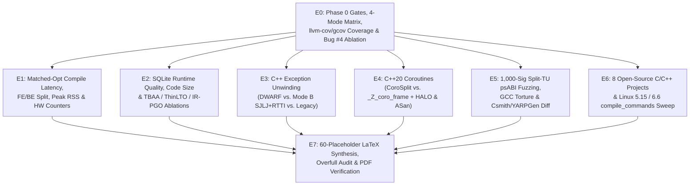

<!-- cspell:words PLDI datalayout -->

# Empirical Experiment Suite: `edgcpp-backends` (`experiments/edgcpp-backends`)

Reproducible multi-backend compiler evaluation campaign (`PLDI-2027-v1`, substrate `local-native`)
benchmarking **EDG C/C++ Front End v7.0.1** (`cpfe`) paired with direct **LLVM IR** (`llvm_gen_be`),
direct **GCC / `libgccjit`** (`gcc_gen_be`), and two-stage **legacy C/C++ source-generating
backends** (`c_gen_be` / `cp_gen_be`) against matched **Native Clang** and **Native GCC** baselines
across sub-suites **`E0` through `E7`**.

Every figure, table cell, and inline metric in `edgecpp_backends.tex` (**60 placeholders total**) is
mechanically synthesized into `generated_metrics.tex` from SHA-256-verified raw JSON telemetry in
`raw/*.json`.

---

## Evaluation Architecture & Sub-Suite DAG (`E0`–`E7`)



---

## Evaluated Compiler Pipelines & Experimental Protocol

### 7 Compiler Pipelines (`suite.json` -> `.compiler_pipelines`)

| Pipeline ID      | Manuscript Label                        | Backend Mode   | Stages | Baseline / Runtime Contract                                                                         |
| :--------------- | :-------------------------------------- | :------------- | :----: | :-------------------------------------------------------------------------------------------------- |
| `EDG-FE-ONLY`    | `cpfe Front-End Only (--no_code_gen)`   | `fe_only`      |   1    | Isolates pure EDG front-end parsing/semantic CPU time (`--gnu_version=130200`).                     |
| `EDG-LLVM`       | `cpfe + llvm_gen_be`                    | `llvm`         |   1    | Matched against `NATIVE-CLANG` (`LLVM_PREFIX`, `CLANG_MATCHED`).                                    |
| `EDG-GCC`        | `cpfe + gcc_gen_be`                     | `gcc`          |   1    | Links `libedg.a`; matched against `NATIVE-GCC` (`GCC_PREFIX`, `EDG_LIBGCCJIT_PATH`, `GCC_MATCHED`). |
| `EDG-C-LEGACY`   | `Legacy c_gen_be (.int.c) + Clang`      | `legacy_c`     |   2    | Separate two-stage `.int.c` accounting + `libedg.a` vs. `NATIVE-CLANG`.                             |
| `EDG-CPP-LEGACY` | `Legacy cp_gen_be (.int.cpp) + Clang++` | `legacy_cpp`   |   2    | Separate two-stage `.int.cpp` accounting vs. `NATIVE-CLANG`.                                        |
| `NATIVE-CLANG`   | `Native Clang / Clang++`                | `native_clang` |   1    | Same-version LLVM baseline (`require_same_llvm_baseline: true`).                                    |
| `NATIVE-GCC`     | `Native GCC / g++`                      | `native_gcc`   |   1    | Same-version GCC baseline (`require_same_gcc_libgccjit_baseline: true`).                            |

### Statistical & Host Integrity Policy

- **Trial Policy**: `1` untimed warm-up run followed by `11` measured trials per cell
  (`prng_seed: 2027`), reporting median & standard deviation plus `[0.25, 0.50, 0.75, 0.99]`
  quantiles with single-TU serialization (`LIBSCRIPT_BENCH_SERIAL_SINGLE_TU=1`) and anti-DCE
  checksum verification.
- **Target Native ISAs & Reference Cloud SKUs**:
  - `macos_arm64` (`mac2.metal`)
  - `linux_x64` (`Standard_D160ads_v7`)
  - `linux_arm64` (`c7g.metal`)
  - `windows_x64` (`Standard_D32s_v5`)
  - Optional cross-ISA `qemu-user` ABI verification across `x86_64`, `aarch64`, `riscv64`, `s390x`,
    `powerpc64le`, and `armhf`.
- **Phase 0 Prerequisite Gates (`prereq_checks`)**:
  1. `gate_vmi_rtti_flags`: Verifies Itanium 2.9.5 `__vmi_class_type_info::__flags` bitmask support
     and removal of the fixed `base_count <= 16` cap in `lib_src/gcc_be_eh_rt.c`.
  2. `gate_deterministic_coro_frame`: Verifies ASLR-free `_Z_coro_frame_%lu_%s` symbol naming in
     `src/gcc_gen_be_stmt.c`.
  3. `gate_darwin_datalayout`: Verifies clean target `createDataLayout` emission in
     `src/llvm_gen_be_codegen.cpp` without leaked x86/MSVC `p270`/`p271`/`p272` address spaces.
  4. `gate_external_declare_abi`: Verifies `llvm_compute_function_abi_info` AAPCS64/Darwin ARM64
     `>16B` composite classification on uncalled external `declare` prototypes.
  5. `gate_o0_bool_lowering`: Verifies streamlined `-O0` `i1` boolean branch lowering in
     `src/llvm_gen_be_expr.cpp`.
  6. `gate_dynamic_deferred_structs`: Verifies dynamically grown `deferred_structs` and big-endian /
     volatile bitfield RMW lowering in `src/gcc_gen_be_type.c`.

---

## Sub-Suite Reference (`E0`–`E7`)

| Sub-Suite | Script Entrypoint                      | LibScript Dependencies                                                                   | Raw & Synthesized Outputs                                                                                                                                        |
| :-------- | :------------------------------------- | :--------------------------------------------------------------------------------------- | :--------------------------------------------------------------------------------------------------------------------------------------------------------------- |
| **`E0`**  | `suites/e0_phase0_gates.{sh,cmd}`      | `edgcpp`, `cmake`, `ninja`, `llvm`, `gcc`, `lcov`, `sqlite`                              | `raw/metadata.json`, `raw/exp0_coverage.json`, `raw/exp0_bug4_ablation.json`                                                                                     |
| **`E1`**  | `suites/e1_compile_perf.{sh,cmd}`      | `edgcpp`, `clang`, `gcc`, `sqlite`, `fmt`                                                | `raw/exp1_compile_perf.json` (16 Table 4 compile-time, FE/BE split, RSS & HW counter slots)                                                                      |
| **`E2`**  | `suites/e2_sqlite_ablation.{sh,cmd}`   | `edgcpp`, `clang`, `gcc`, `llvm`, `sqlite`                                               | `raw/exp2_sqlite_runtime.json` (`speedtest1`, OLAP `GROUP BY`, B-tree scan, `.text` size, 15-way SHA-256 gate), `raw/exp2_ablation.json` (TBAA, ThinLTO, IR-PGO) |
| **`E3`**  | `suites/e3_eh_unwinding.{sh,cmd}`      | `edgcpp`, `clang`, `gcc`                                                                 | `raw/exp3_eh.json` (RAII fast path, single-inheritance throw, virtual-diamond `VBase&` throw)                                                                    |
| **`E4`**  | `suites/e4_coroutines.{sh,cmd}`        | `edgcpp`, `clang`, `gcc`                                                                 | `raw/exp4_coro.json` (50M C++20 `Generator`, `-O0` vs. `-O2` HALO heap elision, 1M `Task` hops & ASan gate)                                                      |
| **`E5`**  | `suites/e5_abi_and_fuzz.{sh,cmd}`      | `edgcpp`, `clang`, `gcc`, `gcc-torture`, `csmith`, `yarpgen`, `qemu`                     | `raw/exp5_abi_fuzz.json` (1,000 split-TU signatures), `raw/exp5_gcc_torture.json`, `raw/exp5_diff_fuzz.json`                                                     |
| **`E6`**  | `suites/e6_corpus_and_kernel.{sh,cmd}` | `edgcpp`, `sqlite`, `lua`, `lz4`, `zlib`, `dash`, `jq`, `fmt`, `catch2`, `linux`, `bear` | `raw/exp6_projects.json` (8 C/C++ packages), `raw/exp6_kernel.json` (Linux `5.15.167` `gnu89` & `6.6.52` `gnu11`)                                                |
| **`E7`**  | `suites/e7_latex_verify.{sh,cmd}`      | `texlive`                                                                                | `generated_metrics.tex` (all 60 LaTeX macros + zero `\tbd` / `???` / overfull audit)                                                                             |

---

## Configuration Variables & CLI Flags

Variables declared in `experiments/edgcpp-backends/vars.schema.json` can be exported in the
environment or passed via `--kebab-case=value` to `./libscript.sh experiment run edgcpp-backends`:

| Environment Variable                | CLI Flag (`experiment run`)                                       | Default                           | Description                                                                              |
| :---------------------------------- | :---------------------------------------------------------------- | :-------------------------------- | :--------------------------------------------------------------------------------------- |
| `EDGCPP_BACKENDS_SUITE_SUBSUITES`   | `--subsuites=<csv>`                                               | `E0,E1,E2,E3,E4,E5,E6,E7`         | Comma-separated subset of sub-suites to run.                                             |
| `EDGCPP_BACKENDS_SUITE_RESULTS_DIR` | `--results-dir=<dir>`                                             | `build/edgcpp_backends_results`   | Output directory for `raw/*.json`, `campaign_summary.json`, and `generated_metrics.tex`. |
| `EDGCPP_BACKENDS_SUITE_REPO`        | `--edgcpp-backends-suite-repo=<dir>`                              | `../edgcpp-compiler-multibackend` | Pinned checkout of `edgcpp-compiler-multibackend` evaluated by `E0`–`E6`.                |
| `EDGCPP_BACKENDS_SUITE_PAPER_DIR`   | `--paper-dir=<dir>`                                               | `../new_research/edgcpp_backends` | Manuscript directory containing `edgecpp_backends.tex`.                                  |
| `EDGCPP_BACKENDS_SUITE_TRIALS`      | `--edgcpp-backends-suite-trials=<n>`                              | `11`                              | Measured steady-state trials per cell (`E1`–`E4`).                                       |
| `EDGCPP_BACKENDS_SUITE_SYNTHETIC`   | `--synthetic-fixtures` / `--edgcpp-backends-suite-synthetic=true` | `false`                           | Runs deterministic offline synthetic fixtures for fast CI and self-testing.              |
| `EDGCPP_BACKENDS_SUITE_CROSS_QEMU`  | `--cross-isa-qemu` / `--edgcpp-backends-suite-cross-qemu=true`    | `false`                           | Enables `qemu-user` split-TU psABI verification across 6 non-host ISAs in `E5`.          |
| `EDGCPP_BACKENDS_SUITE_BUILD_PDF`   | `--build-pdf` / `--edgcpp-backends-suite-build-pdf=true`          | `false`                           | Compiles `edgecpp_backends.tex` via `latexmk` during `E7` and checks page/hbox limits.   |

> **Direct Runner Shortcut:** Invoking `./experiments/edgcpp-backends/run.sh` (or
> `.\experiments\edgcpp-backends\run.cmd`) directly also accepts short flags `--repo=<dir>`,
> `--trials=<n>`, `--host-arch=<arch>`, `--dry-run`, and `--force`.

---

## How to Run

### 1. Validate the Manifest & Run the Smoke Test

**POSIX (`Linux` / `macOS` / `FreeBSD` / `illumos`):**

```sh
./libscript.sh experiment validate edgcpp-backends
./libscript.sh experiment test edgcpp-backends
```

**Windows (`cmd.exe`):**

```cmd
call .\libscript.cmd experiment validate edgcpp-backends
call .\libscript.cmd experiment test edgcpp-backends
```

### 2. Fast Dry-Run Verification

Verifies suite configuration and target sub-suite routing without compiling or mutating benchmark
corpora:

```sh
./libscript.sh experiment run edgcpp-backends \
  --dry-run \
  --subsuites=E0,E1,E2,E7 \
  --results-dir=./build/edgcpp_dry_run
```

### 3. Offline Deterministic Synthetic-Fixtures Run (`E0`–`E7`)

Executes the entire `E0`–`E7` pipeline end-to-end using deterministic synthetic C/C++ fixtures (no
commercial EDG source checkout or network access required) and synthesizes all 60 LaTeX macros:

**POSIX:**

```sh
./libscript.sh experiment run edgcpp-backends \
  --synthetic-fixtures \
  --results-dir=./build/edgcpp_synthetic
```

**Windows:**

```cmd
call .\libscript.cmd experiment run edgcpp-backends --synthetic-fixtures "--results-dir=build\edgcpp_synthetic"
```

### 4. Full Native Hardware Campaign + Cross-ISA QEMU + PDF Build

On a prepared benchmark host with the `edgcpp-compiler-multibackend` repository and manuscript tree
checked out:

```sh
# 1. Provision required T1 toolchains (edgcpp, gcc, llvm, clang, sqlite)
./libscript.sh experiment provision edgcpp-backends

# 2. Execute all 8 sub-suites (11 trials/cell) + QEMU cross-ISA psABI fuzzing + LaTeX PDF audit
./libscript.sh experiment run edgcpp-backends \
  --edgcpp-backends-suite-repo=/path/to/edgcpp-compiler-multibackend \
  --paper-dir=/path/to/new_research/edgcpp_backends \
  --results-dir=./build/edgcpp_backends_results \
  --edgcpp-backends-suite-trials=11 \
  --cross-isa-qemu \
  --build-pdf
```

### 5. Re-Render Only LaTeX Macros (`render-latex`)

```sh
./libscript.sh experiment render-latex edgcpp-backends \
  --results-dir=./build/edgcpp_backends_results \
  --paper-dir=/path/to/new_research/edgcpp_backends
```

---

## Expected Output

### 1. Console Output (`E0`–`E7` Execution)

```text
[CONTINUE] processing "./experiments/cli/cli.sh"
[CONTINUE] processing "./experiments/engine.sh"
[CONTINUE] processing "./experiments/edgcpp-backends/run.sh"
[CONTINUE] processing "./experiments/edgcpp-backends/benchmark_experiments.sh"
[CONTINUE] processing "./experiments/edgcpp-backends/suites/e0_phase0_gates.sh"
[INFO] [E0] Verified 6 Phase 0 gates, coverage, and Bug #4 ablation -> ./build/edgcpp_synthetic/raw/exp0_coverage.json
[CONTINUE] processing "./experiments/edgcpp-backends/suites/e1_compile_perf.sh"
[INFO] [E1] Matched-optimization compile latency & RSS recorded -> ./build/edgcpp_synthetic/raw/exp1_compile_perf.json
[CONTINUE] processing "./experiments/edgcpp-backends/suites/e2_sqlite_ablation.sh"
[INFO] [E2] Verified 15-way SQLite SHA-256 gate, section sizes, and TBAA/ThinLTO/PGO ablations -> ./build/edgcpp_synthetic/raw/exp2_sqlite_runtime.json
[CONTINUE] processing "./experiments/edgcpp-backends/suites/e3_eh_unwinding.sh"
[INFO] [E3] Verified C++ exception unwinding rows (RAII, single-inheritance, virtual-diamond VBase&) -> ./build/edgcpp_synthetic/raw/exp3_eh.json
[CONTINUE] processing "./experiments/edgcpp-backends/suites/e4_coroutines.sh"
[INFO] [E4] Verified C++20 Generator, HALO (O0=5000 -> O2=5000), and Task ASan gate -> ./build/edgcpp_synthetic/raw/exp4_coro.json
[CONTINUE] processing "./experiments/edgcpp-backends/suites/e5_abi_and_fuzz.sh"
[INFO] [E5] Completed Split-TU psABI, GCC Torture, and Differential Fuzzing -> ./build/edgcpp_synthetic/raw/exp5_abi_fuzz.json
[CONTINUE] processing "./experiments/edgcpp-backends/suites/e6_corpus_and_kernel.sh"
[INFO] [E6] Completed 8-project C/C++ corpus and Linux kernel TU sweep -> ./build/edgcpp_synthetic/raw/exp6_projects.json
[CONTINUE] processing "./experiments/edgcpp-backends/suites/e7_latex_verify.sh"
[INFO] [E7] Emitted all 60 verified LaTeX metrics -> ./build/edgcpp_synthetic/generated_metrics.tex
[INFO] Completed edgcpp_backends suites (E0,E1,E2,E3,E4,E5,E6,E7) -> ./build/edgcpp_synthetic/campaign_summary.json
```

### 2. Generated Artifact Directory Structure

```text
build/edgcpp_backends_results/
├── campaign_summary.json          # Top-level run status, host ISA, trial count & synthetic flag
├── generated_metrics.tex          # All 60 \newcommand LaTeX macros consumed by edgecpp_backends.tex
└── raw/
    ├── metadata.json              # Host CPU, RAM, OS kernel, LLVM/GCC matched versions & Git SHA
    ├── exp0_coverage.json         # llvm-cov / gcov function, line, and branch coverage %
    ├── exp0_bug4_ablation.json    # Array-decay backend CPU time before vs. after fix
    ├── exp1_compile_perf.json     # FE CPU, BE CPU, wall time, peak RSS & HW instructions
    ├── exp2_sqlite_runtime.json   # speedtest1, OLAP GROUP BY, B-tree scan ms & .text MB
    ├── exp2_ablation.json         # No-TBAA vs. TBAA vs. ThinLTO vs. IR-PGO runtime ablation
    ├── exp3_eh.json               # RAII fast-path, single-inherit & virtual-diamond unwinding ms
    ├── exp4_coro.json             # 50M Generator ms, O0/O2 HALO allocation count & 1M Task hops
    ├── exp5_abi_fuzz.json         # 1,000-signature split-TU caller/callee psABI pass rate
    ├── exp5_gcc_torture.json      # GCC C execute torture pass rates at -O0 and -O2
    ├── exp5_diff_fuzz.json        # Csmith & YARPGen differential checksum agreement %
    ├── exp6_projects.json         # 8-project build & test verification outcomes
    └── exp6_kernel.json           # Linux 5.15.167 (gnu89) & 6.6.52 (gnu11) TU pass counts
```

### 3. Sample `campaign_summary.json`

```json
{
  "schema_version": "1.0.0",
  "suite": "edgcpp_backends",
  "subsuites": "E0,E1,E2,E3,E4,E5,E6,E7",
  "host_arch": "macos_arm64",
  "trials": 11,
  "synthetic": false,
  "status": "PASS"
}
```

### 4. Sample `generated_metrics.tex` Excerpt

```tex
% Mechanically generated by LibScript edgcpp-backends-suite E7 — DO NOT EDIT BY HAND
% Backing artifacts: 13 raw JSON files in build/edgcpp_backends_results/raw
\newcommand{\EdgPinnedCommitSha}{...}
\newcommand{\EdgGccBeCovFuncPct}{94.2}
\newcommand{\EdgGccBeCovLinePct}{91.8}
\newcommand{\EdgGccBeCovBranchPct}{86.4}
\newcommand{\EdgBugFourBeforeSec}{14.82}
\newcommand{\EdgBugFourAfterSec}{0.41}
\newcommand{\EdgHostCpuModel}{...}
\newcommand{\EdgPsabiFuzzPassedOfThousand}{1000}
```
