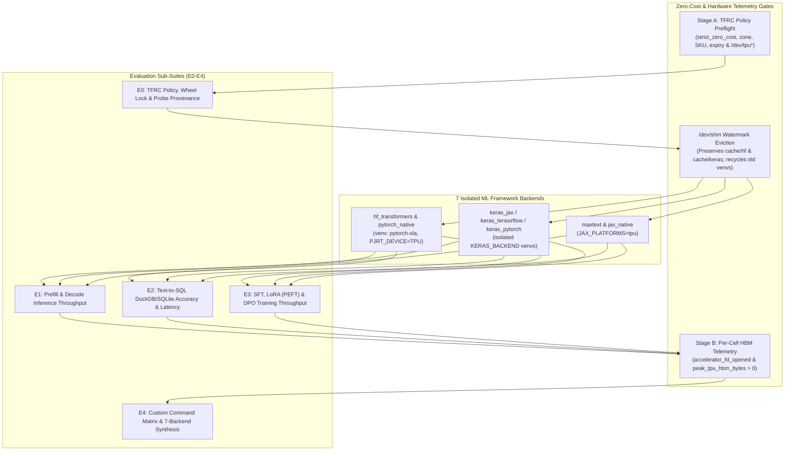

<!-- cspell:words Sechftransformers Secpytorchnative Seckerasjax Seckerastensorflow Seckeraspytorch Secmaxtext Secjaxnative -->

# Empirical Experiment Suite: `gemma-tpu` (`experiments/gemma-tpu`)

Zero-cost **TPU Research Cloud (TFRC)** empirical benchmark plugin (`protocol_version: 1.0.0`,
substrate `tpu-slice`) evaluating **Gemma 4** (`google/gemma-4-E4B` by default) across **all 7
supported ML framework/runtime backends** (`hf_transformers`, `pytorch_native`, `keras_jax`,
`keras_tensorflow`, `keras_pytorch`, `maxtext`, and `jax_native`) and **5 sub-suites (`E0`–`E4`)**.

The suite enforces strict zero-billing TFRC policy preflight/postflight gates, `/dev/shm` tmpfs
virtual-environment watermark eviction (preserving shared model weight caches), spot-preemption
`--resume` idempotency keyed by workspace tree hash, and fail-fast **Stage B TPU HBM telemetry
verification** (aborting with exit code `65` if any backend silently falls back to host CPU).

---

## Execution Pipeline & Guardrail Architecture



---

## Evaluated 7-Backend Matrix (`suite.json` -> `.tpu_matrix.backends`)

| Backend ID         | Label                                       | Venv Group    | CLI Backend      | Key Runtime Environment                                                                |
| :----------------- | :------------------------------------------ | :------------ | :--------------- | :------------------------------------------------------------------------------------- |
| `hf_transformers`  | Hugging Face Transformers `[wraps PyTorch]` | `pytorch-xla` | `pytorch_hf`     | `PJRT_DEVICE=TPU`, `XLA_USE_BF16=1`, `torch_xla[tpu]`                                  |
| `pytorch_native`   | PyTorch `[native]`                          | `pytorch-xla` | `pytorch_native` | `PJRT_DEVICE=TPU`, `XLA_USE_BF16=1`, reuses `pytorch-xla` venv                         |
| `keras_jax`        | Keras `[JAX backend]`                       | `keras-jax`   | `keras`          | `KERAS_BACKEND=jax`, `JAX_PLATFORMS=tpu`, `jax[tpu]`, `keras>=3`                       |
| `keras_tensorflow` | Keras `[TensorFlow backend]`                | `keras-tf`    | `keras`          | `KERAS_BACKEND=tensorflow`, `tensorflow-tpu`, `keras>=3`                               |
| `keras_pytorch`    | Keras `[PyTorch backend]`                   | `keras-torch` | `keras`          | `KERAS_BACKEND=torch`, `PJRT_DEVICE=TPU`, `XLA_USE_BF16=1`                             |
| `maxtext`          | MaxText `[wraps JAX]`                       | `maxtext`     | `maxtext`        | `JAX_PLATFORMS=tpu`, `jax[tpu]`, `flax`, `optax`, `orbax-checkpoint`, `aqt`, `maxtext` |
| `jax_native`       | JAX `[native]`                              | `jax-native`  | `jax`            | `JAX_PLATFORMS=tpu`, `jax[tpu]`, `flax`, `optax`, `grain`                              |

---

## Sub-Suite Reference (`E0`–`E4`)

| Sub-Suite | Script                                           |  Warmup / Trials   | Emitted Artifacts                                                                                                                                                         |
| :-------- | :----------------------------------------------- | :----------------: | :------------------------------------------------------------------------------------------------------------------------------------------------------------------------ |
| **`E0`**  | `suites/e0_tfrc_provenance.{sh,cmd}`             |     `1` probe      | `raw/e0_provenance.json` (GCP project, TFRC grant check, TPU topology, `uv`/pip wheel SHA lock & Stage A device probe)                                                    |
| **`E1`**  | `suites/e1_inference_throughput.{sh,cmd}`        |     `2` / `5`      | `raw/e1_inference_<backend>.json` (`bfloat16` prefill latency, decode `tokens_per_sec`, `peak_tpu_hbm_bytes`)                                                             |
| **`E2`**  | `suites/e2_sql_evaluation.{sh,cmd}`              |     `1` / `3`      | `raw/e2_sql_eval_<backend>.json` (deterministic `seed=42` Text-to-SQL DuckDB/SQLite `execution_accuracy` & latency)                                                       |
| **`E3`**  | `suites/e3_training_finetuning.{sh,cmd}`         |     `1` / `3`      | `raw/e3_training_<backend>.json` (`bfloat16` SFT, LoRA/PEFT, and DPO `tokens_per_sec_per_chip`)                                                                           |
| **`E4`**  | `suites/e4_custom_matrix_and_synthesis.{sh,cmd}` | Custom + Synthesis | `raw/e4_custom_<idx>_<backend>.json` (optional templated commands), `comparison_summary.json`, `comparison_summary.csv`, `comparison_summary.md`, `generated_metrics.tex` |

### Custom Command Template Placeholders (`E4`)

When `GEMMA_TPU_SUITE_COMMAND_TEMPLATE` is set or `.ml.command_matrix[]` is present in the target
workspace's `libscript.json`, `E4` substitutes the following tokens per backend before executing
under Stage B HBM telemetry:

- `{backend_id}`, `{cli_backend}`, `{keras_backend}`, `{model}`, `{batch_size}`, `{output_json}`,
  `{repo_dir}`.

---

## Configuration Variables & CLI Flags

Variables declared in `experiments/gemma-tpu/vars.schema.json` (plus core pass-through flags):

| Environment Variable                   | CLI Flag (`experiment run`)                   | Default                   | Description                                                                                      |
| :------------------------------------- | :-------------------------------------------- | :------------------------ | :----------------------------------------------------------------------------------------------- |
| `GEMMA_TPU_SUITE_MODEL`                | `--model=<id>`                                | `google/gemma-4-E4B`      | Hugging Face / KerasHub Gemma 4 model identifier.                                                |
| `GEMMA_TPU_SUITE_BACKENDS`             | `--backends=<csv\|all>`                       | All 7 backends            | Comma-separated subset of backends or `all`.                                                     |
| `GEMMA_TPU_SUITE_SUBSUITES`            | `--subsuites=<csv>`                           | `E0,E1,E2,E3,E4`          | Comma-separated sub-suites to run.                                                               |
| `GEMMA_TPU_SUITE_RESULTS_DIR`          | `--results-dir=<dir>`                         | `build/gemma_tpu_results` | Local output directory for `raw/*.json` and comparison summaries.                                |
| `GEMMA_TPU_SUITE_REPO_DIR`             | `--repo-dir=<dir>`                            | `.`                       | Target ML workload repository (e.g., `gemma-4-sql`).                                             |
| `TFRC_CONFIG`                          | `--tfrc-config=<path>`                        | `./tfrc.policy.json`      | Zero-cost TFRC grant policy JSON file validated before provisioning/execution.                   |
| `GEMMA_TPU_SUITE_WARMUP`               | `--gemma-tpu-suite-warmup=<n>`                | `2`                       | Untimed XLA compilation warm-up runs before timed trials.                                        |
| `GEMMA_TPU_SUITE_TRIALS`               | `--gemma-tpu-suite-trials=<n>`                | `5`                       | Measured steady-state trials per cell.                                                           |
| `GEMMA_TPU_SUITE_BATCH_SIZE`           | `--gemma-tpu-suite-batch-size=<n>`            | `8`                       | Per-device batch size for inference and PEFT workloads.                                          |
| `GEMMA_TPU_SUITE_SHM_ROOT`             | `--gemma-tpu-suite-shm-root=<dir>`            | `/dev/shm/libscript-tpu`  | RAM-backed staging root for backend venvs and shared weight caches (override on macOS/Windows).  |
| `GEMMA_TPU_SUITE_SHM_MIN_FREE_GB`      | `--gemma-tpu-suite-shm-min-free-gb=<n>`       | `20`                      | Minimum free GiB threshold on `SHM_ROOT` before evicting inactive backend venvs.                 |
| `GEMMA_TPU_SUITE_FRESH_VM_PER_BACKEND` | `--gemma-tpu-suite-fresh-vm-per-backend=true` | `false`                   | Cycles a clean TPU VM / Queued Resource between backend families (`keras_tensorflow` isolation). |
| `GEMMA_TPU_SUITE_REQUIRE_HBM`          | `--no-require-tpu-hbm`                        | `true`                    | Requires non-zero TPU HBM activity (`peak_tpu_hbm_bytes > 0`) on every cell.                     |
| `GEMMA_TPU_SUITE_RESUME`               | `--gemma-tpu-suite-resume=true`               | `true`                    | Skips completed `(subsuite, backend, tree_hash)` cells after spot preemption.                    |
| `GEMMA_TPU_SUITE_COMMAND_TEMPLATE`     | `--gemma-tpu-suite-command-template=<tpl>`    | `""`                      | Optional custom workload template evaluated across every selected backend in `E4`.               |

---

## How to Run

### 1. Validate the Manifest & Run Smoke / Hermetic Matrix Tests

**POSIX (`Linux` / `macOS`):**

```sh
# Validate plugin manifest and schema
./libscript.sh experiment validate gemma-tpu
./libscript.sh experiment test gemma-tpu

# Run the full hermetic 7-backend test suite (venv reuse, /dev/shm eviction, 2x --resume, exit 65 guard)
./tests/test_gemma_tpu_matrix.sh
```

**Windows (`cmd.exe`):**

```cmd
call .\libscript.cmd experiment validate gemma-tpu
call .\libscript.cmd experiment test gemma-tpu
call .\tests\test_gemma_tpu_matrix.cmd
```

### 2. Dry-Run Execution Plan Check

```sh
./libscript.sh experiment run gemma-tpu \
  --dry-run \
  --model=google/gemma-4-E4B \
  --backends=jax_native,maxtext,pytorch_native \
  --subsuites=E0,E1,E4 \
  --results-dir=./build/gemma_tpu_dry
```

### 3. Local Synthetic-Fixtures Verification (Including macOS / Non-Linux Hosts)

On hosts without `/dev/shm` or physical `/dev/accel*` / `/dev/vfio/*` TPU devices (such as macOS or
Windows workstations), point `GEMMA_TPU_SUITE_SHM_ROOT` at a local temporary directory and enable
`GEMMA_TPU_SUITE_SYNTHETIC_FIXTURES=1`:

**POSIX:**

```sh
GEMMA_TPU_SUITE_SYNTHETIC_FIXTURES=1 \
GEMMA_TPU_SUITE_SHM_ROOT=/tmp/libscript-tpu-shm \
./libscript.sh experiment run gemma-tpu \
  --local-exec \
  --no-require-tpu-hbm \
  --backends=hf_transformers,pytorch_native,keras_jax,keras_tensorflow,keras_pytorch,maxtext,jax_native \
  --subsuites=E0,E1,E2,E3,E4 \
  --results-dir=./build/gemma_tpu_synthetic
```

**Windows:**

```cmd
set "GEMMA_TPU_SUITE_SYNTHETIC_FIXTURES=1"
set "GEMMA_TPU_SUITE_SHM_ROOT=%TEMP%\libscript-tpu-shm"
call .\libscript.cmd experiment run gemma-tpu --local-exec --no-require-tpu-hbm "--backends=all" "--subsuites=E0,E1,E2,E3,E4" "--results-dir=build\gemma_tpu_synthetic"
```

### 4. Live Zero-Cost TFRC Cloud TPU Campaign

1. Create a `tfrc.policy.json` file pinning your approved TFRC project, zone, accelerator SKU, spot
   scheduling requirement, and grant expiration date:

   ```json
   {
     "schema_version": "1.0",
     "gcp_project_id": "my-tfrc-project",
     "strict_zero_cost": true,
     "grants": [
       {
         "zone": "us-central2-b",
         "accelerator_types": ["v4-8"],
         "scheduling_tiers": ["spot"],
         "max_hosts": 1,
         "max_chips": 4,
         "max_concurrent_nodes": 1,
         "expires_on": "2027-06-30"
       }
     ]
   }
   ```

2. Launch the full end-to-end cloud lifecycle (preflight policy check -> Queued Resource spot TPU
   provisioning -> workspace sync -> 7-backend `E0`–`E4` execution with per-cell result streaming ->
   `EXIT` trap teardown & postflight zero-orphan audit):

   ```sh
   ./libscript.sh experiment tpu_matrix \
     --tfrc-config=./tfrc.policy.json \
     --repo-dir=/path/to/gemma-4-sql \
     --output-dir=./build/tpu_campaign \
     --state-file=./build/tpu_campaign/state.json \
     --model=google/gemma-4-E4B \
     --backends=all \
     --subsuites=E0,E1,E2,E3,E4 \
     --tfrc-only
   ```

3. Or, when already logged into a provisioned Cloud TPU VM, execute directly on the worker (with
   automatic spot-preemption `--resume`):

   ```sh
   ./libscript.sh experiment run gemma-tpu \
     --local-exec \
     --tfrc-config=./tfrc.policy.json \
     --repo-dir=/path/to/gemma-4-sql \
     --results-dir=./build/gemma_tpu_results \
     --backends=all \
     --subsuites=E0,E1,E2,E3,E4
   ```

---

## Expected Output

### 1. Console Output (`E0`–`E4` Execution)

```text
[CONTINUE] processing "./cli/commands/experiment/cli.sh"
[CONTINUE] processing "./experiments/engine.sh"
[CONTINUE] processing "./experiments/gemma-tpu/run.sh"
[CONTINUE] processing "./_lib/toolchains/gemma-tpu-suite/benchmark_experiments.sh"
[CONTINUE] processing "./_lib/toolchains/gemma-tpu-suite/suites/e0_tfrc_provenance.sh"
[INFO] Wrote E0 TFRC & wheel provenance -> ./build/gemma_tpu_results/raw/e0_provenance.json
[CONTINUE] processing "./_lib/toolchains/gemma-tpu-suite/suites/e1_inference_throughput.sh"
[INFO] Completed E1 inference cell for hf_transformers -> ./build/gemma_tpu_results/raw/e1_inference_hf_transformers.json
...
[CONTINUE] processing "./_lib/toolchains/gemma-tpu-suite/suites/e2_sql_evaluation.sh"
[INFO] Completed E2 SQL evaluation cell for jax_native -> ./build/gemma_tpu_results/raw/e2_sql_eval_jax_native.json
[CONTINUE] processing "./_lib/toolchains/gemma-tpu-suite/suites/e3_training_finetuning.sh"
[INFO] Completed E3 training cell for maxtext -> ./build/gemma_tpu_results/raw/e3_training_maxtext.json
[CONTINUE] processing "./_lib/toolchains/gemma-tpu-suite/suites/e4_custom_matrix_and_synthesis.sh"
[INFO] Synthesized 7-backend comparison tables -> ./build/gemma_tpu_results/comparison_summary.{json,csv,md}
[INFO] Completed gemma-tpu-suite local campaign in ./build/gemma_tpu_results
```

On a second invocation with `--resume` (default), completed cells with matching workspace
`tree_hash` are skipped immediately:

```text
[INFO] Skipping completed E1 cell for jax_native (--resume, tree_hash=...).
```

### 2. Generated Artifact Directory Structure

```text
build/gemma_tpu_results/
├── comparison_summary.json                   # Unified 7-backend metrics & speedups vs. HF / JAX
├── comparison_summary.csv                    # Spreadsheet-ready CSV summary
├── comparison_summary.md                     # Markdown comparison table
├── generated_metrics.tex                     # LaTeX macros (\GemmaTpuTokPerSec...)
└── raw/
    ├── e0_provenance.json                    # TFRC policy audit, TPU topology & wheel lock SHA
    ├── e1_inference_<backend_id>.json        # Decode tok/s, prefill ms & Stage B HBM telemetry
    ├── e2_sql_eval_<backend_id>.json         # DuckDB/SQLite execution accuracy & query latency
    ├── e3_training_<backend_id>.json         # SFT / LoRA / DPO tok/s/chip & HBM telemetry
    └── e4_custom_<idx>_<backend_id>.json     # Optional custom command matrix cell outputs
```

### 3. Sample `comparison_summary.md` & `comparison_summary.json`

**`comparison_summary.md`:**

```markdown
# Gemma 4 7-Backend Cloud TPU Comparison (google/gemma-4-E4B)

| Backend            | Inference tok/s | SQL Exec Acc | Train tok/s/chip | Peak HBM (B) |  vs HF | vs JAX |
| :----------------- | --------------: | -----------: | ---------------: | -----------: | -----: | -----: |
| `hf_transformers`  |           142.5 |        0.812 |           1890.0 |   9663676416 |     1x | 0.625x |
| `pytorch_native`   |           168.4 |        0.812 |           2140.0 |   9126805504 | 1.182x | 0.739x |
| `keras_jax`        |           215.0 |        0.815 |           2760.0 |   8589934592 | 1.509x | 0.943x |
| `keras_tensorflow` |           194.2 |        0.810 |           2490.0 |   9395240960 | 1.363x | 0.852x |
| `keras_pytorch`    |           161.8 |        0.812 |           2050.0 |   9261023232 | 1.135x |  0.71x |
| `maxtext`          |           234.6 |        0.816 |           3120.0 |   8321499136 | 1.646x | 1.029x |
| `jax_native`       |           228.0 |        0.816 |           3045.0 |   8187281408 |   1.6x |     1x |
```

**`comparison_summary.json` structure:**

```json
{
  "suite": "gemma_tpu",
  "status": "ok",
  "model": "google/gemma-4-E4B",
  "backends": [
    {
      "backend_id": "jax_native",
      "inference_tokens_per_sec": 228.0,
      "sql_execution_accuracy": 0.816,
      "train_tokens_per_sec_per_chip": 3045.0,
      "peak_tpu_hbm_bytes": 8187281408,
      "speedup_vs_hf_transformers": 1.6,
      "speedup_vs_jax_native": 1
    }
  ],
  "custom_workloads": []
}
```

### 4. Sample `generated_metrics.tex` & Stage B CPU-Fallback Failure Output

**`generated_metrics.tex`:**

```tex
\newcommand{\GemmaTpuTokPerSechftransformers}{142.5}
\newcommand{\GemmaTpuTokPerSecpytorchnative}{168.4}
\newcommand{\GemmaTpuTokPerSeckerasjax}{215.0}
\newcommand{\GemmaTpuTokPerSeckerastensorflow}{194.2}
\newcommand{\GemmaTpuTokPerSeckeraspytorch}{161.8}
\newcommand{\GemmaTpuTokPerSecmaxtext}{234.6}
\newcommand{\GemmaTpuTokPerSecjaxnative}{228.0}
```

**Stage B Silent CPU-Fallback Detection (Exit Code `65`):**

If a framework improperly configures PJRT/XLA and runs on host CPU (`peak_tpu_hbm_bytes == 0` while
`require_tpu_hbm_activity` is enabled), the runner writes `"status": "failed_cpu_fallback"` into the
cell's `raw/*.json` file, triggers the cloud `EXIT` teardown trap so no TPU resources remain
running, and exits with status **`65`**.
