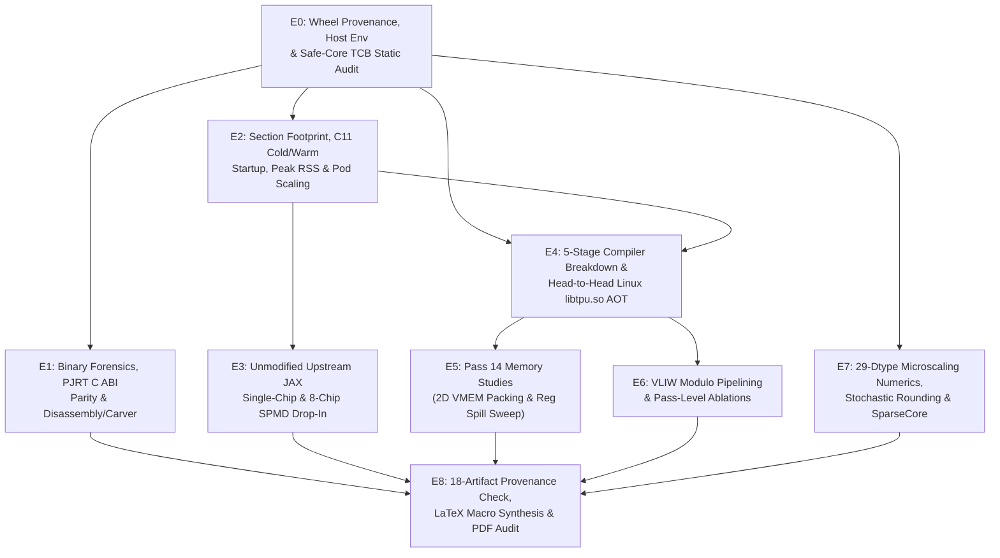

<!-- cspell:words PLDI -->

# Empirical Experiment Suite: `libtpu-pjrt` (`experiments/libtpu-pjrt`)

Clean-room Rust PJRT TPU driver, compiler, and runtime evaluation suite (`PLDI-2027-v1`, substrate
`tpu-slice`) benchmarking **`libtpu-rs`** against Google's closed-source **`libtpu.so`** across
sub-suites **`E0` through `E8`** under **SIGPLAN `RULE-1`–`RULE-7`** statistical and provenance
controls.

The campaign audits wheel/binary provenance and unsafe TCB surface (`E0`), PJRT C ABI layout and
symbol/CFG forensics (`E1`), ELF/Mach-O section footprint, C11 cold/warm client initialization, RSS,
and multi-pod scaling (`E2`), unmodified upstream `jax` single-chip & SPMD drop-in execution (`E3`),
5-stage StableHLO/VHLO AOT compilation latency (`E4`), 2D VMEM buffer packing and register-spill
sweeps (`E5`), VLIW modulo software pipelining and pass ablations (`E6`), 29-dtype microscaling
numerics, stochastic rounding, and 18-optimizer SparseCore throughput (`E7`), and mechanical
18-artifact LaTeX macro emission (`E8`).

---

## Sub-Suite Dependency Graph (`E0`–`E8`)



---

## SIGPLAN Protocol & Prerequisite Gates

### Build, Trial & Hardware Policy (`suite.json`)

- **Pinned Release Profile (`RULE-6`)**: `CARGO_PROFILE_RELEASE_OPT_LEVEL=3`,
  `CARGO_PROFILE_RELEASE_LTO=thin`, `CARGO_PROFILE_RELEASE_CODEGEN_UNITS=1` (`opt3-lto-thin-cgu1`),
  C11 harness compiled with `-std=c11 -O3`, stripped via `strip-unneeded` across `full` and `slim`
  feature variants.
- **Statistical Policy**: `10` untimed warm-up runs and `200` measured trials (`prng_seed: 42`),
  reporting median, `IQR` (25th–75th percentile spread), and `P99` (`[0.25, 0.50, 0.75, 0.99]`).
- **Host Constraints**: Native ISA enforcement (`forbid_binary_translation: true`,
  `prepare_host: true`, `drop_caches_on_cold: true`) on `linux_x64` (`Standard_D160ads_v7`) and
  `macos_arm64` (`mac2.metal`).
- **Static Source Prerequisite Gates (`prereq_checks`)**:
  1. `e4_differential_oracle_pjrt_compile` (`E4`): Confirms `scripts/differential_oracle.py` invokes
     live `PJRT_Compile` rather than a stub.
  2. `e4_hlo_bridge_bounded_fix` (`E4`): Confirms the `Bounded(0)` dynamic-dimension bug is absent
     from `crates/libtpu-core/src/compiler/hlo_bridge.rs`.
  3. `e6_vliw_modulo_scheduler` (`E6`): Confirms `ModuloPipelineScheduler` is implemented in
     `crates/libtpu-core/src/compiler/vliw.rs`.

### Sub-Suite Reference (`E0`–`E8`)

| Sub-Suite | Script Entrypoint                        | LibScript Dependencies                 | Emitted JSON / LaTeX Artifacts                                                     |
| :-------- | :--------------------------------------- | :------------------------------------- | :--------------------------------------------------------------------------------- |
| **`E0`**  | `suites/e0_provenance.{sh,cmd}`          | `tokei`, `libtpu`, `git`               | `e0_env_<arch>.json`, `e0_wheel_provenance.json`, `e0_tcb.json`                    |
| **`E1`**  | `suites/e1_forensics.{sh,cmd}`           | `libtpu`, `libtpu-rs`, `python`        | `e1_abi_parity.json`, `e1_disasm.json`, `e1_carver.json`                           |
| **`E2`**  | `suites/e2_footprint_startup.{sh,cmd}`   | `clang`, `llvm`, `libtpu`, `libtpu-rs` | `e2_footprint_<arch>.json`, `e2_startup_<arch>.json`, `e2_pod_scaling_<arch>.json` |
| **`E3`**  | `suites/e3_jax_e2e.{sh,cmd}`             | `python`, `libtpu-rs`                  | `e3_jax_single.json`, `e3_jax_spmd.json`                                           |
| **`E4`**  | `suites/e4_compiler_aot.{sh,cmd}`        | `clang`, `libtpu`, `libtpu-rs`         | `e4_prereqs.json`, `e4_stages_<arch>.json`, `e4_vs_google_linux_x64.json`          |
| **`E5`**  | `suites/e5_memory_studies.{sh,cmd}`      | `rust`, `libtpu-rs`                    | `e5_vmem_pack.json`, `e5_reg_spill.json`                                           |
| **`E6`**  | `suites/e6_vliw_ablations.{sh,cmd}`      | `rust`, `libtpu-rs`                    | `e6_prereqs.json`, `e6_modulo_speedup.json`, `e6_pass_ablations.json`              |
| **`E7`**  | `suites/e7_numerics_sparsecore.{sh,cmd}` | `rust`, `libtpu-rs`                    | `e7_numerics.json`, `e7_sparsecore.json`                                           |
| **`E8`**  | `suites/e8_latex.{sh,cmd}`               | `texlive`                              | `generated_metrics.tex` (synthesized from 18 verified JSON files)                  |

---

## Configuration Variables & CLI Flags

Variables declared in `experiments/libtpu-pjrt/vars.schema.json` (plus core pass-through flags):

| Environment Variable                                     | CLI Flag (`experiment run`)                         | Default                        | Description                                                                                  |
| :------------------------------------------------------- | :-------------------------------------------------- | :----------------------------- | :------------------------------------------------------------------------------------------- |
| `LIBTPU_RS_SUBSUITES` / `LIBSCRIPT_EXPERIMENT_SUBSUITES` | `--subsuites=<csv>`                                 | `E0,E1,E2,E3,E4,E5,E6,E7,E8`   | Comma-separated sub-suites to run.                                                           |
| `LIBTPU_RS_RESULTS_DIR`                                  | `--results-dir=<dir>`                               | `build/libtpu_results`         | Output directory for the 18 JSON artifacts, compiled workloads, and `generated_metrics.tex`. |
| `LIBTPU_RS_REPO_DIR`                                     | `--repo-dir=<dir>` / `--libtpu-rs-repo-dir=<dir>`   | `../libtpu-rs`                 | Local path to the `libtpu-rs` Cargo workspace.                                               |
| `LIBTPU_RS_GIT_URL`                                      | `--libtpu-rs-git-url=<url>`                         | `""`                           | Optional Git repository cloned automatically if `LIBTPU_RS_REPO_DIR` is missing.             |
| `LIBTPU_RS_PAPER_DIR`                                    | `--paper-dir=<dir>` / `--libtpu-rs-paper-dir=<dir>` | `../new_research/libtpu_paper` | Directory containing `libtpu_paper.tex`.                                                     |
| `LIBTPU_RS_CARGO_PROFILE`                                | `--libtpu-rs-cargo-profile=<id>`                    | `opt3-lto-thin-cgu1`           | Pinned Cargo release profile enforced across Rust builds.                                    |
| `LIBTPU_RS_SLIM_FEATURES`                                | `--libtpu-rs-slim-features=<csv>`                   | Minimal PJRT set               | Feature flags used when building the stripped slim C-ABI shared library variant.             |
| `LIBSCRIPT_EXPERIMENT_WARMUP`                            | _(env var; or `--warmup=<n>` via `run.sh`)_         | `10`                           | Number of untimed warm-up runs per benchmark cell.                                           |
| `LIBSCRIPT_EXPERIMENT_TRIALS`                            | _(env var; or `--trials=<n>` via `run.sh`)_         | `200`                          | Number of measured steady-state trials per benchmark cell.                                   |

> **Note on `--warmup` and `--trials`:** Because `experiments/engine.{sh,cmd}` validates `--k=v`
> flags strictly against `vars.schema.json`, pass custom warmup/trial overrides via environment
> variables
> (`LIBSCRIPT_EXPERIMENT_WARMUP=2 LIBSCRIPT_EXPERIMENT_TRIALS=10 ./libscript.sh experiment run libtpu-pjrt ...`)
> or invoke `./experiments/libtpu-pjrt/run.sh --warmup=2 --trials=10 ...` directly.

---

## How to Run

### 1. Validate the Manifest & Run the Smoke Test

**POSIX (`Linux` / `macOS`):**

```sh
./libscript.sh experiment validate libtpu-pjrt
./libscript.sh experiment test libtpu-pjrt
```

**Windows (`cmd.exe`):**

```cmd
call .\libscript.cmd experiment validate libtpu-pjrt
call .\libscript.cmd experiment test libtpu-pjrt
```

### 2. Offline Deterministic Synthetic-Fixtures Run (`E0`–`E8`)

Compiles a lightweight local C11 mock PJRT shared library and synthetic StableHLO/VHLO workload
suite (`Conv3D`, `FlashAttn`, `MLP`, `SPMD-8`, `SwiGLU`) to exercise every sub-suite `E0`–`E8` and
LaTeX macro emission without requiring Google `libtpu.so` or Cloud TPU hardware:

**POSIX:**

```sh
LIBSCRIPT_EXPERIMENT_WARMUP=1 \
LIBSCRIPT_EXPERIMENT_TRIALS=5 \
./libscript.sh experiment run libtpu-pjrt \
  --synthetic-fixtures \
  --results-dir=./build/libtpu_synthetic
```

**Windows:**

```cmd
set "LIBSCRIPT_EXPERIMENT_WARMUP=1"
set "LIBSCRIPT_EXPERIMENT_TRIALS=5"
call .\libscript.cmd experiment run libtpu-pjrt --synthetic-fixtures "--results-dir=build\libtpu_synthetic"
```

### 3. Run Specific Sub-Suites (e.g., Compiler Stages & VLIW Modulo Scheduling Only)

```sh
./libscript.sh experiment run libtpu-pjrt \
  --subsuites=E0,E2,E4,E6 \
  --repo-dir=/path/to/libtpu-rs \
  --results-dir=./build/libtpu_compiler_focus
```

### 4. Full SIGPLAN 200-Trial Native Hardware Campaign + PDF Build

```sh
# 1. Ensure libtpu-rs and Rust toolchains are provisioned
./libscript.sh experiment provision libtpu-pjrt

# 2. Execute all 9 sub-suites (10 warmup, 200 measured trials) and compile libtpu_paper.tex
./experiments/libtpu-pjrt/run.sh \
  --subsuites=E0,E1,E2,E3,E4,E5,E6,E7,E8 \
  --warmup=10 \
  --trials=200 \
  --repo-dir=/path/to/libtpu-rs \
  --paper-dir=/path/to/new_research/libtpu_paper \
  --results-dir=./build/libtpu_results \
  --build-pdf
```

---

## Expected Output

### 1. Console Output (`E0`–`E8` Execution)

```text
[CONTINUE] processing "./experiments/cli/cli.sh"
[CONTINUE] processing "./experiments/engine.sh"
[CONTINUE] processing "./experiments/libtpu-pjrt/run.sh"
[CONTINUE] processing "./experiments/libtpu-pjrt/benchmark_experiments.sh"
[CONTINUE] processing "./experiments/libtpu-pjrt/suites/e0_provenance.sh"
[INFO] [E0] Completed E0 provenance, environment, and TCB audit in './build/libtpu_synthetic'.
[CONTINUE] processing "./experiments/libtpu-pjrt/suites/e1_forensics.sh"
[INFO] [E1] Completed E1 binary forensics and ABI parity in './build/libtpu_synthetic'.
[CONTINUE] processing "./experiments/libtpu-pjrt/suites/e2_footprint_startup.sh"
[INFO] [E2] Completed E2 footprint, C11 cold/warm startup, RSS, and pod scaling in './build/libtpu_synthetic'.
[CONTINUE] processing "./experiments/libtpu-pjrt/suites/e3_jax_e2e.sh"
[INFO] [E3] Completed E3 stock JAX single-chip and SPMD validation in './build/libtpu_synthetic'.
[CONTINUE] processing "./experiments/libtpu-pjrt/suites/e4_compiler_aot.sh"
[INFO] [E4] Completed E4 5-stage breakdown and AOT comparison in './build/libtpu_synthetic'.
[CONTINUE] processing "./experiments/libtpu-pjrt/suites/e5_memory_studies.sh"
[INFO] [E5] Completed E5 2D VMEM packing and register spill sweep in './build/libtpu_synthetic'.
[CONTINUE] processing "./experiments/libtpu-pjrt/suites/e6_vliw_ablations.sh"
[INFO] [E6] Completed E6 VLIW modulo speedup and pass ablations in './build/libtpu_synthetic'.
[CONTINUE] processing "./experiments/libtpu-pjrt/suites/e7_numerics_sparsecore.sh"
[INFO] [E7] Completed E7 29-dtype numerics and 18-optimizer SparseCore suite in './build/libtpu_synthetic'.
[CONTINUE] processing "./experiments/libtpu-pjrt/suites/e8_latex.sh"
[INFO] [E8] Emitted verified LaTeX metrics to './build/libtpu_synthetic/generated_metrics.tex' (18 provenance-checked JSON files).
[INFO] Completed libtpu empirical suites (E0,E1,E2,E3,E4,E5,E6,E7,E8) -> ./build/libtpu_synthetic/campaign_summary.json
```

### 2. Generated Artifact Directory Structure

```text
build/libtpu_results/
├── campaign_summary.json             # Overall PASS/FAIL, ISA, warmup/trials & Cargo profile
├── cargo_profile.json                # Verified opt3-lto-thin-cgu1 compiler flags
├── e0_env_<arch>.json                # Host CPU, kernel, Rust/Clang versions
├── e0_tcb.json                       # First-party SLOC & unsafe block count in safe core
├── e0_wheel_provenance.json          # Upstream libtpu wheel SHA-256 & binary size
├── e1_abi_parity.json                # PJRT_Api struct byte size & function-table offset parity
├── e1_carver.json                    # Embedded protobuf descriptor & section carving stats
├── e1_disasm.json                    # .eh_frame FDE counts, prologue & CFG metrics
├── e2_footprint_<arch>.json          # Full vs. slim stripped shared-lib section sizes
├── e2_startup_<arch>.json            # Cold/warm dlopen + PJRT_Client_Create latency quantiles
├── e2_pod_scaling_<arch>.json        # Multi-process RSS & pod topology initialization scaling
├── e3_jax_single.json                # Stock jax.jit max relative error vs. reference
├── e3_jax_spmd.json                  # 8-device SPMD collective parity
├── e4_prereqs.json                   # Static source gate verification record for E4
├── e4_stages_<arch>.json             # 5-stage compiler pass latency breakdown
├── e4_vs_google_linux_x64.json       # Head-to-head AOT compile time vs. Google libtpu.so
├── e5_vmem_pack.json                 # 2D VMEM packing memory reduction %
├── e5_reg_spill.json                 # Register pressure & spill sweep curves
├── e6_prereqs.json                   # Static source gate verification record for E6
├── e6_modulo_speedup.json            # VLIW modulo software pipelining speedup ratios
├── e6_pass_ablations.json            # Per-pass compiler optimization ablations
├── e7_numerics.json                  # 29-dtype microscaling & stochastic rounding ULP accuracy
├── e7_sparsecore.json                # 18-optimizer SparseCore row-ops/s throughput
├── generated_metrics.tex             # Mechanically emitted LaTeX macros for libtpu_paper.tex
└── workloads/                        # Materialized MLIR & VHLO bytecode workloads
    ├── Conv3D.{param.mlir,param.vhlo.bc,splat.mlir}
    ├── FlashAttn.{param.mlir,param.vhlo.bc,splat.mlir}
    ├── MLP.{param.mlir,param.vhlo.bc,splat.mlir}
    ├── SPMD-8.{param.mlir,param.vhlo.bc,splat.mlir}
    └── SwiGLU.{param.mlir,param.vhlo.bc,splat.mlir}
```

### 3. Sample `campaign_summary.json` & `generated_metrics.tex`

**`campaign_summary.json`:**

```json
{
  "schema_version": "1.0.0",
  "suite": "libtpu",
  "subsuites": "E0,E1,E2,E3,E4,E5,E6,E7,E8",
  "host_arch": "linux_x64",
  "warmup": 10,
  "trials": 200,
  "cargo_profile": "opt3-lto-thin-cgu1",
  "status": "PASS"
}
```

**`generated_metrics.tex`:**

```tex
% Mechanically generated by LibScript Suite E8 (SIGPLAN RULE-1) — DO NOT EDIT BY HAND
% Verified JSON artifacts: 18 | Pinned Git SHA: <commit-sha>
\newcommand{\MetricLibtpuSoSizeMB}{...}
\newcommand{\MetricFirstPartySLOC}{...}
\newcommand{\MetricSafeCoreUnsafeSites}{0}
\newcommand{\MetricPjrtApiBytes}{1144}
\newcommand{\MetricEhFrameFdes}{...}
\newcommand{\MetricProtoDescriptors}{...}
\newcommand{\MetricRustStrippedLinuxMB}{...}
\newcommand{\MetricWarmClientInitMedMs}{...}
\newcommand{\MetricPeakRssMiB}{...}
\newcommand{\MetricJaxMaxRelErr}{...}
\newcommand{\MetricVmemSavedMaxPct}{...}
\newcommand{\MetricModuloMaxSpeedupX}{...}
\newcommand{\MetricSparseCoreRowOpsMedM}{...}
```
