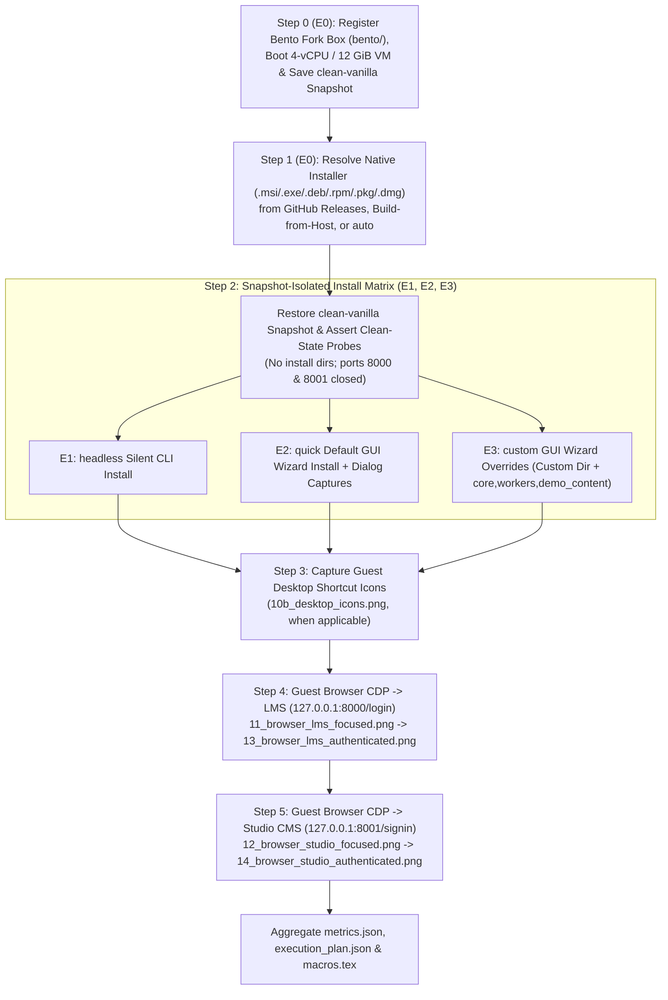

# Open edX Multi-OS Vagrant, Native Installer & Guest-UI Verification Suite (`experiments/openedx`)

Declarative `installer-e2e` campaign (`protocol_version: 1.0.0`) verifying native **Open edX**
packages (`.msi`, `.exe`, `.deb`, `.rpm`, `.pkg`, `.dmg`) across clean **Bento fork Vagrant VMs**
via `_lib/_common/experiment/pkg_ui_runner.{sh,cmd}` and `_lib/web-apps/openedx/packaging.json` with
**zero application-specific orchestration code**.

Because all URLs, ports, credentials, CSS selectors, and desktop shortcut expectations are inherited
declaratively from `_lib/web-apps/openedx/packaging.json` (`.verification.screenshots`), the exact
same runner powers WordPress, Odoo, or any packaged Tier 1 web application without code changes.

---

## End-to-End 6-Step Verification Lifecycle (`E0`–`E3`)



---

## Supported Guest OS, Provider & Package Matrix

### Target Guest Operating Systems (`suite.json` -> `.installer_e2e.vagrant.supported_guest_oses`)

| `TARGET_OS` (`--target-os`)                 | Default Bento Box       | Native Formats (`--pkg-format=auto`) | Clean-State Probe Paths                        |
| :------------------------------------------ | :---------------------- | :----------------------------------- | :--------------------------------------------- |
| `windows-11` _(default on Windows hosts)_   | `bento/windows-11`      | `msi` _(default)_, `exe`             | `C:/Program Files/OpenEdX`, `C:/OpenEdXCustom` |
| `debian-13` _(default on Linux/BSD hosts)_  | `bento/debian-13`       | `deb`                                | `/opt/openedx`, `/opt/openedx-custom`          |
| `rockylinux-10.2`                           | `bento/rockylinux-10.2` | `rpm`                                | `/opt/openedx`, `/opt/openedx-custom`          |
| `freebsd-15.1`                              | `bento/freebsd-15.1`    | `pkg`                                | `/opt/openedx`, `/opt/openedx-custom`          |
| `macos-14-arm64` _(default on macOS ARM64)_ | `bento/macos-14-arm64`  | `pkg` _(default)_, `dmg`             | `/opt/openedx`, `/opt/openedx-custom`          |
| `alpine-3.24`                               | `bento/alpine-3.24`     | Native package                       | `/opt/openedx`, `/opt/openedx-custom`          |
| `omnios`                                    | `bento/omnios`          | Native package                       | `/opt/openedx`, `/opt/openedx-custom`          |

- **Supported Hypervisor Providers (`--provider`)**: `auto` (detects host hypervisor), `virtualbox`,
  `libvirt`, `hyperv`, `vmware_desktop`, `qemu`, `utm`.
- **Clean-State Port Probes**: Asserts TCP ports `8000` (LMS) and `8001` (Studio CMS) are closed
  after every `clean-vanilla` snapshot restore prior to launching each install mode.
- **Custom Mode Overrides (`E3`)**: Overrides install root to `C:\OpenEdXCustom` (Windows) or
  `/opt/openedx-custom` (POSIX) and enables feature set `["core", "workers", "demo_content"]`.
- **Guest Browser Preference**: `msedge` -> `chromium` -> `google-chrome` -> `firefox` with a
  `300`-second service readiness window (`service_ready_timeout_sec: 300`).

---

## Configuration Variables & CLI Flags

All variables in `experiments/openedx/vars.schema.json` can be exported in the environment or passed
via `--kebab-case=value` to `./libscript.sh experiment <verb> openedx`:

| Environment Variable | CLI Flag                      | Default                     | Description                                                                                                                                    |
| :------------------- | :---------------------------- | :-------------------------- | :--------------------------------------------------------------------------------------------------------------------------------------------- |
| `TARGET_OS`          | `--target-os=<os>`            | `auto`                      | Guest OS (`windows-11`, `debian-13`, `rockylinux-10.2`, `freebsd-15.1`, `macos-14-arm64`, `alpine-3.24`, `omnios`, or `auto`).                 |
| `BENTO_PREFIX`       | `--bento-prefix=<org>`        | `bento`                     | Vagrant box namespace or fork prefix (e.g., `bento` or `custom-bento`).                                                                        |
| `BENTO_DIR`          | `--bento-dir=<path>`          | `""`                        | Optional local checkout of a Bento fork (`builds/<provider>/<os>.box`) registered before remote lookup.                                        |
| `PROVIDER`           | `--provider=<prov>`           | `auto`                      | Vagrant provider (`auto`, `virtualbox`, `libvirt`, `hyperv`, `vmware_desktop`, `qemu`, `utm`).                                                 |
| `PKG_FORMAT`         | `--pkg-format=<fmt>`          | `auto`                      | Installer format (`auto`, `msi`, `exe`, `deb`, `rpm`, `pkg`, `dmg`).                                                                           |
| `PKG_SOURCE`         | `--pkg-source=<mode>`         | `auto`                      | Artifact source: `github-release`, `build-from-host`, or `auto` (downloads release asset if published, else builds offline installer on host). |
| `RELEASE_REPO`       | `--release-repo=<owner/repo>` | `SamuelMarks/libscript`     | GitHub repository queried when resolving release installer assets.                                                                             |
| `RELEASE_TAG`        | `--release-tag=<tag>`         | `latest`                    | GitHub Release tag (`latest` or explicit tag such as `v0.4.0`).                                                                                |
| `INSTALL_MODES`      | `--install-modes=<csv>`       | `headless,quick,custom`     | Comma-separated install modes executed sequentially from clean snapshots.                                                                      |
| `FORCE_REBUILD`      | `--force-rebuild=0\|1`        | `0`                         | Forces fresh host package rebuild or bypasses cached dry-run stamp (`1`).                                                                      |
| `DRY_RUN`            | `--dry-run=0\|1`              | `0`                         | Emits `execution_plan.json` and `metrics.json` without booting a hypervisor (`1`).                                                             |
| `RESULTS_DIR`        | `--results-dir=<dir>`         | `build/experiments/openedx` | Output directory for `metrics.json`, `execution_plan.json`, `macros.tex`, and screenshots.                                                     |
| `DESTROY_VM`         | `--destroy-vm=0\|1`           | `0`                         | Destroys (`1`) instead of halting (`0`) the Vagrant VM during `teardown`.                                                                      |

---

## How to Run

### 1. Validate Manifest & Run Hermetic Multi-OS / Multi-App Test Suite

`test.{sh,cmd}` validates `openedx`, verifies the multi-OS dry-run plan across Windows
`.msi`/`.exe`, Debian `.deb`, Rocky `.rpm`, and macOS `.pkg`/`.dmg`, checks 2x idempotency
(`[SKIP]`), and proves zero-code reuse by scaffolding temporary WordPress and Odoo suites:

**POSIX (`Linux` / `macOS` / `FreeBSD` / `illumos`):**

```sh
./libscript.sh experiment validate openedx
./libscript.sh experiment test openedx
```

**Windows (`cmd.exe`):**

```cmd
call .\libscript.cmd experiment validate openedx
call .\libscript.cmd experiment test openedx
```

### 2. Inspect Resolved Execution Plan in Dry-Run Mode (`--dry-run=1`)

**POSIX:**

```sh
./libscript.sh experiment run openedx \
  --dry-run=1 \
  --target-os=windows-11 \
  --pkg-format=msi \
  --pkg-source=github-release \
  --results-dir=./build/experiments/openedx-win11-plan
```

**Windows:**

```cmd
call .\libscript.cmd experiment run openedx "--dry-run=1" "--target-os=windows-11" "--pkg-format=msi" "--pkg-source=github-release" "--results-dir=build\experiments\openedx-win11-plan"
```

### 3. Full Live Multi-OS Campaigns

```sh
# Windows 11 Bento VM: pull published .msi from GitHub Releases and verify headless + quick + custom
./libscript.sh experiment run openedx \
  --target-os=windows-11 \
  --pkg-format=msi \
  --pkg-source=github-release

# Debian 13 Bento VM (custom Bento fork checkout): build offline .deb on host and verify all 3 modes
./libscript.sh experiment run openedx \
  --bento-prefix=bento \
  --bento-dir=/path/to/bento \
  --target-os=debian-13 \
  --pkg-format=deb \
  --pkg-source=build-from-host \
  --force-rebuild=1

# Rocky Linux 10.2 Bento VM: auto-resolve .rpm (release if available, else build-from-host)
./libscript.sh experiment run openedx \
  --target-os=rockylinux-10.2 \
  --pkg-format=rpm \
  --pkg-source=auto

# macOS 14 ARM64 Bento VM via UTM/QEMU: verify .pkg installer in headless & quick modes
./libscript.sh experiment run openedx \
  --target-os=macos-14-arm64 \
  --provider=utm \
  --pkg-format=pkg \
  --install-modes=headless,quick
```

### 4. Step-by-Step Lifecycle Control (`provision`, `sync`, `collect`, `render-latex`, `teardown`)

```sh
./libscript.sh experiment provision openedx --target-os=debian-13 --provider=qemu
./libscript.sh experiment sync openedx --target-os=debian-13 --pkg-format=deb --pkg-source=auto
./libscript.sh experiment run openedx --target-os=debian-13 --pkg-format=deb
./libscript.sh experiment collect openedx --results-dir=./build/experiments/openedx
./libscript.sh experiment render-latex openedx --results-dir=./build/experiments/openedx
DESTROY_VM=1 ./libscript.sh experiment teardown openedx --target-os=debian-13 --provider=qemu
```

---

## Expected Output

### 1. Console Output across Lifecycle Verbs

```text
$ ./libscript.sh experiment validate openedx
[CONTINUE] processing "./cli/commands/experiment/cli.sh"
[CONTINUE] processing "./experiments/engine.sh"
[PASS] Experiment suite "openedx" validated cleanly.

$ ./libscript.sh experiment run openedx --dry-run=1 --target-os=windows-11 --pkg-format=msi --pkg-source=github-release --results-dir=./build/experiments/openedx-win11-plan
[CONTINUE] processing "./cli/commands/experiment/cli.sh"
[CONTINUE] processing "./experiments/engine.sh"
[OK] Dry-run installer-e2e plan emitted -> ./build/experiments/openedx-win11-plan/execution_plan.json

# Re-running the exact same dry-run configuration demonstrates 2x idempotency:
$ ./libscript.sh experiment run openedx --dry-run=1 --target-os=windows-11 --pkg-format=msi --pkg-source=github-release --results-dir=./build/experiments/openedx-win11-plan
[CONTINUE] processing "./cli/commands/experiment/cli.sh"
[CONTINUE] processing "./experiments/engine.sh"
[SKIP] Dry-run plan for openedx (windows-11/msi) already converged at ./build/experiments/openedx-win11-plan

# Smoke test output:
$ ./libscript.sh experiment test openedx
[PASS] Open edX installer-e2e experiment & generic web-app reusability verified.
```

During live hypervisor execution (`--dry-run=0`), phase transitions emit:

```text
[PROVISION] Prepared Vagrant workspace for bento/debian-13 (qemu)
[SYNC] Synchronized installer artifact for openedx (deb)
[OK] Completed installer-e2e experiment for openedx (debian-13/deb) -> ./build/experiments/openedx/metrics.json
[TEARDOWN] Halted Vagrant workspace ./tests_tmp/experiments/openedx/debian-13-qemu
```

### 2. Generated Artifact Directory Structure

```text
build/experiments/openedx/
├── execution_plan.json                        # Resolved VM, package & verification DAG (--dry-run=1)
├── metrics.json                               # Provenance-stamped per-mode results & SHA-256
├── macros.tex                                 # LaTeX suite identifier (\newcommand{\ExpSuiteId}{openedx})
└── modes/
    ├── headless/
    │   ├── mode_result.json
    │   └── screenshots/
    │       ├── 10b_desktop_icons.png
    │       ├── 11_browser_lms_focused.png
    │       ├── 13_browser_lms_authenticated.png
    │       ├── 12_browser_studio_focused.png
    │       └── 14_browser_studio_authenticated.png
    ├── quick/
    │   ├── mode_result.json
    │   └── screenshots/
    │       ├── 01_wizard_welcome.png ...      # Installer GUI wizard dialog captures
    │       ├── 10b_desktop_icons.png
    │       ├── 11_browser_lms_focused.png
    │       ├── 13_browser_lms_authenticated.png
    │       ├── 12_browser_studio_focused.png
    │       └── 14_browser_studio_authenticated.png
    └── custom/
        ├── mode_result.json
        └── screenshots/
            ├── 01_wizard_custom_dir.png ...   # Custom install dir & feature selection captures
            ├── 10b_desktop_icons.png
            ├── 11_browser_lms_focused.png
            ├── 13_browser_lms_authenticated.png
            ├── 12_browser_studio_focused.png
            └── 14_browser_studio_authenticated.png
```

### 3. Sample `execution_plan.json` / `metrics.json`

```json
{
  "suite_id": "openedx",
  "application": "Open edX Platform",
  "application_version": "sumac.2",
  "git_commit": "dea275eee",
  "generated_at": "2026-11-21T12:00:00Z",
  "host_os": "darwin",
  "host_arch": "arm64",
  "vagrant": {
    "bento_box": "bento/windows-11",
    "target_os": "windows-11",
    "os_family": "windows",
    "provider": "qemu",
    "vanilla_snapshot": "clean-vanilla"
  },
  "artifact": {
    "format": "msi",
    "source": "github-release",
    "release_repo": "SamuelMarks/libscript",
    "release_tag": "latest",
    "resolved_path": "...",
    "sha256": "..."
  },
  "mode_results": [
    {
      "mode": "headless",
      "snapshot_restored": "clean-vanilla",
      "status": "passed",
      "verification_steps": [
        "10b_desktop_icons",
        "11_browser_lms_focused",
        "13_browser_lms_authenticated",
        "12_browser_studio_focused",
        "14_browser_studio_authenticated"
      ]
    },
    {
      "mode": "quick",
      "snapshot_restored": "clean-vanilla",
      "status": "passed",
      "verification_steps": [
        "10b_desktop_icons",
        "11_browser_lms_focused",
        "13_browser_lms_authenticated",
        "12_browser_studio_focused",
        "14_browser_studio_authenticated"
      ]
    },
    {
      "mode": "custom",
      "snapshot_restored": "clean-vanilla",
      "status": "passed",
      "verification_steps": [
        "10b_desktop_icons",
        "11_browser_lms_focused",
        "13_browser_lms_authenticated",
        "12_browser_studio_focused",
        "14_browser_studio_authenticated"
      ]
    }
  ],
  "status": "passed"
}
```
