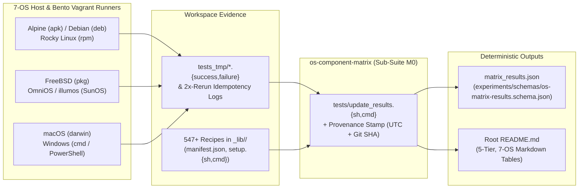

# 7-OS Component Compatibility & 2x-Idempotency Matrix (`experiments/os-component-matrix`)

Release-engineering and empirical compatibility aggregation plugin (`protocol_version: 1.0.0`,
substrate `vagrant-os-matrix`, sub-suite `M0`) coordinating component smoke and **2x-rerun
idempotency** results across **all 7 target operating system families** (`alpine`, `debian`,
`rockylinux`, `freebsd`, `omnios`, `macos`, and `windows`).

The runner invokes `tests/update_results.{sh,cmd}` to inspect `.success` / `.failure` markers in
`tests_tmp/` alongside architectural metadata across `_lib/<category>/<component>/`, emits a
provenance-stamped `matrix_results.json` conforming to
`experiments/schemas/os-matrix-results.schema.json` (`generated_at` UTC ISO-8601 timestamp +
`git_commit` SHA), and deterministically regenerates the 5-tier **Supported Components** tables in
`README.md`.

---

## Multi-OS Aggregation & Synthesis Dataflow (`M0`)



---

## Evaluated 7-OS Matrix & Architectural Tiers

### 7 Target Operating System Columns (`experiments/schemas/os-matrix-results.schema.json`)

| `suite.json` OS ID | JSON Field | `README.md` Column | Primary Package / Script Substrate                            |
| :----------------- | :--------- | :----------------- | :------------------------------------------------------------ |
| `alpine`           | `apk`      | Linux (`apk`)      | Alpine Linux (`musl`, `apk`, OpenRC)                          |
| `debian`           | `deb`      | Linux (`deb`)      | Debian / Ubuntu (`glibc`, `apt`/`dpkg`, `systemd`)            |
| `rockylinux`       | `rpm`      | Linux (`rpm`)      | Rocky Linux / RHEL / Fedora (`dnf`/`rpm`, `systemd`)          |
| `windows`          | `windows`  | Windows            | Windows 11 / Server (`setup_win.cmd`, PowerShell, MSI/winget) |
| `omnios`           | `sunos`    | illumos (`SunOS`)  | OmniOS (`pkg(5)`, SMF, Crossbow/Zones)                        |
| `freebsd`          | `freebsd`  | FreeBSD            | FreeBSD 14/15 (`pkg`, `rc.d`, Jails/bhyve)                    |
| `macos`            | `macos`    | macOS              | macOS ARM64 / x86_64 (`launchd`, native tarballs/pkg/dmg)     |

### 5 Architectural Tiers (`tier` Enum)

| Tier  | Scope                                                                                                                                 |
| :---: | :------------------------------------------------------------------------------------------------------------------------------------ |
|  `1`  | Leaf software recipes: languages, toolchains, databases, caches, web servers, web apps, runtimes, AI serving, ML training, utilities. |
| `1.5` | Base userland catalogs, init systems (`systemd`, `OpenRC`, `runit`, `s6`), display servers, and desktop environments.                 |
|  `2`  | Disk, VM, container, and native installer packaging targets (`qcow2`, `iso`, `msi`, `deb`, `rpm`, `pkg`, `dmg`).                      |
|  `3`  | Kernel, unikernel (`OSv`, `MirageOS`, `Unikraft`), RTOS (`Zephyr`, `FreeRTOS`), BSD, illumos, and ReactOS builders.                   |
|  `4`  | Multi-node cluster orchestrators (`k8s`, `k0s`, `mesos`, `nomad`), cloud providers, and HA topologies.                                |

---

## Configuration Variables & CLI Flags

Variables declared in `experiments/os-component-matrix/vars.schema.json` (plus core pass-through
flags):

| Environment Variable | CLI Flag (`experiment run`) | Default                                 | Description                                                                                   |
| :------------------- | :-------------------------- | :-------------------------------------- | :-------------------------------------------------------------------------------------------- |
| `OS_FILTER`          | `--os-filter=<csv\|all>`    | `all`                                   | Comma-separated OS subset (`alpine,debian,rockylinux,freebsd,omnios,macos,windows`) or `all`. |
| `README_OUT`         | `--readme-out=<path>`       | `./README.md`                           | Target Markdown file updated with the 5-tier, 7-OS Supported Components tables.               |
| `RESULTS_DIR`        | `--results-dir=<dir>`       | `build/experiments/os-component-matrix` | Directory receiving provenance-stamped `matrix_results.json`.                                 |

---

## How to Run

### 1. Validate the Manifest & Run the Smoke Test

**POSIX (`Linux` / `macOS` / `FreeBSD` / `illumos`):**

```sh
./libscript.sh experiment validate os-component-matrix
./libscript.sh experiment test os-component-matrix
```

**Windows (`cmd.exe`):**

```cmd
call .\libscript.cmd experiment validate os-component-matrix
call .\libscript.cmd experiment test os-component-matrix
```

### 2. Non-Destructive Staging Preview (Without Modifying Root `README.md`)

Copy `README.md` to a temporary path and pass `--readme-out` so you can inspect
`matrix_results.json` and the rendered Markdown diff without touching tracked repository files:

**POSIX:**

```sh
mkdir -p ./build/matrix_preview
cp ./README.md ./build/matrix_preview/README.preview.md

./libscript.sh experiment run os-component-matrix \
  --results-dir=./build/matrix_preview \
  --readme-out=./build/matrix_preview/README.preview.md
```

**Windows:**

```cmd
if not exist build\matrix_preview mkdir build\matrix_preview
copy /Y README.md build\matrix_preview\README.preview.md >nul

call .\libscript.cmd experiment run os-component-matrix "--results-dir=build\matrix_preview" "--readme-out=build\matrix_preview\README.preview.md"
```

### 3. Regenerate Root `README.md` & `matrix_results.json`

```sh
# Via the experiment plugin (emits both matrix_results.json and updates README.md):
./libscript.sh experiment run os-component-matrix

# Or via the convenience verb delegating directly to tests/update_results.{sh,cmd}:
./libscript.sh experiment update-readme
```

### 4. Full End-to-End Multi-OS Bento Vagrant Campaign + Matrix Synthesis

Pair `rapid-experiment` (see [`../../EXPERIMENTS.md`](../../EXPERIMENTS.md)) with
`os-component-matrix` to collect fresh `.success` / `.failure` markers from clean Bento VMs before
synthesizing `matrix_results.json`:

```sh
# 1. Boot clean Bento multi-OS Vagrant matrix on a cloud or bare-metal host and run component tests
./libscript.sh rapid-experiment all --provider azure --multi-os --pull-results ./tests_tmp

# 2. Aggregate collected markers into matrix_results.json and update root README.md
./libscript.sh experiment run os-component-matrix \
  --results-dir=./build/experiments/os-component-matrix \
  --readme-out=./README.md
```

---

## Expected Output

### 1. Console Output

```text
[CONTINUE] processing "./experiments/cli/cli.sh"
[CONTINUE] processing "./experiments/engine.sh"
[CONTINUE] processing "./experiments/os-component-matrix/run.sh"
[CONTINUE] processing "./tests/update_results.sh"
[INFO] Scanning component catalog across _lib/ and test markers in ./tests_tmp ...
[INFO] Wrote JSON compatibility matrix -> ./build/experiments/os-component-matrix/matrix_results.json
[INFO] Updated Supported Components tables in ./README.md
[OK] Emitted provenance-stamped 7-OS matrix -> ./build/experiments/os-component-matrix/matrix_results.json
```

### 2. Generated Artifact Directory Structure

```text
build/experiments/os-component-matrix/
└── matrix_results.json      # Schema-validated 7-OS & 5-tier compatibility + provenance JSON
```

Plus updated Supported Components tables inside `--readme-out` (default `./README.md`).

### 3. Sample `matrix_results.json` (`experiments/schemas/os-matrix-results.schema.json`)

```json
{
  "generated_at": "2026-11-21T12:00:00Z",
  "git_commit": "dea275eee",
  "components": [
    {
      "component": "nodejs",
      "category": "languages",
      "tier": "1",
      "idempotent": "2x-verified",
      "apk": "✅",
      "deb": "✅",
      "rpm": "✅",
      "windows": "✅",
      "sunos": "✅",
      "freebsd": "✅",
      "macos": "✅"
    },
    {
      "component": "postgres",
      "category": "databases",
      "tier": "1",
      "idempotent": "2x-verified",
      "apk": "✅",
      "deb": "✅",
      "rpm": "✅",
      "windows": "✅",
      "sunos": "✅",
      "freebsd": "✅",
      "macos": "✅"
    }
  ]
}
```

### 4. Sample Synthesized Markdown Table Row (`README.md`)

```markdown
| Component  | Category    | Idempotency | Linux (`apk`) | Linux (`deb`) | Linux (`rpm`) | Windows | illumos (`SunOS`) | FreeBSD | macOS |
| :--------- | :---------- | :---------: | :-----------: | :-----------: | :-----------: | :-----: | :---------------: | :-----: | :---: |
| `nodejs`   | `languages` |    `2x`     |      ✅       |      ✅       |      ✅       |   ✅    |        ✅         |   ✅    |  ✅   |
| `postgres` | `databases` |    `2x`     |      ✅       |      ✅       |      ✅       |   ✅    |        ✅         |   ✅    |  ✅   |
```
