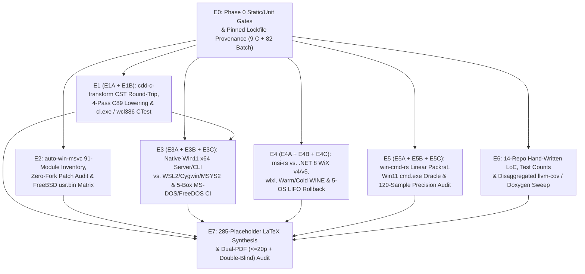

<!-- cspell:words PLDI -->

# Empirical Experiment Suite: `win-port` (`experiments/win-port`)

Reproducible 14-repository portability, compiler-lowering, installer-transaction, and shell-analysis
evaluation campaign (`PLDI-2027-win-port-v1`, substrate `vagrant-os-matrix`) across sub-suites
**`E0` through `E7`**.

The suite benchmarks **4 core clean-room systems** (`cdd-c`, `auto-win-msvc`, `msi-rs`,
`win-cmd-rs`), **1 Vagrant image builder** (`bento`), and **9 upstream C systems ports**
(`busybox-windows`, `toybox-windows`, `dash-windows`, `gawk-windows`, `jq-windows`,
`memcached-windows`, `redis-windows`, `valkey-windows`, `freebsd-usr-bin-windows`, anchored against
`freebsd-src`) across **6 native hardware/VM targets** (`macos_arm64`, `linux_x64`, `windows_x64`,
`freebsd_x64`, `illumos_x64`, and 32-bit `dos32_le` across MS-DOS 1.25/2.0/4.0 & FreeDOS 1.3/1.4
COM1 Vagrant VMs) and mechanically synthesizes **all 285 LaTeX placeholders** (`283` in
`win_port_paper.tex` + `2` in `win_port_appendix.tex`).

---

## Sub-Suite Architecture & Evaluation DAG (`E0`–`E7`)



---

## Evaluated 14-Repository Ecosystem & Experimental Protocol

### Ecosystem Repositories (`suite.json` -> `.ecosystem_repos`)

| Role           | Repositories                                                                                                                                                         | Languages                   | Primary Subsystem Evaluated                                                                                                                                  |
| :------------- | :------------------------------------------------------------------------------------------------------------------------------------------------------------------- | :-------------------------- | :----------------------------------------------------------------------------------------------------------------------------------------------------------- |
| `core_tool`    | `cdd-c`, `auto-win-msvc`, `msi-rs`, `win-cmd-rs`                                                                                                                     | C89, CMake/C11, Rust (2021) | Lossless CST C11->C89/MSVC/Watcom lowering, 91-shim POSIX->Win32/DOS layer, clean-room MSI/CAB/ICE/rollback engine, Packrat Batch parser/linter/interpreter. |
| `infra`        | `bento`                                                                                                                                                              | Packer / HCL2 / Ruby        | Multi-OS & MS-DOS/FreeDOS Vagrant image bakery.                                                                                                              |
| `port_harness` | `busybox-windows`, `toybox-windows`, `dash-windows`, `gawk-windows`, `jq-windows`, `memcached-windows`, `redis-windows`, `valkey-windows`, `freebsd-usr-bin-windows` | Python / CMake              | Zero-fork native MSVC (`/MT`, `/MD`) and OpenWatcom (`dos32a`) downstream ports.                                                                             |
| `upstream_ref` | `freebsd-src`                                                                                                                                                        | C89 / C11                   | Reference `usr.bin` upstream tree audited in `E2`.                                                                                                           |

### Statistical, Build & Execution Baselines

- **Statistical Policy**: `5` untimed warm-up runs and `30` measured trials per cell
  (`prng_seed: 202705`), reporting median, `IQR` (25th–75th percentile spread), and `P99`
  (`[0.25, 0.50, 0.75, 0.99]`).
- **Pinned Profiles**: Rust `OPT_LEVEL=3`, `LTO=thin`, `CODEGEN_UNITS=1`,
  `cargo_forbid_unsafe: true`; C89 strict flags
  `-std=c89 -Wdeclaration-after-statement -Wall -Wextra -pedantic -Werror`; MSVC `/O2 /DNDEBUG /W4`
  (`/MT` & `/MD`); OpenWatcom `-bt=dos -mf -3r -ox`.
- **9 Execution Modes**: `native_only`, `wine_warm`, `wine_cold`, `wsl2_loopback`,
  `wsl2_cross_boundary`, `wsl2_cli_spawn`, `cygwin`, `msys2`, `dos32_vagrant_com1`.
- **3 Phase 0 Static Prerequisite Checks**:
  1. `awm_use_cdd_c` (`auto-win-msvc`): Verifies `AutoWinMsvcTransform.cmake` invokes
     `cdd-c-transform`.
  2. `wincmd_packrat_keys` (`win-cmd-rs`): Verifies `CompoundBlock|IfStmt|ForStmt` memoization keys
     in `src/parser/peg.rs` for linear $O(n)$ Packrat parsing.
  3. `msi_affine_drop_guard` (`msi-rs`): Verifies `Transaction<Executed>` affine `Drop` and
     worker-EOF LIFO rollback in `crates/msi/src/execution/transaction/mod.rs`.

---

## Sub-Suite Reference (`E0`–`E7`)

| Sub-Suite | Internal Stages                                                | LibScript Dependencies                                                                            | Emitted Artifacts (`build/win_port_results/`)                                                                                                                             |
| :-------- | :------------------------------------------------------------- | :------------------------------------------------------------------------------------------------ | :------------------------------------------------------------------------------------------------------------------------------------------------------------------------ |
| **`E0`**  | `e0_phase0_gates`                                              | `cdd-c`, `auto-win-msvc`, `win-cmd-rs`, `msi-rs`, `tokei`                                         | `raw/metadata.json`, `raw/e0_phase0_gates.json`                                                                                                                           |
| **`E1`**  | `e1a_cdd_eval`, `e1b_downstream_builds`                        | `cdd-c`, `auto-win-msvc`, `msvc`, `openwatcom`                                                    | `raw/e1_cdd_transform.json`, `raw/e1b_downstream_compile_ctest.json`, `raw/listings/*.c`                                                                                  |
| **`E2`**  | `e2_port_audit`                                                | `tokei`                                                                                           | `raw/e2_port_audit.json` (91 modules, zero-fork patch audit & FreeBSD `usr.bin` matrix)                                                                                   |
| **`E3`**  | `e3a_win64_servers`, `e3b_win64_cli`, `e3c_dos_matrix`         | `msvc`, `cygwin`, `msys2`, `wsl`, `hyperfine`, `memtier-benchmark`, `openwatcom`, `bento-builder` | `raw/e3a_win64_servers.json`, `raw/e3b_win64_cli.json`, `raw/e3c_dos_matrix.json`, `dos_boxes/dos_{msdos-1.25,msdos-2.0,msdos-4.0,freedos-1.3,freedos-1.4}.json`          |
| **`E4`**  | `e4a_msi_authoring`, `e4b_wine_matrix`, `e4c_msi_rollback`     | `msi-rs`, `wix`, `msitools`, `wine`, `hyperfine`                                                  | `raw/e4a_msi_authoring.json`, `raw/e4b_wine_{warm,cold}_{Linux_x86_64,Darwin_arm64}.json`, `raw/e4c_msi_rollback.json`                                                    |
| **`E5`**  | `e5a_wincheck_corpus`, `e5b_cmd_oracle`, `e5c_precision_audit` | `win-cmd-rs`, `hyperfine`                                                                         | `raw/e5a_wincheck_corpus.json`, `raw/e5b_win11_ground_truth.json`, `raw/e5b_cmd_oracle_comparison.json`, `raw/e5c_precision_sample.csv`, `raw/e5c_precision_summary.json` |
| **`E6`**  | `e6_ecosystem_rigor`                                           | `tokei`, `llvm`, `cargo-llvm-cov`, `doxygen`                                                      | `raw/e6_ecosystem_rigor.json`                                                                                                                                             |
| **`E7`**  | `e7_latex_verify`                                              | `texlive`                                                                                         | `generated_metrics.tex` (all 285 `\wpMetric...` macros + optional dual-PDF verification)                                                                                  |

---

## Configuration Variables & CLI Flags

Variables declared in `experiments/win-port/vars.schema.json` (plus core pass-through flags):

| Environment Variable           | CLI Flag (`experiment run`)                                | Default                          | Description                                                                                                  |
| :----------------------------- | :--------------------------------------------------------- | :------------------------------- | :----------------------------------------------------------------------------------------------------------- |
| `WIN_PORT_SUITE_SUBSUITES`     | `--subsuites=<csv>`                                        | `E0,E1,E2,E3,E4,E5,E6,E7`        | Comma-separated sub-suites to run.                                                                           |
| `WIN_PORT_SUITE_RESULTS_DIR`   | `--results-dir=<dir>`                                      | `build/win_port_results`         | Output directory for `raw/*.json`, `dos_boxes/*.json`, `campaign_summary.json`, and `generated_metrics.tex`. |
| `WIN_PORT_SUITE_ECOSYSTEM_DIR` | `--win-port-suite-ecosystem-dir=<dir>`                     | `..`                             | Parent directory containing the 14 sibling `win_port` repositories.                                          |
| `WIN_PORT_SUITE_PAPER_DIR`     | `--paper-dir=<dir>`                                        | `../new_research/win_port_paper` | Directory containing `win_port_paper.tex` and `win_port_appendix.tex`.                                       |
| `WIN_PORT_SUITE_HOST_ARCH`     | `--win-port-suite-host-arch=<arch>`                        | Auto-detected                    | Host ISA (`macos_arm64`, `linux_x64`, `windows_x64`, `freebsd_x64`, `illumos_x64`, `dos32_le`).              |
| `WIN_PORT_SUITE_TRIALS`        | `--win-port-suite-trials=<n>`                              | `30`                             | Measured steady-state trials per cell (`E1`, `E3`, `E4`, `E5`).                                              |
| `WIN_PORT_SUITE_WARMUP`        | `--win-port-suite-warmup=<n>`                              | `5`                              | Untimed warm-up runs before measured trials.                                                                 |
| `WIN_PORT_SUITE_SYNTHETIC`     | `--synthetic-fixtures` / `--win-port-suite-synthetic=true` | `false`                          | Deterministic offline synthetic fixtures mode for CI and self-verification.                                  |
| `WIN_PORT_SUITE_BUILD_PDF`     | `--build-pdf` / `--win-port-suite-build-pdf=true`          | `false`                          | Compiles `win_port_paper.pdf` and `win_port_appendix.pdf` via `latexmk` during `E7`.                         |

> **Direct Runner Shortcut:** `./experiments/win-port/run.sh` (or `.\experiments\win-port\run.cmd`)
> also accepts short flags `--ecosystem-dir=<dir>`, `--host-arch=<arch>`, `--trials=<n>`,
> `--warmup=<n>`, `--dry-run`, and `--force`.

---

## How to Run

### 1. Validate the Manifest & Run the Smoke Test

**POSIX (`Linux` / `macOS` / `FreeBSD` / `illumos`):**

```sh
./libscript.sh experiment validate win-port
./libscript.sh experiment test win-port
```

**Windows (`cmd.exe`):**

```cmd
call .\libscript.cmd experiment validate win-port
call .\libscript.cmd experiment test win-port
```

### 2. Offline Deterministic Synthetic-Fixtures Run (`E0`–`E7`)

Executes every sub-suite (`E0` through `E7`), including synthetic COM1 serial logs across all 5
MS-DOS / FreeDOS Vagrant targets, and synthesizes all **285** `\wpMetric...` LaTeX macros without
requiring hypervisors or sibling checkouts:

**POSIX:**

```sh
./libscript.sh experiment run win-port \
  --synthetic-fixtures \
  --results-dir=./build/win_port_synthetic
```

**Windows:**

```cmd
call .\libscript.cmd experiment run win-port --synthetic-fixtures "--results-dir=build\win_port_synthetic"
```

### 3. Targeted Sub-Suite Runs (e.g., `msi-rs` & `win-cmd-rs` Only)

```sh
./libscript.sh experiment run win-port \
  --subsuites=E0,E4,E5 \
  --win-port-suite-ecosystem-dir=/path/to/win_port_repos \
  --win-port-suite-trials=10 \
  --results-dir=./build/win_port_msi_cmd
```

### 4. Full 14-Repository Native Hardware Campaign + Dual-PDF Verification

```sh
# 1. Provision core toolchains (c, rust, valkey)
./libscript.sh experiment provision win-port

# 2. Run full 30-trial E0-E7 evaluation and build both paper + appendix PDFs
./libscript.sh experiment run win-port \
  --win-port-suite-ecosystem-dir=/path/to/win_port_repos \
  --paper-dir=/path/to/new_research/win_port_paper \
  --results-dir=./build/win_port_results \
  --win-port-suite-warmup=5 \
  --win-port-suite-trials=30 \
  --build-pdf
```

---

## Expected Output

### 1. Console Output (`E0`–`E7` Execution)

```text
[CONTINUE] processing "./cli/commands/experiment/cli.sh"
[CONTINUE] processing "./experiments/engine.sh"
[CONTINUE] processing "./experiments/win-port/run.sh"
[CONTINUE] processing "./_lib/toolchains/win-port-suite/benchmark_experiments.sh"
[CONTINUE] processing "./_lib/toolchains/win-port-suite/suites/e0_phase0_gates.sh"
[INFO] [E0] Phase 0 gates and lockfile provenance verified -> ./build/win_port_synthetic/raw/e0_phase0_gates.json
[CONTINUE] processing "./_lib/toolchains/win-port-suite/suites/e1a_cdd_eval.sh"
[INFO] [E1A] Emitted CST round-trip and 4-pass lowering metrics -> ./build/win_port_synthetic/raw/e1_cdd_transform.json
[CONTINUE] processing "./_lib/toolchains/win-port-suite/suites/e1b_downstream_builds.sh"
[INFO] [E1B] Emitted downstream cl.exe/wcl386 compilation & CTest metrics -> ./build/win_port_synthetic/raw/e1b_downstream_compile_ctest.json
[CONTINUE] processing "./_lib/toolchains/win-port-suite/suites/e2_port_audit.sh"
[INFO] [E2] Emitted auto-win-msvc 91-module & zero-fork patch audit -> ./build/win_port_synthetic/raw/e2_port_audit.json
[CONTINUE] processing "./_lib/toolchains/win-port-suite/suites/e3a_win64_servers.sh"
[INFO] [E3A] Emitted Win64 server throughput & P99 metrics -> ./build/win_port_synthetic/raw/e3a_win64_servers.json
[CONTINUE] processing "./_lib/toolchains/win-port-suite/suites/e3b_win64_cli.sh"
[INFO] [E3B] Emitted Win64 CLI spawn, 100 MiB workload & PE64 DLL purity metrics -> ./build/win_port_synthetic/raw/e3b_win64_cli.json
[CONTINUE] processing "./_lib/toolchains/win-port-suite/suites/e3c_dos_matrix.sh"
[INFO] [E3C] Emitted 5-box MS-DOS / FreeDOS CTest matrix -> ./build/win_port_synthetic/raw/e3c_dos_matrix.json
[CONTINUE] processing "./_lib/toolchains/win-port-suite/suites/e4a_msi_authoring.sh"
[INFO] [E4A] Emitted MSI authoring, 105-ICE validation & decompile metrics -> ./build/win_port_synthetic/raw/e4a_msi_authoring.json
[CONTINUE] processing "./_lib/toolchains/win-port-suite/suites/e4b_wine_matrix.sh"
[INFO] [E4B] Emitted warm vs cold WINE confounded overhead matrix -> ./build/win_port_synthetic/raw/e4b_wine_warm_Linux_x86_64.json
[CONTINUE] processing "./_lib/toolchains/win-port-suite/suites/e4c_msi_rollback.sh"
[INFO] [E4C] Emitted 5-OS msiexec install & fault-injected LIFO rollback matrix -> ./build/win_port_synthetic/raw/e4c_msi_rollback.json
[CONTINUE] processing "./_lib/toolchains/win-port-suite/suites/e5a_wincheck_corpus.sh"
[INFO] [E5A] Emitted 82-repo wincheck throughput, Packrat O(n) scaling & rule counts -> ./build/win_port_synthetic/raw/e5a_wincheck_corpus.json
[CONTINUE] processing "./_lib/toolchains/win-port-suite/suites/e5b_cmd_oracle.sh"
[INFO] [E5B] Emitted 6-family cmd.exe oracle conformance & wincmd startup metrics -> ./build/win_port_synthetic/raw/e5b_cmd_oracle_comparison.json
[CONTINUE] processing "./_lib/toolchains/win-port-suite/suites/e5c_precision_audit.sh"
[INFO] [E5C] Emitted 120-diagnostic stratified precision sample & summary -> ./build/win_port_synthetic/raw/e5c_precision_summary.json
[CONTINUE] processing "./_lib/toolchains/win-port-suite/suites/e6_ecosystem_rigor.sh"
[INFO] [E6] Emitted 14-repo hand-written LoC, test counts & coverage -> ./build/win_port_synthetic/raw/e6_ecosystem_rigor.json
[CONTINUE] processing "./_lib/toolchains/win-port-suite/suites/e7_latex_verify.sh"
[INFO] [E7] Emitted all 285 verified LaTeX metrics -> ./build/win_port_synthetic/generated_metrics.tex
[INFO] Completed win_port suites (E0,E1,E2,E3,E4,E5,E6,E7) -> ./build/win_port_synthetic/campaign_summary.json
```

### 2. Generated Artifact Directory Structure

```text
build/win_port_results/
├── campaign_summary.json                      # Overall PASS/FAIL, ISA, warmup/trials & synthetic flag
├── generated_metrics.tex                      # All 285 \providecommand{\wpMetric...} LaTeX macros
├── dos_boxes/
│   ├── dos_freedos-1.3.json                   # FreeDOS 1.3 OpenWatcom COM1 CTest results
│   ├── dos_freedos-1.4.json                   # FreeDOS 1.4 OpenWatcom COM1 CTest results
│   ├── dos_msdos-1.25.json                    # MS-DOS 1.25 COM1 smoke results
│   ├── dos_msdos-2.0.json                     # MS-DOS 2.0 COM1 smoke results
│   └── dos_msdos-4.0.json                     # MS-DOS 4.0 COM1 CTest results
└── raw/
    ├── metadata.json                          # Host ISA, OS, toolchain versions & Git SHA
    ├── e0_phase0_gates.json                   # 3 static prereq checks + 9 C / 82 Batch lockfile SHAs
    ├── e1_cdd_transform.json                  # Lossless CST round-trip & 4-pass lowering throughput
    ├── e1b_downstream_compile_ctest.json      # cl.exe (/MT, /MD) & wcl386 build + CTest pass rates
    ├── e2_port_audit.json                     # 91 auto-win-msvc modules & zero-fork diff stats
    ├── e3a_win64_servers.json                 # Valkey/Redis/Memcached req/s & P99 vs. WSL2/MSYS2/Cygwin
    ├── e3b_win64_cli.json                     # CLI process spawn ms, 100 MiB throughput & PE64 DLL imports
    ├── e3c_dos_matrix.json                    # Aggregated 5-box MS-DOS / FreeDOS CTest matrix
    ├── e4a_msi_authoring.json                 # msi-rs vs. .NET 8 WiX v4/v5 & wixl build/ICE ms
    ├── e4b_wine_{warm,cold}_{Linux_x86_64,Darwin_arm64}.json
    ├── e4c_msi_rollback.json                  # 5-OS fault-injected LIFO rollback cleanliness
    ├── e5a_wincheck_corpus.json               # 82-repo Batch corpus throughput & O(n) scaling
    ├── e5b_win11_ground_truth.json            # Native Windows 11 cmd.exe oracle traces
    ├── e5b_cmd_oracle_comparison.json         # wincmd vs. cmd.exe behavioral agreement %
    ├── e5c_precision_sample.csv               # 120-diagnostic stratified precision audit table
    ├── e5c_precision_summary.json             # Precision & false-positive confidence intervals
    ├── e6_ecosystem_rigor.json                # 14-repo LoC, unit/integration test counts & coverage %
    └── listings/                              # Representative before/after C89 lowered code listings
        ├── listing1_before.c
        └── listing1_after.c
```

### 3. Sample `campaign_summary.json` & `generated_metrics.tex`

**`campaign_summary.json`:**

```json
{
  "schema_version": "1.0.0",
  "suite": "win_port",
  "subsuites": "E0,E1,E2,E3,E4,E5,E6,E7",
  "host_arch": "macos_arm64",
  "warmup": 5,
  "trials": 30,
  "synthetic": false,
  "status": "PASS"
}
```

**`generated_metrics.tex`:**

```tex
% Mechanically generated by LibScript win-port-suite E7 — DO NOT EDIT BY HAND
% Total verified placeholders: 285 (283 win_port_paper.tex + 2 win_port_appendix.tex)
\providecommand{\wpMetricAbsAA}{14}
\providecommand{\wpMetricAbsAB}{9}
\providecommand{\wpMetricAbsAC}{91}
\providecommand{\wpMetricAbsAD}{0}
...
```
